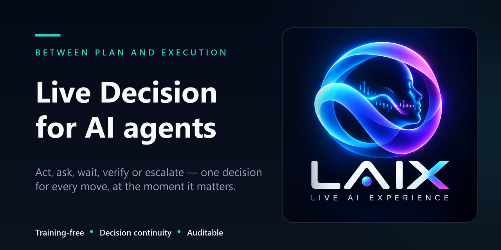
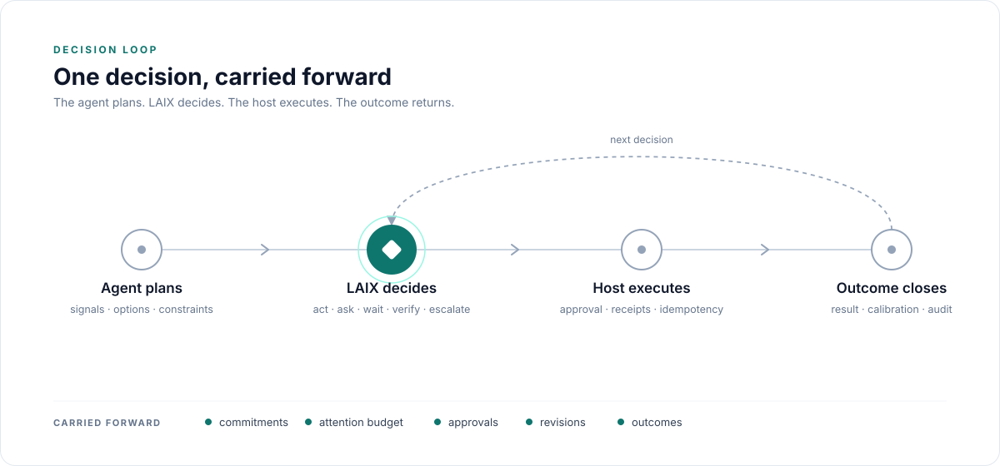
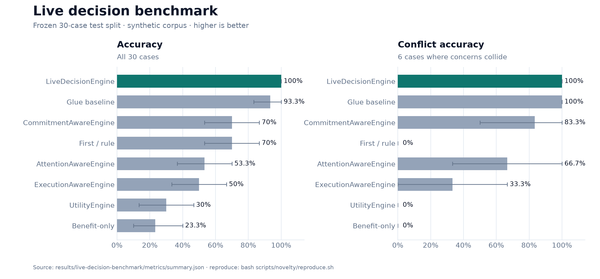

[](https://github.com/michaelatamuk/laix/actions/workflows/ci.yml)
[](LICENSE)


# LAIX — Live AI Experience

**LAIX is the live decision runtime for AI agents and automations that act in the real world.**

Agent frameworks plan. Workflow engines orchestrate. LAIX decides whether to act, ask, wait, verify
or escalate — and makes the choice explicit, scored and auditable.

One contract for utility, commitments, execution risk and human attention — with **decision
continuity**: every decision carries its commitments, attention budget, approvals and revisions into
the next. The host owns execution, data, delivery and storage; LAIX owns the decision and its trail.

LAIX is **training-free**: the default path is deterministic policies and planners; a planner can use
a model the host supplies.

**Who it is for:** teams building AI agents or automations that take real actions — especially when
approvals, promises, human attention or auditability matter.

**Status:** `0.9.0` · synthetic + continuity evidence · first external benchmark run · real-world validation pending.

## Contents

- [Install](#install)
- [One decision](#one-decision)
- [Integrated live decision](#integrated-live-decision)
- [How it works](#how-it-works)
- [Decision continuity](#decision-continuity)
- [Results](#results)
- [Documentation](#documentation)
- [Contributing](#contributing)

## Install

Python:

```powershell
pip install "git+https://github.com/michaelatamuk/laix.git@v0.9.0#subdirectory=packages/python/laix"
```

From a local checkout, at the repository root:

```powershell
pip install -e packages/python/laix
```

TypeScript, from a local checkout (the package is not published to npm yet):

```powershell
npm install file:../path/to/laix/packages/typescript/laix
```

The Python package needs Python 3.11 or newer. The TypeScript package needs Node 22 or newer.
See the [quickstart](docs/01-start/02-quickstart.md) for the full setup.

## One decision

```python
from datetime import datetime, timezone

from laix import Context, DecisionRequest, Signal, decide

decision = decide(
    DecisionRequest(
        subject="one decision",
        at="2026-11-01T10:00:00+00:00",
        signals=(
            Signal(id="s-1", kind="deadline", severity="high", confidence=0.9),
        ),
        context=Context(
            now=datetime(2026, 11, 1, 10, 0, tzinfo=timezone.utc),
            quiet_hours=None,
        ),
    )
)[0]

print(decision.verb, decision.reason_code, decision.confidence)
```

TypeScript:

```ts
import { Layer } from "laix";

const [decision] = new Layer().decide({
  subject: "one decision",
  at: "2026-11-01T10:00:00Z",
  signals: [{ id: "s-1", kind: "deadline", severity: "high", confidence: 0.9 }],
  context: { now: "2026-11-01T10:00:00Z", quietHours: ["22:00", "06:00"] },
});
```

Every decision carries a verb, a reason code, confidence, an action and the identifiers that
connect it to the audit trail.

## Integrated live decision

`LiveDecisionEngine` scores the options on utility, promises, execution risk and human attention,
then returns one plan with the full breakdown.

```python
from laix import ActionOption, Commitment, DecisionProblem, LiveDecisionEngine

plan = LiveDecisionEngine().solve(
    DecisionProblem(
        subject="send the report",
        at="2026-11-01T10:00:00+00:00",
        options=(
            ActionOption(
                id="now",
                verb="act",
                name="send now",
                expected_benefit=1.0,
                reversible=False,
                params={"commitments": {"violates": ["c1"]}},
            ),
            ActionOption(
                id="ask",
                verb="ask",
                name="ask first",
                expected_benefit=0.6,
                params={"commitments": {"fulfills": ["c1"]}},
            ),
        ),
        attributes={
            "commitments": (
                Commitment(
                    id="c1",
                    subject="send the report",
                    due="2026-11-01T09:00:00+00:00",
                ),
            )
        },
    )
)

print(plan.action_id, plan.reason_code)
```

The plan prefers the reversible, promise-keeping option and keeps the commitment, execution and
attention scores. See the full
[conflict scenario](examples/python/03-plan/conflict_scenario.py).

## How it works



An agent or automation plans the task. LAIX decides the next move. The host executes it. The
receipt and outcome close the loop and calibrate the next decision.

Every decision carries a verb, a reason code, confidence, a score, approval state and a trace.

## Decision continuity

A decision is one step in a sequence. It leaves state for the next decision.

| Step | Decision | State carried forward |
|---|---|---|
| 1 | acts, creating commitment `c1` | `c1` open; attention budget 0.6 spent |
| 2 | asks because `c1` is due and the budget is low | `c1` still open; approval pending |
| 3 | verifies after execution | `c1` fulfilled; receipt and outcome recorded |

The next decision sees the commitments, attention budget, approvals, revisions and outcomes the
previous one left. See [Decision continuity](docs/02-core/08-decision-continuity.md).

In a 12-episode synthetic mechanism test, the stateful runtime completed **100%** of episodes; a
stateless utility planner completed **0%** with 36 continuity errors. See the
[continuity benchmark](docs/06-research/02-evaluation/continuity-benchmark.md).

## What you get

LAIX is one decision core plus an optional app kit. The core returns decisions; the app kit adds the
lifecycle around them.

| Capability | What it covers |
|---|---|
| Decision contract | one `Decision` shape for attention, action, follow-up and execution |
| Decision continuity | commitments, budget, approvals, revisions and outcomes carried into the next decision |
| Policies | action, safety, replanning, allocation, negotiation, preference, verification and escalation |
| Planners | UtilityEngine, CommitmentAwareEngine, ExecutionAwareEngine, AttentionAwareEngine, LiveDecisionEngine, MDPEngine and POMDPEngine |
| Learning | rewards, bandits, causal attribution, calibration and decision calibration |
| Streaming and execution | event time, checkpoints, timeline, receipts, recovery and records |
| App kit | stores, platform, delivery, live context and bench |

## LAIX and decision models

**JEV returns a judgment. LAIX decides what the task does next.**

| | JEV (decision model) | LAIX (decision runtime) |
|---|---|---|
| Returns | A judgment and probability | The next move, with reason, approval, execution and record |
| Scope | Typed questions | The task decision and its lifecycle |
| Use together | JEV can be the chooser inside a policy | LAIX supplies the contract, continuity and audit |

See [LAIX and decision models](docs/04-concepts/decision-models.md#can-they-be-compared) for a fair
comparison protocol. A measured chooser swap needs TypeSafe API access.

## Why LAIX

- **The core stays stateless.** Commitment, budget and execution state live in the request, so the
  host owns storage and [decision continuity](docs/02-core/08-decision-continuity.md) stays explicit
  rather than hidden in a memory layer.
- **The integration is the decision.** Utility, commitments, execution risk and attention are scored
  in one plan, not by separate policies that can silently cancel each other out.
- **The reason is part of the result.** Every decision carries its reason code, score breakdown and
  trace, so audit is produced at decision time, not reconstructed from logs. The mapping to EU
  Product Liability Directive 2024/2853 is in
  [eu-liability.md](docs/06-research/05-governance/eu-liability.md).

The proof object is `LiveDecisionEngine`: one plan that keeps a promise, avoids an irreversible action
and respects an attention budget. See [comparators](docs/06-research/01-positioning/comparators.md)
and the [evidence map](docs/06-research/02-evaluation/evidence-map.md).

## Results

`LiveDecisionEngine` scores **30/30** on the frozen 30-case test split of the 120-case corpus and
**6/6** on the conflict cases. The hand-built glue baseline scores 28/30; the **+6.7 pp** difference
is **not yet significant** (p = 0.48). Every single-concern planner has significantly lower accuracy
(McNemar p ≤ 0.008).



| Measure | `LiveDecisionEngine` | Best comparator |
|---|---:|---:|
| Accuracy, all 30 cases | **100%** | 93.3% (glue baseline) |
| Conflict accuracy, 6 cases | **100%** | 100% (glue baseline) |
| Promise keeping | **100%** | 100% (glue baseline) |
| Irreversible actions | **0%** | 0% (glue baseline) |
| Attention-budget violations | **0%** | 0% (glue baseline) |
| p95 decision latency | **0.22 ms** | — |

The glue baseline matches `LiveDecisionEngine` on conflict, promises, reversibility and budget. The
remaining difference is accuracy on the other 24 cases, and it is not significant on 30 cases.

### Ablations

Removing a concern costs accuracy on the frozen test split:

| Variant | Accuracy |
|---|---:|
| Full integration | **100%** |
| No attention | 96.7% |
| No execution | 83.3% |
| No commitment | 70% |
| Utility only | 30% |

Removing commitments costs **30 points**, execution risk **16.7** and attention **3.3**. Equal
weights also scores 100%, so the gain comes from including the concerns, not from tuning their
weights. See [the full ablation](docs/06-research/02-evaluation/benchmark.md#ablations-test-split-30-cases)
for promise, irreversibility and budget columns.

### Verification

All checks pass: 396 Python tests, 172 TypeScript tests, 24/24 attention conformance, 210/210
Python/TypeScript action parity and 17/17 invariants. The full check matrix is in
[Testing](docs/05-project/testing.md). Reproduce the benchmark with
`bash scripts/novelty/reproduce.sh`; raw data is in
[results/live-decision-benchmark/](results/live-decision-benchmark/README.md).

External validation — real incident replay or a participant study — is still pending.

## Documentation

| Start with | Covers |
|---|---|
| [Documentation index](docs/README.md) | every guide and reference page |
| [Quickstart](docs/01-start/02-quickstart.md) | install and first decision |
| [Decision lifecycle](docs/01-start/03-decision-lifecycle.md) | moment to outcome in one loop |
| [Decision models](docs/04-concepts/decision-models.md) | JEV, classifiers and judges vs the LAIX runtime |
| [Deployment](docs/03-appkit/10-deployment.md) | production topology, reliability, rollout and retention |
| [Research and evidence](docs/06-research/README.md) | claims, benchmarks and paper plan |
| [Examples](examples/README.md) | Python and TypeScript, grouped by lifecycle |

The index also covers core, app kit, commitments, privacy, security, testing, troubleshooting,
migration, the API map and repository structure.

## Contributing

Run the full checks before opening a change:

```powershell
cd packages/python/laix
py -m pytest -q
py -m ruff check .

cd ../../packages/typescript/laix
npm test
npm run typecheck
npm run conformance
npm run bench
```

CI runs the same checks on every push, plus the live benchmark, TypeScript parity, examples and docs
links. See [Testing](docs/05-project/testing.md) for every check.

For setup, design rules and the pull-request checklist, read [CONTRIBUTING.md](CONTRIBUTING.md).
Questions go to [SUPPORT.md](SUPPORT.md); participation is covered by
[CODE_OF_CONDUCT.md](CODE_OF_CONDUCT.md).

## Security

Report vulnerabilities privately through [SECURITY.md](SECURITY.md); the
[security and threat model](docs/04-concepts/security.md) explains the boundaries.

## Citation

If you use LAIX in research, cite it via [CITATION.cff](CITATION.cff).

## License and status

Apache-2.0. See [LICENSE](LICENSE).

Current release: `0.9.0`. Python and TypeScript share the same decision contract, policies, planners,
streaming, execution, learning and app-kit surface. See [CHANGELOG.md](CHANGELOG.md).
