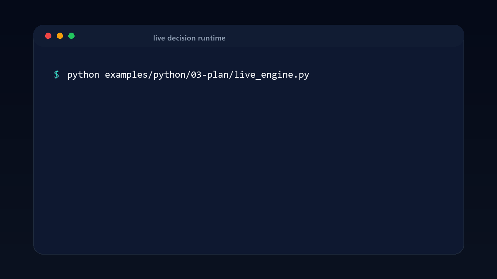
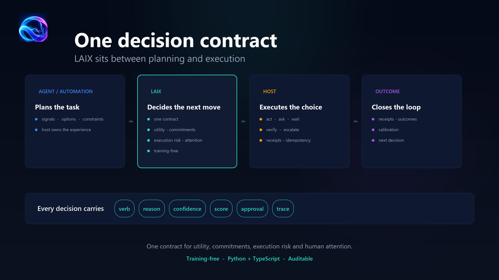

[](https://github.com/michaelatamuk/laix/actions/workflows/ci.yml)
[](LICENSE)


# LAIX — Live AI Experience

**LAIX is the live decision runtime for AI agents and automations that act in the real world.**

Agent frameworks plan. Workflow engines orchestrate. LAIX decides whether to act, ask, wait, verify
or escalate — and makes the choice explicit, scored and auditable.

One contract for utility, commitments, execution risk and human attention — with **decision
continuity**: every decision carries its commitments, attention budget, approvals and revisions into
the next. The host owns execution, data, delivery and storage; LAIX owns the decision and its trail.

LAIX is **training-free**: the default path is deterministic policies and planners; a planner can use
a model the host supplies.

**Who it is for:** teams building AI agents or automations that take real actions — especially when
approvals, promises, human attention or auditability matter.

**Status:** `0.9.0` · synthetic evidence complete · external validation pending.

## Contents

- [Install](#install)
- [One decision](#one-decision)
- [Integrated live decision](#integrated-live-decision)
- [Demo](#demo)
- [How it works](#how-it-works)
- [Decision continuity](#decision-continuity)
- [Results](#results)
- [Documentation](#documentation)
- [Contributing](#contributing)

## Install

Python:

```powershell
pip install "git+https://github.com/michaelatamuk/laix.git@v0.9.0#subdirectory=packages/python/laix"
```

From a local checkout, at the repository root:

```powershell
pip install -e packages/python/laix
```

TypeScript, from a local checkout (the package is not published to npm yet):

```powershell
npm install file:../path/to/laix/packages/typescript/laix
```

The Python package needs Python 3.11 or newer. The TypeScript package needs Node 22 or newer.
See the [quickstart](docs/01-start/02-quickstart.md) for the full setup.

## One decision

```python
from datetime import datetime, timezone

from laix import Context, DecisionRequest, Signal, decide

decision = decide(
    DecisionRequest(
        subject="one decision",
        at="2026-11-01T10:00:00+00:00",
        signals=(
            Signal(id="s-1", kind="deadline", severity="high", confidence=0.9),
        ),
        context=Context(
            now=datetime(2026, 11, 1, 10, 0, tzinfo=timezone.utc),
            quiet_hours=None,
        ),
    )
)[0]

print(decision.verb, decision.reason_code, decision.confidence)
```

TypeScript:

```ts
import { Layer } from "laix";

const [decision] = new Layer().decide({
  subject: "one decision",
  at: "2026-11-01T10:00:00Z",
  signals: [{ id: "s-1", kind: "deadline", severity: "high", confidence: 0.9 }],
  context: { now: "2026-11-01T10:00:00Z", quietHours: ["22:00", "06:00"] },
});
```

Every decision carries a verb, a reason code, confidence, an action and the identifiers that
connect it to the audit trail.

## Integrated live decision

`LiveDecisionEngine` scores the options on utility, promises, execution risk and human attention,
then returns one plan with the full breakdown.

```python
from laix import ActionOption, Commitment, DecisionProblem, LiveDecisionEngine

plan = LiveDecisionEngine().solve(
    DecisionProblem(
        subject="send the report",
        at="2026-11-01T10:00:00+00:00",
        options=(
            ActionOption(
                id="now",
                verb="act",
                name="send now",
                expected_benefit=1.0,
                reversible=False,
                params={"commitments": {"violates": ["c1"]}},
            ),
            ActionOption(
                id="ask",
                verb="ask",
                name="ask first",
                expected_benefit=0.6,
                params={"commitments": {"fulfills": ["c1"]}},
            ),
        ),
        attributes={
            "commitments": (
                Commitment(
                    id="c1",
                    subject="send the report",
                    due="2026-11-01T09:00:00+00:00",
                ),
            )
        },
    )
)

print(plan.action_id, plan.reason_code)
```

The plan prefers the reversible, promise-keeping option and keeps the commitment, execution and
attention scores. See the full
[conflict scenario](examples/python/03-plan/conflict_scenario.py).

## Demo



A four-second animated quickstart generated from the actual example output.

## How it works



An agent or automation plans the task. LAIX decides the next move. The host executes it. The
receipt and outcome close the loop and calibrate the next decision.

## Decision continuity

A decision is one step in a sequence. It leaves state for the next decision.

| Step | Decision | State carried forward |
|---|---|---|
| 1 | acts, creating commitment `c1` | `c1` open; attention budget 0.6 spent |
| 2 | asks because `c1` is due and the budget is low | `c1` still open; approval pending |
| 3 | verifies after execution | `c1` fulfilled; receipt and outcome recorded |

The next decision sees the commitments, attention budget, approvals, revisions and outcomes the
previous one left. See [Decision continuity](docs/02-core/08-decision-continuity.md).

## What you get

| Capability | What it gives the host |
|---|---|
| Decision contract | one `Decision` shape for attention, action, follow-up and execution |
| Decision continuity | commitments, budget, approvals, revisions and outcomes carried into the next decision |
| Policies | action, safety, replanning, allocation, negotiation, preference, verification and escalation |
| Planners | utility, commitment, execution, attention, integrated live, MDP and POMDP |
| Learning | rewards, bandits, causal attribution, calibration and decision calibration |
| Streaming and execution | event time, checkpoints, timeline, receipts, recovery and records |
| App kit | stores, platform, delivery, live context and bench |

## Why LAIX

- **One decision contract** — attention, action, follow-up, execution and outcomes share the same
  shape, reasons, confidence and trail.
- **Live context and continuity** — promises, execution risk and human attention are scored in the
  plan, and the next decision sees what the last one left.
- **Training-free, host-owned** — deterministic policies and planners; the host supplies the model
  and owns data, execution, storage and delivery.
- **Inspectable** — reason code, score breakdown, decision id, trace, conformance vectors and
  Python/TypeScript parity.

The contribution is the integration: one contract for utility, commitments, execution risk and human
attention. See [comparators](docs/06-research/01-positioning/comparators.md) and the
[evidence map](docs/06-research/02-evaluation/evidence-map.md).

The proof object is `LiveDecisionEngine`: one plan that keeps a promise, avoids an irreversible action
and respects an attention budget.

Because every decision carries its reason and score at the moment it is made, LAIX produces an audit
trail without log mining. The mapping to EU Product Liability Directive 2024/2853 is in
[eu-liability.md](docs/06-research/05-governance/eu-liability.md).

## Results


`live` is 30/30 on the frozen 30-case test split. A hand-built glue baseline is 28/30; the difference
is not yet significant. Single-concern planners lose when concerns conflict.

| Check | Result |
|---|---|
| Python tests | 396 |
| TypeScript tests | 172 |
| Attention conformance | 24/24 |
| LAIX-Bench | 25/25 |
| Live corpus | 120 cases: 72 dev / 30 test / 18 adversarial |
| Live test split | `live` 30/30; glue 28/30; conflict 6/6 |
| Python/TypeScript parity | 210/210 |
| Invariants | 17/17 |
| Decision p95 | 0.22 ms on the test split |
| External adapter | 6-7 ms |


The 120-case live corpus and the 7-case ablation demo are separate. The 7-case demo shows the
single-concern planners fail when concerns conflict; the 120-case corpus is the larger evidence set.
See [Testing](docs/05-project/testing.md) for the commands.

Reproduce with `bash scripts/novelty/reproduce.sh`. Raw data:
[results/live-decision-benchmark/](results/live-decision-benchmark/README.md).

External validation — real incident replay or a participant study — is still pending.

## Documentation

| Page | Covers |
|---|---|
| [Documentation index](docs/README.md) | start, core, app kit, concepts, project and research |
| [Quickstart](docs/01-start/02-quickstart.md) | install and first decision |
| [Decision lifecycle](docs/01-start/03-decision-lifecycle.md) | moment to outcome in one loop |
| [Core building blocks](docs/02-core/00-architecture.md) | the live decision runtime |
| [Commitments](docs/02-core/07-commitments.md) | promises, ledgers, due times and dependencies |
| [App-kit building blocks](docs/03-appkit/00-architecture.md) | streaming, execution, stores and delivery |
| [Deployment](docs/03-appkit/10-deployment.md) | production topology, reliability, rollout and retention |
| [Research and evidence](docs/06-research/README.md) | claim, prior art, experiments and paper plan |
| [Privacy](docs/04-concepts/privacy.md) | what may be shared, stored or exported |
| [Security](docs/04-concepts/security.md) | threat model, trust boundaries and controls |
| [Testing](docs/05-project/testing.md) | pytest, ruff, tsc, bench, conformance and CI |
| [Troubleshooting](docs/05-project/troubleshooting.md) | symptoms, reason codes and execution failures |
| [Migration](docs/05-project/migration.md) | upgrades, compatibility and deprecation |
| [API map](docs/05-project/api-map.md) | the public surface by role |
| [Repository structure](docs/05-project/repository-structure.md) | where each package, module and test lives |
| [Examples](examples/README.md) | Python and TypeScript, grouped by lifecycle |

## Contributing

Run the full checks before opening a change:

```powershell
cd packages/python/laix
py -m pytest -q
py -m ruff check .

cd ../../packages/typescript/laix
npm test
npm run typecheck
npm run conformance
npm run bench
```

CI runs the same checks on every push, plus the live benchmark, TypeScript parity, examples and docs
links. See [Testing](docs/05-project/testing.md) for every check.

For setup, design rules and the pull-request checklist, read [CONTRIBUTING.md](CONTRIBUTING.md).
Questions go to [SUPPORT.md](SUPPORT.md); participation is covered by
[CODE_OF_CONDUCT.md](CODE_OF_CONDUCT.md).

## Security

Report vulnerabilities privately through [SECURITY.md](SECURITY.md); the
[security and threat model](docs/04-concepts/security.md) explains the boundaries.

## Citation

If you use LAIX in research, cite it via [CITATION.cff](CITATION.cff).

## License and status

Apache-2.0. See [LICENSE](LICENSE).

Current release: `0.9.0`. Python and TypeScript share the same decision contract, policies, planners,
streaming, execution, learning and app-kit surface. See [CHANGELOG.md](CHANGELOG.md).
