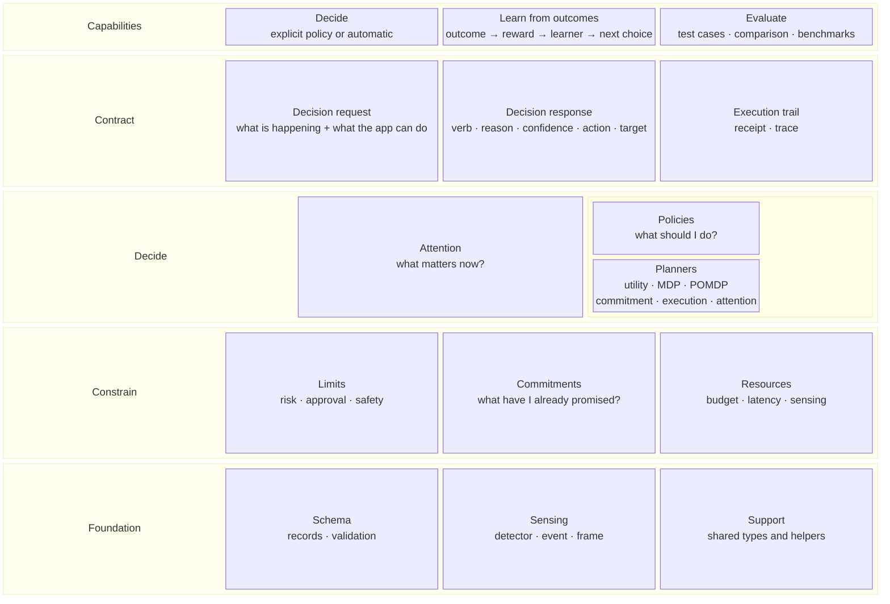

# Core building blocks

LAIX core only. Read top-down: what you get, through the boundary, from the decision
layers, on the foundation.



## The rows

| Row block | Contains | What it is |
|---|---|---|
| **Capabilities** | Decide · Learn from outcomes · Evaluate | What the core can do. |
| **Contract** | Decision request · Decision response · Execution trail | The boundary and its records. |
| **Decide** | Attention · Policies (with optional Planners) | What produces the choice. |
| **Constrain** | Limits · Commitments · Resources | What shapes the choice: permission, promises, capacity. |
| **Foundation** | Schema · Sensing · Support | Shared records and utilities. |

Limits is a gate, not a folder: it is the `Constraint` set on the request, enforced by policies and
the utility engine. Commitments live in `core/planning`; `PlanningPolicy` is a policy wrapper, not
this node.

## Which path runs

The call picks a path in one of two ways. Without `policy=`, the request selects a built-in path.
With `policy=`, it uses the policy you pass. Constrain applies to every path.

| The call has | The path |
|---|---|
| `signals` + `context` | Attention |
| `situation` + `options` | Action policy |
| `policy=...` | The policy you pass: a rule set or `EnginePolicy` |

Attention and policies produce the choice. A policy can be a rule set or an `EnginePolicy` wrapping
a planner; planners are not a third path. Limits, commitments and resources constrain every path.
Packaged and custom policies are selected explicitly. `RulePolicy` and `TargetedPolicy` are the
authoring and target wrappers. `UtilityEngine`, `MDPEngine` and `POMDPEngine` are built-in planners
behind `EnginePolicy`. See [what an MDP is](06-engines.md#what-an-mdp-is).

## Learning loop

```text
outcome → reward → learner → better policy
outcome → label → feedback → better attention
```

## What each part contains

| Row | Part | Contains | Built on |
|---|---|---|---|
| Capabilities | **Decide** | explicit policy or automatic; return the response | Contract, Decide, Constrain, support |
| Capabilities | **Learn from outcomes** | outcome → reward → learner → better policy; outcome → label → feedback → better attention | Support |
| Capabilities | **Evaluate** | test cases, comparison, reports, benchmarks | Contract, Decide, Constrain, support |
| Contract | **Decision request** | what is happening and what the app can do; signals + context, or situation + options | Support |
| Contract | **Decision response** | verb, reason, confidence, action, evidence, approval, target, recipients | Support |
| Contract | **Execution trail** | execution receipt, trace | Support |
| Decide | **Attention** | signals, priority, timing | Contract, support |
| Decide | **Policies** | eight packs, planner adapter, rule, target, planning wrapper, group and shadow wrappers | Contract, learning, support |
| Decide | **Planners** (in a policy) | expected utility, [MDP](06-engines.md#what-an-mdp-is) value iteration, POMDP belief planning, commitment-aware, execution-aware and attention-aware selection | Contract, support |
| Constrain | **Limits** | risk, approval, safety and policy constraints | Contract, support |
| Constrain | **Commitments** | promises, due times, dependencies and stores | Support |
| Constrain | **Resources** | budget, latency, sensing options and schedule | Support |
| Foundation | **Schema** | records, validation | Contract, learning, support |
| Foundation | **Sensing** | detector, detection, event, frame | Support |
| Foundation | **Support** | shared types and helpers: ids, time, verbs, errors, version | — |

## Reading the stack

- **Capabilities** — Decide chooses explicitly or automatically; Learn turns outcomes into a better policy or attention; Evaluate checks the decision layers.
- **Contract** — the request describes what is happening and what the app can do; the response carries the verb, reason, confidence, action, approval and target; the trail records what happened.
- **Path choice** — `signals + context` → Attention; `situation + options` → Action policy. A packaged or custom policy is selected explicitly with `policy=...`.
- **Decide** — Attention ranks signals; Policies cover action, safety, replanning, allocation, negotiation, preference, verification and escalation, plus `EnginePolicy`, `RulePolicy`, `TargetedPolicy`, `PlanningPolicy`, `GroupPolicy` and `ShadowPolicy`. Planners sit inside a policy via `EnginePolicy`; `UtilityEngine`, `MDPEngine`, `POMDPEngine`, `CommitmentAwareEngine`, `ExecutionAwareEngine` and `AttentionAwareEngine` add expected utility, value iteration, belief planning, commitment-aware, execution-aware and attention-aware selection, with simulator, calibration and model learning.
- **Constrain** — Limits declare risk, approval, safety and policy constraints; Commitments track promises and dependencies; Resources cover budget, latency and sensing options.
- **Foundation** — Schema validates records; Sensing defines detectors, events and frames; Support provides shared types and helpers.

Streaming, execution, records and delivery live in the app kit: see
[App-kit building blocks](../03-appkit/00-architecture.md).
