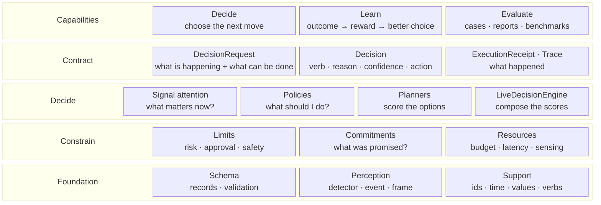

# Core overview

The LAIX core turns one request into one decision. It has no UI, no storage, no execution and no app
kit. It provides the decision contract, the decision mechanisms, the decision state, and the learning
and evaluation primitives that close the loop.

## The five layers



| Layer | Contains | Answers |
|---|---|---|
| **Capabilities** | Decide, Learn, Evaluate | What the core can do. |
| **Contract** | `DecisionRequest`, `Decision`, `ExecutionReceipt`, `Trace` | What crosses the boundary. |
| **Decide** | Signal attention, policies, planners, `LiveDecisionEngine` | What to do next. |
| **Constrain** | Limits, commitments, resources | What is allowed, promised and affordable. |
| **Foundation** | Schema, perception, support | What the records and helpers rest on. |

## The decision loop

```text
DecisionRequest
      │
      ▼
   dispatch
      │
      ├── signal attention ──┐
      ├── policy ────────────┤
      └── planner/engine ────┤
                             ▼
                          Decision
                             │
                             ▼
                    host executes the action
                             │
                             ▼
                 ExecutionReceipt / Outcome
                             │
                             ▼
                 reward · calibration · learning
                             │
                             ▼
             next DecisionRequest with current state
```

The core evaluates one request and returns the resulting decision or decisions. It is stateless
between calls. The host keeps the state and passes the current commitments, attention budget,
approvals and receipts into the next request. [Decision continuity](10-decision-continuity.md) describes that hand-off.

## Ways to get a decision

| Entry point | What it does | Use it when |
|---|---|---|
| `decide(request)` | Selects signal attention or the action policy from the request shape. | You want the answer only. |
| `decide(request, policy=...)` | Runs the policy you pass. | You want a packaged, authored or learned policy. |
| `decide(request, policy=EnginePolicy(engine))` | Runs a planner or the live engine behind the policy interface. | You want utility, commitments, execution risk or attention scoring. |
| `Layer` | Uses the same core selection and adds runtime, traces, execution and records. | You want the full app kit. |

`decide` lives in `core/dispatch.py` and imports no app-kit code. [Dispatch](03-dispatch.md) explains
the selection rule and the identity fields.

## Choose a mechanism

| You have | Use |
|---|---|
| Signals and a context | Signal attention |
| A situation and options, no special policy | The built-in action policy |
| Options and explicit decision rules | `RulePolicy` |
| Options and one concern: utility, promises, execution risk or human attention | The matching planner through `EnginePolicy` |
| Options and several live concerns | `LiveDecisionEngine` |
| A world model with states and transitions | `MDPPlanner` |
| A hidden state and observations | `POMDPPlanner` |
| A learned choice among arms | `BanditPolicy` |
| A planner or engine behind the policy interface | `EnginePolicy` |

The request shape selects signal attention or the action policy. Every other row is an explicit
`policy=` choice.

## Vocabulary

The words are not interchangeable.

| Term | Meaning |
|---|---|
| **Planner** | A strategy that scores the options and chooses one. Built-ins: `UtilityPlanner`, `CommitmentPlanner`, `ExecutionRiskPlanner`, `HumanAttentionPlanner`, `MDPPlanner`, `POMDPPlanner`. |
| **Engine** | A composition of planners that returns one `Plan`. The built-in engine is `LiveDecisionEngine`. |
| **Policy** | An integration layer with `decide(request)`. `EnginePolicy` adapts a planner or engine to that interface. |
| **Learner** | Code that updates a choice from measured outcomes: `UCBBandit`, `ModelLearner`. |
| **Protocol** | `DecisionEngine`: the `solve(problem) -> Plan` interface. |
| **Decision** | The public answer. One verb, one reason, confidence, action, approval and trail identifiers. |
| **Plan** | The planner's internal answer. `EnginePolicy` converts it into a `Decision`. |
| **`DecisionRequest`** | The public input. It carries signals and context, or a situation and options. |
| **`DecisionProblem`** | The planner input. It is the request projected onto the planner contract. |
| **Signal attention** | The engine that ranks signals and returns `guide`, `wait`, `act` or `escalate`. |
| **Human-attention planning** | `HumanAttentionPlanner`: the planner that prices interruption, approval and escalation when it chooses an action. |
| **Attention budget** | Human interruption capacity. It limits how often a decision may involve a person. |
| **Resource budget** | Compute, latency and sensing capacity. `ResourceScheduler` admits or rejects work. |

The full vocabulary is in the [glossary](../04-concepts/glossary.md).

## What the core owns

- The request and response shapes.
- The seven verbs and the reason-code contract.
- The signal-attention rules.
- The policy contract and the packaged policies.
- The planner contract and the built-in planners.
- The live decision engine.
- Commitments as decision state.
- Outcome, bandit, causal, calibration and model-learning primitives.
- The evaluation primitives and the live decision benchmark.

The host owns the experience, the data, the UI, the execution, the durable stores, the delivery
channels and the retention policy. The host also maps an action to a commitment effect, an outcome to
a label and a decision to an arm.

## Invariants

- One request shape: `DecisionRequest` in, `Decision` out.
- One response shape on every path: signal attention, policies, planners and the engine.
- Seven verbs: `wait`, `observe`, `guide`, `ask`, `act`, `verify`, `escalate`.
- Reason codes are stable; app logic branches on them, not on `rationale`.
- The core is stateless between calls. The host supplies state.
- A planner returns one `Plan`; `EnginePolicy` converts it to one `Decision`.
- Hard limits gate the choice before a decision is returned.
- Record field names, JSON keys and schema versions are versioned; class names are code identifiers.

## Reading map

Read in order. Each page builds on the pages before it.

The sequence follows the dependency order: the contract defines the shapes; dispatch defines how a
request chooses a mechanism; commitments and resources define the state and capacity; signal
attention and policies define the two decision paths; the planner pages define the optional formal
choice; learning closes the loop; continuity explains the hand-off; evaluation checks the mechanisms;
foundation holds the shared records and helpers.

| Page | Covers |
|---|---|
| [Decision contract](01-decision-contract.md) | `DecisionRequest`, `Decision`, the seven verbs and reason codes. |
| [Records and schema](02-records-and-schema.md) | every record shape, JSON mapping, schema generation and version axes. |
| [Dispatch](03-dispatch.md) | `decide`, automatic selection, `policy=`, ids and confidence provenance. |
| [Commitments](05-commitments.md) | the commitment model, ledger, stores and `PlanningPolicy`. |
| [Resources](11-resources.md) | `Budget`, `ResourcePlan`, `ResourceScheduler` and `SensingOption`. |
| [Signal attention](04-signal-attention.md) | the gate pipeline, score and reason codes of `decide_attention`. |
| [Policies](06-policies.md) | the policy protocol, registry, the built-in action policy, the eight decision-class policies, authoring, wrappers and the learned policy. |
| [Planner contract](07-planning/00-planner-contract.md) | `DecisionProblem`, `Plan`, `DecisionEngine`, `EnginePolicy` and the simulator. |
| [Live planners](07-planning/01-live-planners.md) | utility, commitment, execution-risk and human-attention scoring. |
| [Live decision engine](07-planning/02-live-decision-engine.md) | `LiveDecisionEngine`, `CompositeScore` and the combined plan. |
| [Model-based planners](07-planning/03-model-based-planners.md) | `MDPPlanner`, `POMDPPlanner`, value iteration and belief update. |
| [Outcome learning](08-outcome-learning.md) | outcomes, rewards, `UCBBandit`, `BanditPolicy` and causal attribution. |
| [Calibration and model learning](09-calibration-and-model-learning.md) | prediction and decision calibration, `CalibratedPolicy`, `ModelLearner`. |
| [Decision continuity](10-decision-continuity.md) | what carries from one decision to the next and how the host passes it. |
| [Evaluation](12-evaluation.md) | cases, rows, reports, parity, LAIX-Bench and the live decision benchmark. |
| [Foundation](13-foundation.md) | perception records and the shared support helpers. |

## A minimal decision

```python
from laix import ActionOption, Constraint, DecisionRequest, Situation, decide

request = DecisionRequest(
    subject="leaking sink",
    at="2026-11-01T10:00:00+00:00",
    situation=Situation(
        id="situation-1",
        at="2026-11-01T10:00:00+00:00",
        subject="leaking sink",
        constraints=(Constraint(id="risk", kind="risk", value=0.3, hard=True),),
    ),
    options=(
        ActionOption(id="valve", verb="act", name="close the valve", expected_benefit=0.9, risk=0.1),
        ActionOption(id="hit", verb="act", name="hit the pipe", expected_benefit=1.0, risk=0.9),
    ),
)

decision = decide(request)[0]
print(decision.verb, decision.action_id, decision.reason_code)
```

The request has a situation and options, so `decide` selects the action policy. The hard risk limit
removes the second option. The result is one `Decision` with a verb, a reason code and the chosen
option.

## Where the code lives

| Path | Contents |
|---|---|
| `core/decisions/` | request, response and trail records. |
| `core/dispatch.py` | `decide` and `select`. |
| `core/engines/signals/` | signal attention, gates, score and timing. |
| `core/engines/policies/` | policy protocol, registry and packaged policies. |
| `core/engines/contract/` | `DecisionProblem`, `Plan`, `DecisionEngine` and `EnginePolicy`. |
| `core/engines/planners/` | utility, commitment, execution, human-attention, MDP and POMDP planners. |
| `core/engines/live/` | `LiveDecisionEngine` and `CompositeScore`. |
| `core/engines/simulation/` | simulator, scenarios and planner comparison. |
| `core/engines/bench/` | the live decision benchmark. |
| `core/engines/resources/` | budget, resource plan, scheduler and sensing options. |
| `core/commitments/` | commitment model, ledger and stores. |
| `core/outcome_learning/` | outcomes, bandits and causal attribution. |
| `core/engines/learning/` | calibration, decision calibration and model learning. |
| `core/evaluation/` | cases, rows, reports and decision comparison. |
| `core/perception/` | detector, detection, event and frame. |
| `core/schema/` | record registry, schema generation and validation. |
| `core/support/` | ids, time, values, serialization, errors, verbs and version. |

Streaming, execution, records and delivery live in the optional app kit:
[App-kit overview](../03-appkit/00-architecture.md).
