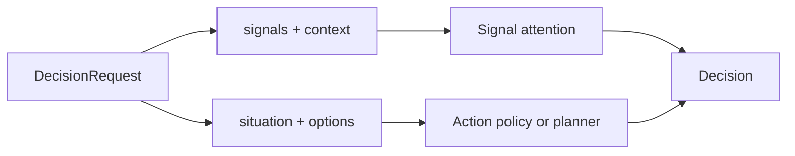

# The decision contract

Every LAIX path returns the same two shapes:

- `DecisionRequest` goes in;
- `Decision` comes out.

The shapes are frozen dataclasses in Python and readonly interfaces in TypeScript. Every policy,
planner and the app kit use them. A caller can switch from a rule policy to a planner without
changing the request or the response handling.

## The request

`DecisionRequest` is the public input. It carries one of two payloads:

- `signals` and `context` for signal attention;
- `situation` and `options` for an action decision.

```python
from laix import DecisionRequest

request = DecisionRequest(
    subject="electricity bill",
    at="2026-11-01T10:00:00+00:00",
    signals=(signal,),
    context=context,
)
```

### Fields

| Field | Type | Meaning |
|---|---|---|
| `subject` | `str` | What the request is about. |
| `at` | ISO-8601 `str` | The moment of the decision. |
| `signals` | `tuple` | Items that may need attention. |
| `context` | `SignalContext \| None` | Time, quiet hours, thresholds, budget and feedback. |
| `situation` | `Situation \| None` | Observations, beliefs, goals and constraints. |
| `options` | `tuple[ActionOption, ...]` | Actions the host can take. |
| `attributes` | `dict` | DecisionPolicy-specific inputs such as `risk_limit`, `plans`, `requests` or `commitments`. |
| `confidence` | `float \| None` | The host's confidence in its own input. |
| `confidence_source` | `str` | Where that confidence came from. |
| `calibrated` | `bool` | Whether the host confidence is a calibrated probability. |
| `deadline` | ISO-8601 `str \| None` | When the decision has to be made. |
| `valid_until` | ISO-8601 `str \| None` | How long the decision applies. |
| `event_id` | `str` | Dedupe key for a stream. |
| `target` | `str` | `one`, `some`, `all`, `peer` or `gather`. |
| `recipients` | `tuple[str, ...]` | The users or groups that receive the decision. |

`DecisionRequest` describes the situation and the available options; the decision mechanism chooses
the action.

### The two payloads



A request that carries both payloads is valid. `dispatch` chooses the action path when `situation`
or `options` is present; otherwise it chooses signal attention. [Dispatch](04-dispatch.md) defines the
exact rule.

## The response

`Decision` is the public output. It is immutable and has one verb. The other fields explain the verb,
identify the chosen option and connect the decision to a record or an execution.

```python
from laix import Decision

decision = Decision(
    verb="act",
    confidence=0.92,
    reason_code="safe_action",
    rationale="the valve is the highest-benefit option inside the risk limit",
    action_id="valve",
    reversible=True,
)
```

### Fields by role

**What to do**

| Field | Meaning |
|---|---|
| `verb` | The next move. One of the seven verbs. |
| `confidence` | How sure the decision is, clamped to `0..1`. |
| `reason_code` | The stable label for the rule that fired. Use it in app logic. |
| `rationale` | A human-readable explanation. Do not branch on it. |

**What to run**

| Field | Meaning |
|---|---|
| `action_id` | The chosen option id, when the request offered options. |
| `intent` | `Intent(capability, args)` the host can execute. |
| `requires_approval` | A person must approve before execution. |
| `reversible` | Whether the chosen action can be undone. |
| `undo_hint` | How to undo it. |

**Ranking and explanation**

| Field | Meaning |
|---|---|
| `score` | The ranking inside one decision mechanism. Compare scores only within that mechanism. |
| `breakdown` | `ScoreBreakdown` parts for a signal-attention decision. |
| `cost_of_waiting` | The cost of waiting in this situation. |
| `evidence` | `EvidenceRef` rows that support the decision. |
| `alternatives` | The options that lost, with their scores and the reason they lost. |
| `constraints_applied` | Hard limits that removed options. |
| `attributes` | Values the decision mechanism used or produced. |

**Identity and audit**

| Field | Meaning |
|---|---|
| `decision_id` | The id used by records, outcomes and traces. |
| `situation_id` | The id of the situation this decision answered. |
| `policy_version` | The version of the policy or planner that produced the decision. |
| `trace_id` | Correlates related events. |
| `created_at` | When the decision was made. |
| `confidence_source` | Where the confidence came from. |
| `calibrated` | Whether the confidence is a calibrated probability. |
| `deliver` | Whether the host should surface the decision now. |
| `record` | Whether the host should keep it. |
| `schema_version` | The record-shape version. |

**Stream and lifecycle**

| Field | Meaning |
|---|---|
| `stream_id` | The stream session that produced it; empty for a one-shot decision. |
| `event_time` | When the event happened. |
| `deadline` | When the decision had to be made. |
| `valid_until` | How long the decision applies. |
| `supersedes` | The decision this one replaces. |
| `revision` | `0` for the first decision, then `1`, `2`, … |
| `status` | `final`, `provisional` or `superseded`. |
| `target` | `one`, `some`, `all`, `peer` or `gather`. |
| `recipients` | The users or groups that receive the decision. |

`Decision.__post_init__` validates the verb, the status and the target mode, and clamps confidence.
`Decision.to_dict()` and `Decision.from_dict()` round-trip the shape.

## Confidence and score

`confidence` and `score` answer different questions:

- **`confidence`** is the decision mechanism's certainty in its choice. It is always `0..1`. The host
  can calibrate it against measured outcomes.
- **`score`** is the ranking value inside one mechanism. Signal-attention scores, utility scores, expected
  MDP values and composite live scores use different scales. Do not compare scores across mechanisms.

`breakdown` describes the parts of a signal-attention score.

## The seven verbs

| Verb | Meaning |
|---|---|
| `wait` | Hold for now and keep watching. |
| `observe` | Get more information before deciding. |
| `guide` | Show the situation to a person and let them choose. |
| `ask` | Ask a person or another agent for information or a decision. |
| `act` | Run the chosen option now. |
| `verify` | Check whether an earlier step worked. |
| `escalate` | Hand the decision to a person with more authority. |

The verb set is closed. `Decision` rejects any other value. A notification is a `guide` decision plus
a host delivery channel. Approval is the `requires_approval` flag on a decision, not a separate verb.

A policy decides which verbs it can return:

| Mechanism | Verbs |
|---|---|
| Signal attention | `guide`, `wait`, `act`, `escalate` |
| Action policy | `wait`, `observe`, `ask`, `verify`, `act`, `guide`, `escalate` |
| Active perception | `observe`, `wait` |
| Safety-constrained action | `act`, `guide`, `wait` |
| Replanning | `act`, `ask` |
| Allocation | `act`, `wait` |
| Negotiation | `act`, `escalate` |
| Preference elicitation | `ask`, `act`, `wait` |
| Verification | `verify`, `wait`, `escalate` |
| Escalation | `escalate`, `ask`, `wait` |
| Live planners | the chosen option's verb |
| `CAVODPlanner` | the chosen option's verb |
| `MDPPlanner`, `POMDPPlanner` | `act`, `wait` |
| `RulePolicy` | any verb set by the matching rule |
| `BanditPolicy` | `act`, `wait` |
| `PlanningPolicy` | `act`, `ask`, `wait` |

## Reason codes

A **reason code** is a stable, short label for the rule that fired. It is part of the contract: app
logic branches on `reason_code`, not on `rationale`. A change to a reason code is a behaviour change
and belongs in the changelog.

The machine-readable registry is
[`packages/contracts/reason-codes.v1.json`](../../../packages/contracts/reason-codes.v1.json). See
[Reason codes](05-reason-codes.md) for the groups, the generated source and the change rules.

Reason codes are grouped by producer:

| Producer | Examples |
|---|---|
| Signal attention | `worth_surfacing`, `quiet_hours`, `below_floor`, `low_confidence`, `muted`, `snoozed`, `wrong`, `assigned`, `dismissed`, `budget`, `already_sent`, `kill_switch`, `overdue_escalation`, `act` |
| Utility planner | `expected_utility`, `no_options`, `no_feasible_option` |
| Commitment planner | `commitment_aware` |
| Execution-risk planner | `execution_aware` |
| Human-attention planner | `human_attention_aware`, `human_attention_budget_exhausted`, `approval_rejected` |
| Live composite planner | `live_decision` |
| CA-VOD planner | `value_of_decision` |
| Model-based planners | `mdp_plan`, `pomdp_plan`, `terminal_state`, `no_action` |
| Authored rules | `policy_rule`, `no_rule` |
| Packaged policies | `safe_action`, `safety_blocked`, `no_safe_option`, `ask_preference`, `verify_outcome`, `escalate_to_target`, `replan`, and the codes listed on the [policies page](../03-decision/01-single/05-policies.md) |

The gate set emits the codes in the table above. `ask_approval` is a reserved enum value; approval is
carried by `requires_approval` on the decision.

The pages that define each mechanism list its full set of codes. The
[troubleshooting guide](../../05-project/02-quality/02-troubleshooting.md) maps the common codes to symptoms.

## Evidence basis

`Decision.basis()` returns host-neutral evidence rows:

```python
[
    {"kind": "reason", "ref": "within_risk_limit", "note": "risk is inside the limit"},
    {"kind": "reference", "ref": "sensor-1", "note": "water detected"},
]
```

The rows are built from the reason code, the evidence references, the intent and the constraints
that were applied. A host can write them into its own audit record without importing LAIX types.

## The stable surface

These are stable identifiers:

- the field names on `DecisionRequest` and `Decision`;
- the seven verbs;
- the reason codes;
- the JSON keys produced by `to_dict()`;
- the `schema_version` and `policy_version` fields.

The task shape, the option fields and the planner scores can grow additively. A removed or renamed
field is a schema change. [Records and schema](03-records.md) describes the version rules.

## Related

- [Records and schema](03-records.md) — every record shape and the schema workflow.
- [Dispatch](04-dispatch.md) — how the request selects a mechanism.
- [Policies](../03-decision/01-single/05-policies.md) — the policy contract.
- [Planner contract](02-planner-contract.md) — the `PlannerResult` shape and its conversion.
