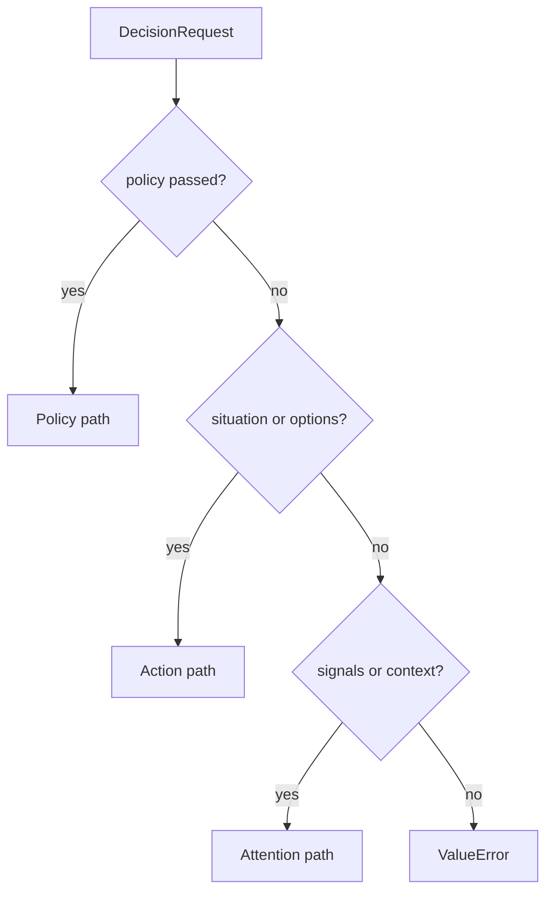

# Dispatch: from request to decision

`decide` is the core entry point. It chooses one mechanism, runs it, normalizes the result and returns
a list of `Decision` objects. It imports no app-kit code, so a host can use it without runtime,
storage or records.

```python
from laix import decide

decisions = decide(request)
```

## Selection

`select(request, policy)` names the handler:

```text
policy is not None                         -> "policy"
situation is not None or options is non-empty -> "action"
signals is non-empty or context is not None  -> "attention"
otherwise                                  -> ValueError
```



The order matters. A request with both a situation and signals goes to the action path. An explicit
policy always wins, even when the request has a situation or signals.

## The three paths

### Policy path

When `policy` is passed, `decide` calls `policy.decide(request)`. Every returned item is normalized
with `coerce`, gets an id and inherits the request's confidence provenance.

```python
decision = decide(request, policy=ReplanningPolicy())[0]
```

A policy may return more than one decision. The list is preserved.

### Action path

The action path needs a `situation`. It builds an `ActionPolicyRequest` from the situation, the
options and the merged attributes, then runs the built-in `ActionPolicy`.

```python
action_request = ActionPolicyRequest(
    situation=request.situation,
    options=request.options,
    attributes=attributes_for(request),
)
decision = ActionPolicy().decide(action_request)
```

If the request has options but no situation, `decide` raises `ValueError`.

### Attention path

The attention path needs `context`. It calls `decide_attention(request.signals, request.context)`,
converts each `AttentionDecision` with `from_attention`, and returns the list.

```python
attention_decisions = decide_attention(request.signals, request.context)
```

If the request has signals but no context, `decide` raises `ValueError`, because attention needs a
clock and the context thresholds.

## Attribute merging

`attributes_for(request)` copies `request.attributes` and adds the confidence provenance when the
request carries it:

| Request field | Attribute key | Rule |
|---|---|---|
| `confidence` | `confidence` | Sets it only when the attribute is absent. |
| `confidence_source` | `confidence_source` | Sets it only when the attribute is absent. |
| `calibrated` | `calibrated` | Sets `True` only when the attribute is absent. |

Policies read their inputs from these merged attributes. A host can pass the same values directly in
`request.attributes` and they win.

## Identity and provenance

Every decision gets:

- `decision_id` with the `DEC` prefix when the mechanism did not set one;
- `trace_id` with the `TRC` prefix when the mechanism did not set one.

Both use `new_id` by default. Pass `id_factory=` to supply a deterministic or host-owned generator:

```python
decisions = decide(request, id_factory=lambda prefix: f"{prefix}-{counter.next()}")
```

After the ids are set, `annotate_confidence` merges the request's confidence provenance: the
request's `confidence_source` wins when set, and `calibrated` is true if either the request or the
decision marks it true. This lets a host mark a whole request as calibrated without changing every
policy.

## Normalization

`coerce` accepts a `Decision`, an attention-like object with `signal_id` and `verb`, or a mapping
with the decision fields, and returns a `Decision`. For a mapping, it defaults `verb` to `wait`,
`reason_code` to `policy_rule`, `deliver` and `record` to `True`, `status` to `final` and `target` to
`one`. An unsupported result raises `PolicyError`.

`from_attention` converts an `AttentionDecision` into the public shape: it maps the attention verb,
reason, score and delivery flags onto `Decision`. The reason code becomes the rationale; the
structured explanation stays in `breakdown` and `attributes`.

The normalization step is why every path returns the same shape even though signal attention and
policies use different internal result types.

## `decide` and `Layer`

| Entry point | Adds |
|---|---|
| `decide` | Selection, normalization, ids and confidence provenance. |
| `Layer` | The same core selection plus the runtime, streaming, execution, records, stores and platform. |

`Layer` is optional. The core `decide` never imports it. See
[App-kit overview](../../03-appkit/00-architecture.md).

## Errors

| Condition | Result |
|---|---|
| No policy, no situation/options, no signals/context | `ValueError` from `select`. |
| Action route without a situation | `ValueError`. |
| Attention route without a context | `ValueError`. |
| Unknown verb in a `Decision` | `ValueError` from `Decision.__post_init__`. |
| Unknown status or target mode | `ValueError` from `Decision.__post_init__`. |

## Related

- [Decision contract](01-decision-contract.md) — the request and response shapes.
- [Signal attention](../02-decide/01-signal-attention.md) — the attention path.
- [Policies](../02-decide/03-policies.md) — the explicit policy path.
- [Planner contract](../03-planning/01-planner-contract.md) — the `EnginePolicy` path.
