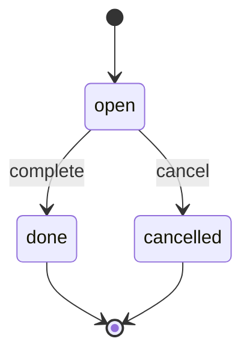
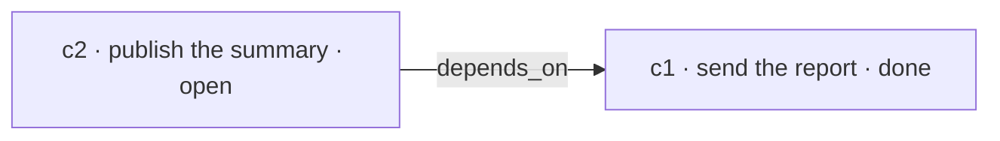

# Commitments

A commitment is a promise the task has already made. LAIX treats it as decision state, not as a note
beside the decision. An action can fulfill a promise, break one or create a new one, and the
commitment planner scores that effect with the rest of the decision.

## The shape

| Field | Type | Meaning |
|---|---|---|
| `id` | `str` | Stable identity used by options and the ledger. |
| `subject` | `str` | The promised outcome. |
| `due` | ISO-8601 `str \| None` | When the promise is due. |
| `status` | `str` | `open`, `done` or `cancelled`. |
| `depends_on` | `tuple[str, ...]` | Commitments that must be `done` first. |
| `priority` | `float` | Importance in `0..1`. The default is `0.5`. |
| `payload` | `dict` | Host-owned detail. Keep sensitive data in the host. |

`COMMITMENT_STATUSES` is the tuple `("open", "done", "cancelled")`. `Commitment.__post_init__`
rejects an unknown status. `is_due(now)` compares `due` with the supplied clock. `to_dict()` and
`from_dict()` round-trip the shape.

```python
from laix import Commitment

commitment = Commitment(
    id="c1",
    subject="send the report",
    due="2026-11-01T09:00:00+00:00",
    priority=0.8,
)
```

## The ledger

`CommitmentLedger` is the in-memory view of the promises for one task. The host saves it through a
`CommitmentStore`.

| Method | Result |
|---|---|
| `add(commitment)` | Stores and returns the commitment. |
| `get(id)` | Returns one commitment. |
| `complete(id)` | Marks it `done` and returns the updated copy. |
| `cancel(id)` | Marks it `cancelled` and returns the updated copy. |
| `all()` | Every commitment, including done and cancelled ones. |
| `open()` | Only the commitments with status `open`. |
| `due(now)` | Open commitments whose due time is at or before `now`. |
| `next(now=None)` | The first open commitment by due time, priority and id. |
| `next_actionable(now=None)` | The first open commitment whose dependencies are all `done`. |
| `blocked_open()` | Open commitments that still wait on another commitment. |
| `blocked(commitment)` | Whether one commitment waits on an unfinished dependency. |
| `to_dict()` / `from_dict(payload)` | Round-trip the ledger. |

The ordering key is `(due, -priority, id)`. A missing due time sorts last. `next_actionable` filters
blocked commitments before applying the same order. `next` and `next_actionable` accept `now` for a
uniform signature but do not filter by due time; use `due(now)` for that.

```python
from laix import Commitment, CommitmentLedger

ledger = CommitmentLedger(
    (
        Commitment(id="c1", subject="send the report", priority=0.8),
        Commitment(id="c2", subject="publish the summary", depends_on=("c1",)),
    )
)

print(ledger.next().id)                 # c1
print(ledger.next_actionable().id)      # c1
print([item.id for item in ledger.blocked_open()])  # ['c2']

ledger.complete("c1")
print(ledger.next_actionable().id)      # c2
```

## Status and dependencies





A commitment is actionable when every id in `depends_on` resolves to a commitment with status
`done`. A missing dependency counts as unfinished. A blocked commitment stays open; the ledger
reports it through `blocked_open()` and excludes it from `next_actionable()`.

## The store

`CommitmentStore` is the persistence port:

```python
class CommitmentStore:
    def save(self, key: str, ledger: CommitmentLedger) -> None: ...
    def load(self, key: str) -> CommitmentLedger | None: ...
    def delete(self, key: str) -> None: ...
```

`InMemoryCommitmentStore` is for tests and short-lived tasks. `FileCommitmentStore` writes one file
per key. The host can implement the port with its own database.

## How commitments enter a decision

The host passes commitments in `DecisionRequest.attributes`:

```python
DecisionRequest(
    ...,
    attributes={"commitments": ledger},
)
```

The planner reads the same value from `PlannerInput.attributes`. It accepts the `commitments`
key or the `commitment_ledger` alias. The accepted forms are:

- a `CommitmentLedger`;
- a tuple of `Commitment` objects;
- a mapping with a `commitments` key that `Commitment.from_dict` can read.

The commitment planner then scores an option's declared effect:

```python
ActionOption(
    id="send-later",
    verb="act",
    name="send later",
    params={
        "commitments": {
            "fulfills": ["c1"],
            "violates": ["c2"],
            "creates": ["c3"],
            "hard": True,
        }
    },
)
```

The effect can also be written under `params["commitment"]` or at the top level of `params` without
a wrapper. The scoring rules, weights and returned attributes are on the
[commitment planner page](../03-decision/01-single/01-planners.md#commitment-planner).

`PlanningPolicy` consumes a ledger and turns the next actionable commitment into a decision. The
constructor, the exact reason codes and the policy contract are on the
[policies page](../03-decision/01-single/05-policies.md#planning-policy).

## What the host owns

- the subject and the due time;
- the priority and the dependency graph;
- the durable store and retention;
- whether a commitment is done or cancelled;
- the mapping from an action to a fulfillment or a violation.

LAIX owns the decision and the record. The host sends the report, publishes the summary, decides that
a promise was kept and records the outcome.

## Related

- [Decision contract](../01-contract/01-decision-contract.md)
- [Policies](../03-decision/01-single/05-policies.md) — `PlanningPolicy`
- [Single-decision planners](../03-decision/01-single/01-planners.md#commitment-planner) — `CommitmentPlanner`
- [Stores](../../03-appkit/04-connect/01-stores.md) — `CommitmentStore`
