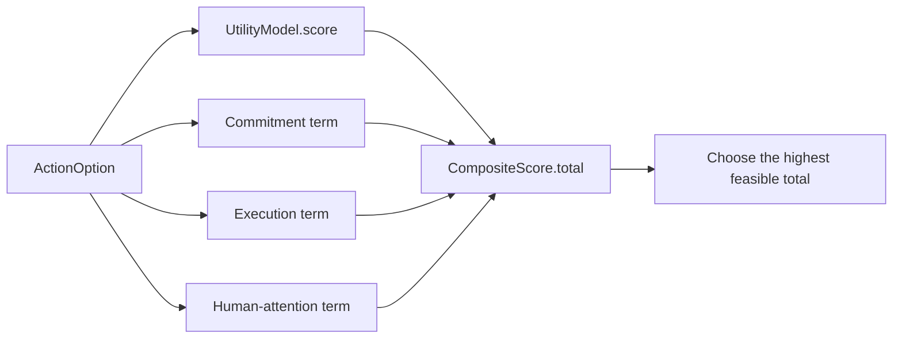

# The composite planner

`LiveCompositePlanner` is the composite planner. It runs the four live planner scores on the same
problem and returns one `PlannerResult`.

`live` means the decision is made inside the running loop, at event time, with the current state.
The core stays stateless; the host supplies the state in the request.

## `CompositeScore`

`CompositeScore` holds the four terms and their total:

| Field | Meaning |
|---|---|
| `utility` | the `UtilityModel` score |
| `commitment` | the commitment term |
| `execution` | the execution-risk term |
| `human_attention` | the human-attention term |
| `total` | `utility + commitment + execution + human_attention`, rounded to six places |

## Initialization

```python
LiveCompositePlanner(
    model: UtilityModel | None = None,
    *,
    commitment_weights: CommitmentWeights | None = None,
    execution_weights: ExecutionWeights | None = None,
    human_attention_weights: HumanAttentionWeights | None = None,
    enforce_feasibility: bool = True,
)
```

Each weight argument defaults to the corresponding planner's defaults. `model` is the base
`UtilityModel`. `enforce_feasibility=False` keeps every option in the comparison and still records
blockers in the alternatives.

## Per-option score

The composite planner uses the shared scoring functions from the four planners directly, rather than
instantiating the planner classes. It keeps a `UtilityPlanner` internally to resolve `UtilityModel`
overrides.

```text
utility    = utility_model.score(option)
commitment = commitment_score(option, ...)
execution  = execution_score(option, ...)
human_attention = human_attention_score(option, ...)

total = utility + commitment + execution + human_attention
```

Each term is computed exactly as on the [single-decision planners](01-planners.md) page.



## Blocking and feasibility

A row is blocked when any term blocks it:

```text
blocked = commitment.blocked or human_attention.blocked or constraint_blocker
```

A row is feasible when:

```text
model.feasible(option) and blocked is None     if enforce_feasibility
True                                           otherwise
```

The hard `Situation` constraints are the same ones the utility planner uses. Commitment, attention
and hard constraints block; the execution term prices risk.

If no option is feasible, the composite planner returns `wait` with `no_feasible_option`. If there are no
options, it returns `wait` with `no_options`.

## Selection and confidence

The composite planner sorts the feasible rows by `(-total, option.id)` and takes the first. The confidence is:

```text
1.0                                      if there is no second feasible row
clamp(0.5 + 0.5 × gap / |best|)          otherwise, gap = max(0, best - second)
```

## The returned planner result

| Field | Value |
|---|---|
| `verb` | the chosen option's verb |
| `confidence` | the selection confidence |
| `reason_code` | `live_decision` |
| `rationale` | the four terms and the chosen option |
| `action_id` | the chosen option id |
| `requires_approval` | human attention requires approval or execution requires approval |
| `reversible` | the chosen option's reversibility |
| `score` | `CompositeScore.total` |
| `alternatives` | every other option, its four terms, total and rejection reason |

`PlannerResult.attributes` carries the full breakdown:

| Attribute | Meaning |
|---|---|
| `utility` | the utility term |
| `commitment_score` | the commitment term |
| `execution_score` | the execution term |
| `human_attention_score` | the attention term |
| `human_attention_cost` | the attention effect cost |
| `commitments_fulfilled` | ids fulfilled by the chosen option |
| `commitments_violated` | ids violated by the chosen option |
| `commitments_created` | ids created by the chosen option |
| `receipt_status` | the chosen option's receipt status |
| `approval_state` | the chosen option's approval state |

Alternatives use the same four terms. A rejected row says `blocked by <blocker>`,
`outside the hard limits` or `lower integrated score`.

## Example

```python
from laix import ActionOption, HumanAttentionBudget, Commitment, PlannerInput, LiveCompositePlanner

problem = PlannerInput(
    subject="send the report",
    at="2026-11-01T10:00:00+00:00",
    options=(
        ActionOption(
            id="now",
            verb="act",
            name="send now",
            expected_benefit=1.0,
            reversible=False,
            params={"commitments": {"violates": ["c1"]}},
        ),
        ActionOption(
            id="ask",
            verb="ask",
            name="ask first",
            expected_benefit=0.6,
            params={"commitments": {"fulfills": ["c1"]}},
        ),
    ),
    attributes={
        "commitments": (
            Commitment(id="c1", subject="send the report", due="2026-11-01T09:00:00+00:00"),
        ),
        "human_attention_budget": HumanAttentionBudget(total=1.0, spent=0.4),
    },
)

planner_result = LiveCompositePlanner().solve(problem)
print(planner_result.action_id, planner_result.reason_code)
print(planner_result.attributes["commitment_score"])
print(planner_result.attributes["execution_score"])
print(planner_result.attributes["human_attention_score"])
```

The `ask` option keeps the promise and avoids the irreversible send. The `now` option starts with
higher utility but loses the commitment term and pays the irreversibility penalty.

## How it differs from running the planners

| Running planners separately | `LiveCompositePlanner` |
|---|---|
| Each planner returns its own `PlannerResult`. | One `PlannerResult` combines all four terms. |
| A planner can win on its own concern and lose the others. | The total includes every concern at once. |
| The host compares plans. | The composite planner compares rows and returns the winner. |
| The host must reconcile blockers. | Commitment, attention and hard constraints block in one pass. |

The composite planner composes the planners' scores. The planners remain the direct choice when only one concern
matters.

## Reference results

The seven-case live demo matches all seven expected actions. On the frozen 30-case test split of
the 120-case corpus, `LiveCompositePlanner` scores 30/30 and 6/6 on the conflict subset. The
hand-built glue baseline scores 28/30; the +6.7 pp difference is not significant on 30 cases
(p = 0.48).

The composite planner is the composition object. The benchmark design and the measured evidence are in
[the benchmark page](../../../06-research/02-evaluation/benchmark.md).

## Examples

- Python: `examples/python/core/decision/single/planners/live_composite_planner.py`
- TypeScript: `examples/typescript/core/decision/single/planners/live_composite_planner.mts`

## Related

- [Single-decision planners](01-planners.md)
- [Planner contract](../../01-contract/02-planner-contract.md)
- [Commitments](../../02-domain/02-commitments.md)
- [Decision continuity](../04-history.md)
- [Evaluation](../../06-evaluation/01-cases.md)
