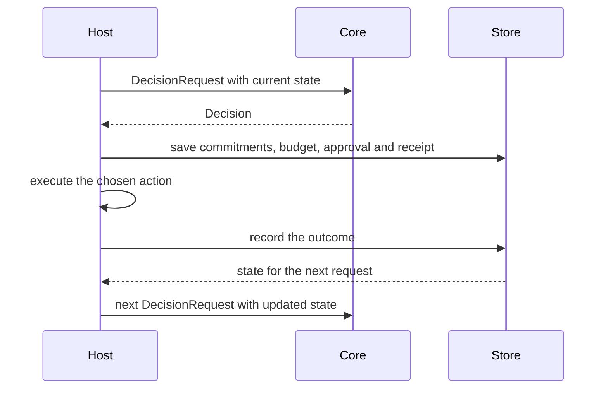

# Decision continuity

A LAIX decision is one step in a sequence. The next decision sees what the previous one left behind:
promises, attention budget, approvals, revisions, receipts and outcomes. Decision continuity is the
property that each step starts from the current state instead of from zero.

This is what makes LAIX a runtime rather than a one-shot classifier. The core stays stateless; the
host passes the current state into the next request.

## What carries forward

| State | Shape | Where it lives |
|---|---|---|
| Open commitments | `Commitment`, `CommitmentLedger` | core commitments and the host store |
| Attention budget | `AttentionBudget` | decision attributes |
| Approval state | `Decision.requires_approval`, `DecisionRecord` | the decision and the audit record |
| Prior decisions and revisions | `DecisionTimeline` | app-kit streaming |
| Receipts and recovery | `ExecutionBridge`, `Saga` | app-kit runtime |
| Outcomes and calibration | `Outcome`, `OutcomeStore`, `CalibrationReport` | core learning and host stores |

Outcomes and calibration are described in [Learning](../05-learning/01-outcome-learning.md).

## How state reaches the next decision

1. The previous decision may fulfill, violate or create a commitment.
2. It may spend part of a shared attention budget.
3. It may require approval or leave an execution receipt.
4. It may supersede an earlier decision and produce a revision.
5. Its outcome may update a calibration report or a learner.

The next `DecisionRequest` carries the commitments, budget, approvals and receipts that matter. The
planner receives them in `DecisionProblem.attributes` and scores the current options against that
state. `LiveDecisionEngine` does this for utility, commitments, execution risk and attention in one
plan.

## A sequence

| Step | Decision | State after |
|---|---|---|
| 1 | acts and creates commitment `c1` | `c1` open; budget 0.6 spent; receipt pending |
| 2 | asks because `c1` is due and the budget is low | `c1` open; approval pending |
| 3 | verifies after execution | receipt unknown; `c1` still open |
| 4 | acts on the verified result | `c1` fulfilled; receipt recorded; outcome stored |
| 5 | the next decision | calibration and the new state are available |

The exact path depends on the policy. The invariant is that no step starts from zero.

## What the core owns

LAIX evaluates the state and returns the decision. The host and the app kit own persistence:

- the host owns the durable store and retention;
- `CommitmentStore` and `OutcomeStore` define the persistence ports;
- `DecisionTimeline` defines revision and event-time semantics;
- `DecisionRecord` defines the audit lifecycle.

## Why it matters

The [continuity benchmark](02-continuity-benchmark.md) measures the mechanism: 12 episodes, 60
decisions, a stateless planner and a stateful engine.

- A one-shot classifier answers one question. LAIX carries the consequences into the next decision.
- An orchestration framework carries state. LAIX adds decision semantics to that state.
- Glue code can copy a decision object. A coherent sequence is where the integration shows.

## Related

- [Continuity benchmark](02-continuity-benchmark.md)
- [Commitments](../02-decide/02-commitments.md)
- [Human-attention planning](../03-planning/02-live-planners.md#human-attention-planner)
- [Outcome learning](../05-learning/01-outcome-learning.md)
- [Evaluation](../06-reference/01-evaluation.md)
- [Streaming decisions](../../03-appkit/02-run/02-streaming.md)
- [Stores](../../03-appkit/04-connect/01-stores.md)
- [Execution and recovery](../../03-appkit/03-execute/01-execution-and-recovery.md)
