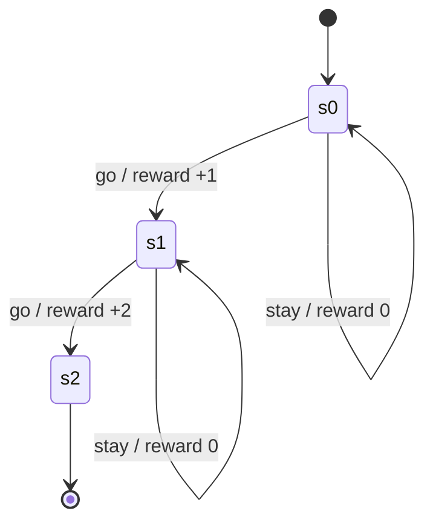
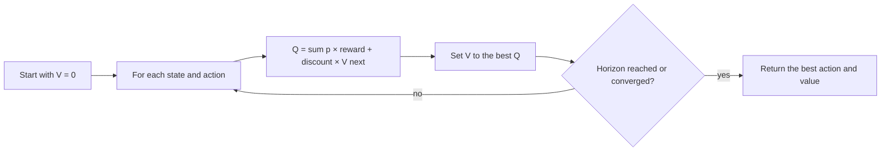

# Planners and the engine contract

The planner contract, the built-in planners and the simulator are implemented in
`core/engines/`. Rule policies and packaged policies work on their own; planners are optional.
This page covers the planner contract; attention and policies are separate parts of the Decide layer.
The vocabulary is defined in the [glossary](../04-concepts/glossary.md).

The goal is:

- one planner contract;
- LAIX’s own planners;
- adapters for external planners;
- every planner returns the same `Plan`; the adapter returns the same `Decision` and uses the same
  lifecycle.

Build order and current status live in [the project roadmap](../05-project/roadmap.md).

## Architecture

```text
DecisionRequest
      │
      ▼
   Policy
   ├── rule policy
   └── EnginePolicy             wraps any planner
          ├── external planner  JEV, OR-Tools (an optimizer), a POMDP library
          └── LAIX planner      UtilityEngine, MDPEngine, POMDPEngine
      │
      ▼
   Decision
      │
      ▼
approval -> execute -> verify -> outcome
```

The rule:

> A planner produces a plan. The layer turns that plan into a decision. All paths return the same
> decision shape.

## Core contracts

```python
from laix import DecisionProblem, EnginePolicy, Plan

class DecisionEngine(Protocol):
    def solve(self, problem: DecisionProblem) -> Plan: ...

policy = EnginePolicy(engine)
decision = policy.decide(request)[0]
```

`EnginePolicy` owns the conversion; the planner returns a `Plan`, the policy returns
the one `Decision` shape.

The contracts:

| Contract | Purpose |
|---|---|
| `DecisionProblem` | states, actions, utility, limits and uncertainty |
| `Plan` | chosen option, expected value, confidence and alternatives |
| `DecisionEngine` | `solve(problem) -> Plan` |
| `EnginePolicy` | turns a plan into a `Decision` |
| `UtilityEngine` | expected utility with hard limits and risk attitude |
| `MdpModel`, `MDPEngine` | finite MDP, value iteration and a greedy plan |
| `PomdpModel`, `POMDPEngine` | belief update and finite-horizon planning |
| `Simulator` | runs a planner in a model |
| `SimulationReport` | planner comparison, reward and optimality gap |
| `CalibrationReport` | predicted confidence vs observed accuracy |
| `ModelLearner` | transition and reward learning with rollback |

## Capabilities

| # | Capability | Piece |
|---|---|---|
| 1 | Problem shape | `DecisionProblem`, request projection |
| 2 | Option model | `ActionOption`, costs, risks and hard limits |
| 3 | Utility model | `UtilityModel`, weights, risk attitude |
| 4 | Planner choice | `DecisionEngine.solve`, `MDPEngine`, `POMDPEngine` |
| 5 | Calibration | `CalibrationReport` and confidence adjustment |
| 6 | Learning | `ModelLearner` for transitions and rewards |
| 7 | Explanation | chosen plan, alternatives, expected value |
| 8 | Simulator and bench | `Simulator`, planner comparison, optimality gap |

## What an MDP is

A **Markov Decision Process** models a sequence of decisions under uncertainty. At each step the app
is in a **state**, chooses an **action**, the world moves to a **next state** with some probability,
and the action earns a **reward**. “Markov” means the next state depends on the current state and
action, not on the whole history.



| Piece | LAIX type | Meaning |
|---|---|---|
| State | `str` | what is true now |
| Action | `str` | one move the planner may choose |
| Transition | `MdpTransition` | probability of the next state, and its reward |
| Discount | `MdpModel.discount` | how much future reward matters |
| Horizon | `MdpModel.horizon` | how many steps to plan |
| Policy | `MDPEngine` | the action to choose in each state |

The planner computes a value for each state:

```text
V(s) = max over actions of
       sum over next states of
       P(next | s, action) × (reward + discount × V(next))
```

That is **value iteration**. `value_iteration(model)` returns the state values;
`action_values(model, state)` returns each action’s expected value in descending order.

The loop is:



A rule policy answers “what matches this situation?”. An MDP answers “if I act now, what is likely to
happen next, and what is that sequence worth?”. That matters when actions have delayed consequences,
uncertain outcomes, or a cost to waiting.

```python
from laix import DecisionProblem, MDPEngine, MdpModel, MdpTransition

model = MdpModel(
    states=("s0", "s1", "s2"),
    actions=("go", "stay"),
    transitions=(
        MdpTransition("s0", "go", "s1", 1.0, 1.0),
        MdpTransition("s0", "stay", "s0", 1.0, 0.0),
        MdpTransition("s1", "go", "s2", 1.0, 2.0),
        MdpTransition("s1", "stay", "s1", 1.0, 0.0),
    ),
    start="s0",
    discount=0.9,
    horizon=2,
)

plan = MDPEngine(model).solve(
    DecisionProblem(subject="choose", at="2026-11-01T10:00:00+00:00")
)
print(plan.action_id, plan.score, plan.alternatives)
```

## What a POMDP is

A **POMDP** is an MDP where the state is hidden. The planner cannot read the state directly, so it
keeps a **belief**: a probability for each state. Each observation updates the belief, and the
planner chooses the action that is best under that belief.

| Piece | Meaning |
|---|---|
| Hidden state | what is true, but not directly observed |
| Observation | what the app sees |
| Belief | the probability of each state |
| Update | revise the belief from the new observation |
| Action | chosen to maximise expected reward under the belief |

`POMDPEngine` plans over a finite model. Belief planning grows quickly with the number of states and
observations, so keep the model small. See [the app-kit bench](../03-appkit/08-bench.md) for planner
comparison.

Both MDP and POMDP need a world model: states, transitions and rewards. The app supplies that model;
LAIX plans over it. Large state spaces become expensive, so keep the model small and purposeful.

## Path A: external planner

```python
decision = decide(request, policy=EnginePolicy(JevEngine(...)))[0]
decision = decide(request, policy=EnginePolicy(OrToolsEngine(...)))[0]
decision = decide(request, policy=EnginePolicy(MDPEngine(...)))[0]
```

The external planner can be a classifier, an optimizer or a model service. The adapter maps its
output into a `Plan`.

## Path B: built-in planner

```python
class MDPEngine:
    def solve(self, problem: DecisionProblem) -> Plan:
        ...
        return Plan(
            verb="act",
            action_id="valve",
            confidence=0.88,
            reason_code="expected_utility",
            rationale="the valve plan has the highest expected utility",
            score=0.91,
            alternatives=(...),
        )

decision = decide(request, policy=EnginePolicy(MDPEngine()))[0]
```

Pass the planner through `EnginePolicy(engine)` so every path shares one conversion.

Internally this is still a planner-backed policy.

## Design rules

1. Every planner returns a `Plan`; `EnginePolicy` returns the one `Decision` shape.
2. Approval, execution, verification and outcome recording stay outside the core.
3. The app supplies the domain model. LAIX supplies the decision method.
4. Planners are optional. The rule policies remain.
5. A planner can be replaced without changing the app adapter.
6. A planner result must be explainable: chosen plan, alternatives, expected value.
7. Bench compares planners on the same cases.

## Limits

- A planner needs a world model. The app supplies the domain transitions; LAIX plans over them.
- Utility elicitation remains the hard part.
- POMDPs get expensive quickly.
- Calibration needs real outcomes.
- Planner explanations are harder than rule traces.
- The API grows. Keep every piece optional.

See [the project roadmap](../05-project/roadmap.md) for status and next work.
