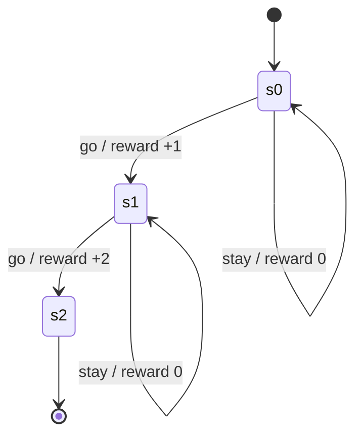
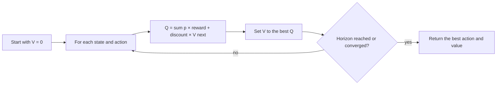

# Planners, engines and the decision contract

The decision components live in `core/engines/`. Planners are grouped under
`core/engines/planners/`; the live decision engine is under `core/engines/live/`; the
signal-attention engine is under `core/engines/signals/`. Rule policies and packaged policies
work on their own; planners are optional. This page covers the planner and engine contract;
attention and policies are separate parts of the Decide layer. The vocabulary is defined in the
[glossary](../04-concepts/glossary.md).

## Vocabulary

The words are not interchangeable:

| Layer | Role | Built-ins |
|---|---|---|
| **Planner** | A strategy: score the options and choose one. | `UtilityPlanner`, `CommitmentPlanner`, `ExecutionRiskPlanner`, `HumanAttentionPlanner`, `MDPPlanner`, `POMDPPlanner` |
| **Engine** | A composition: run several planners on the same problem and return one `Plan`. | `LiveDecisionEngine` |
| **Policy** | An integration: place a decision inside the host loop. | `RulePolicy`, `EnginePolicy`, `ShadowPolicy` |
| **Learner** | Learning from outcomes. | `UCBBandit`, `ModelLearner` |
| **Protocol** | The `solve(problem) -> Plan` interface. | `DecisionEngine` |

A planner is not an engine, and an engine is not a planner. `LiveDecisionEngine` composes
planners; it does not replace them. `EnginePolicy` is an adapter between the `DecisionEngine`
protocol and the host's policy interface.

The goal is:

- one decision protocol;
- LAIX’s own planners;
- one composition engine;
- adapters for external planners;
- every planner and every engine returns the same `Plan`; the policy adapter returns the same
  `Decision` and uses the same lifecycle.

Build order and current status live in [the project roadmap](../05-project/roadmap.md).

## Architecture

```text
DecisionRequest
      │
      ▼
   Policy
   ├── RulePolicy            matches the situation against authored rules
   └── EnginePolicy          adapts a DecisionEngine to the policy interface
          ├── LiveDecisionEngine      composes the live planners
          │      ├── UtilityPlanner
          │      ├── CommitmentPlanner
          │      ├── ExecutionRiskPlanner
          │      └── HumanAttentionPlanner
          ├── MDPPlanner
          ├── POMDPPlanner
          └── external engine       JEV, OR-Tools (an optimizer), a POMDP library
      │
      ▼
   Decision
      │
      ▼
approval -> execute -> verify -> outcome
```

The rule:

> A planner produces a plan. An engine composes planners into one plan. The layer turns that
> plan into a decision. All paths return the same decision shape.

## Core contracts

```python
from laix import DecisionProblem, EnginePolicy, Plan

class DecisionEngine(Protocol):
    def solve(self, problem: DecisionProblem) -> Plan: ...

policy = EnginePolicy(engine)
decision = policy.decide(request)[0]
```

`EnginePolicy` owns the conversion; the planner or engine returns a `Plan`, the policy returns
the one `Decision` shape.

The contracts:

| Contract | Purpose |
|---|---|
| `DecisionProblem` | states, actions, utility, limits and uncertainty |
| `Plan` | chosen option, expected value, confidence and alternatives |
| `DecisionEngine` | `solve(problem) -> Plan` |
| `EnginePolicy` | turns a plan into a `Decision` |
| `UtilityPlanner` | expected utility with hard limits and risk attitude |
| `CommitmentPlanner` | utility plus promise keeping, violations and due commitments |
| `ExecutionRiskPlanner` | utility plus irreversibility, unknown outcomes and recovery cost |
| `HumanAttentionPlanner` | utility plus interruption, approval and escalation cost |
| `LiveDecisionEngine` | composition: commitments, execution risk and human attention in one plan |
| `MdpModel`, `MDPPlanner` | finite MDP, value iteration and a greedy plan |
| `PomdpModel`, `POMDPPlanner` | belief update and finite-horizon planning |
| `Simulator` | runs a planner in a model |
| `SimulationReport` | planner comparison, reward and optimality gap |
| `CalibrationReport` | predicted confidence vs observed accuracy |
| `DecisionCalibrationReport` | decision accuracy, per-verb and per-action calibration |
| `ModelLearner` | transition and reward learning with rollback |

## Capabilities

| # | Capability | Piece |
|---|---|---|
| 1 | Problem shape | `DecisionProblem`, request projection |
| 2 | Option model | `ActionOption`, costs, risks and hard limits |
| 3 | Utility model | `UtilityModel`, weights, risk attitude |
| 4 | Planning and composition | Planners: `UtilityPlanner`, `CommitmentPlanner`, `ExecutionRiskPlanner`, `HumanAttentionPlanner`, `MDPPlanner`, `POMDPPlanner`. Engine: `LiveDecisionEngine`. Protocol: `DecisionEngine.solve` |
| 5 | Calibration | `CalibrationReport`, `DecisionCalibrationReport` and confidence adjustment |
| 6 | Learning | `ModelLearner` for transitions and rewards |
| 7 | Explanation | chosen plan, alternatives, expected value |
| 8 | Simulator and bench | `Simulator`, planner comparison, optimality gap |

## What an MDP is

A **Markov Decision Process** models a sequence of decisions under uncertainty. At each step the app
is in a **state**, chooses an **action**, the world moves to a **next state** with some probability,
and the action earns a **reward**. “Markov” means the next state depends on the current state and
action.



| Piece | LAIX type | Meaning |
|---|---|---|
| State | `str` | what is true now |
| Action | `str` | one move the planner may choose |
| Transition | `MdpTransition` | probability of the next state, and its reward |
| Discount | `MdpModel.discount` | how much future reward matters |
| Horizon | `MdpModel.horizon` | how many steps to plan |
| Policy (MDP term) | `MDPPlanner` | the best action per state; this is not the LAIX `Policy` layer |

The planner computes a value for each state:

```text
V(s) = max over actions of
       sum over next states of
       P(next | s, action) × (reward + discount × V(next))
```

That is **value iteration**. `value_iteration(model)` returns the state values;
`action_values(model, state)` returns each action’s expected value in descending order.

The loop is:



A rule policy answers “what matches this situation?”. An MDP answers “if I act now, what is likely to
happen next, and what is that sequence worth?”. That matters when actions have delayed consequences,
uncertain outcomes, or a cost to waiting.

```python
from laix import DecisionProblem, MDPPlanner, MdpModel, MdpTransition

model = MdpModel(
    states=("s0", "s1", "s2"),
    actions=("go", "stay"),
    transitions=(
        MdpTransition("s0", "go", "s1", 1.0, 1.0),
        MdpTransition("s0", "stay", "s0", 1.0, 0.0),
        MdpTransition("s1", "go", "s2", 1.0, 2.0),
        MdpTransition("s1", "stay", "s1", 1.0, 0.0),
    ),
    start="s0",
    discount=0.9,
    horizon=2,
)

plan = MDPPlanner(model).solve(
    DecisionProblem(subject="choose", at="2026-11-01T10:00:00+00:00")
)
print(plan.action_id, plan.score, plan.alternatives)
```

## What a POMDP is

A **POMDP** is an MDP where the state is hidden. The planner cannot read the state directly, so it
keeps a **belief**: a probability for each state. Each observation updates the belief, and the
planner chooses the action that is best under that belief.

| Piece | Meaning |
|---|---|
| Hidden state | what is true and inferred from observations |
| Observation | what the app sees |
| Belief | the probability of each state |
| Update | revise the belief from the new observation |
| Action | chosen to maximise expected reward under the belief |

`POMDPPlanner` plans over a finite model. Belief planning grows quickly with the number of states and
observations, so keep the model small. See [the app-kit bench](../03-appkit/08-laix-bench.md) for planner
comparison.

Both MDP and POMDP need a world model: states, transitions and rewards. The app supplies that model;
LAIX plans over it. Large state spaces become expensive, so keep the model small and purposeful.

## Commitment-aware planning

The utility planner scores benefit, cost, risk and interruption. The commitment-aware planner adds
what an option does to the promises the task already made.

An option declares its effect in `params`:

```python
ActionOption(
    id="send-later",
    verb="act",
    name="send later",
    params={"commitments": {"fulfills": ["c1"]}},
)
```

The planner adds:

- a reward for fulfilling an open commitment;
- an extra reward when the commitment is due;
- a penalty for violating a commitment;
- a penalty for creating a new one, because it reduces future flexibility;
- a penalty for trying to fulfill a commitment whose dependencies are still open.

The reward scales with `Commitment.priority`, so a high-priority promise counts more. A blocked
commitment counts as fulfilled once its dependencies are `done`.

`CommitmentPlanner` returns the same `Plan`. It is deterministic and training-free; the
commitments and due times come from the host. The effect can be written under `commitments` or at
the top level of `params`.

## Execution-aware planning

The execution-aware planner adds the cost of acting. An option may be irreversible, may have an
unknown outcome, may need approval and may cost time or money to recover from.

An option declares its facts in `params`:

```python
ActionOption(
    id="archive",
    verb="act",
    name="archive",
    expected_benefit=0.7,
    params={"unknown_risk": 0.2, "recovery_cost": 0.1},
)
```

The planner subtracts:

- a penalty for an irreversible action;
- a penalty for unknown outcome risk;
- a penalty for an approval step;
- a penalty for recovery cost.

The host can also pass execution state in the request attributes:

```python
DecisionProblem(
    ...,
    attributes={
        "execution_receipts": receipts,      # ExecutionReceipt objects
        "execution_state": {"archive": "unknown"},
    },
)
```

An `unknown` receipt raises the unknown risk, a `failed`, `refused`, `cancelled` or `undone` receipt
raises the recovery cost, and a `pending` receipt counts as approval.

`ExecutionRiskPlanner` returns the same `Plan`. It is deterministic and training-free; the
execution facts come from the option and the host's constraints.

## Attention-aware planning

Attention-aware planning treats human attention as a budget. An option may interrupt a person, need
approval or escalate; the planner charges for each and refuses a human-facing option when the
budget is gone.

The host supplies the budget in the request attributes:

```python
DecisionProblem(
    ...,
    attributes={"attention_budget": 0.2, "attention_spent": 0.2},
)
```

An option can also declare its own interruption cost:

```python
ActionOption(
    id="guide",
    verb="guide",
    name="guide",
    expected_benefit=0.75,
    interrupt_cost=0.8,
)
```

A shared `AttentionBudget` can be passed as one object:

```python
from laix import AttentionBudget

budget = AttentionBudget(total=1.0, spent=0.4)
DecisionProblem(..., attributes={"attention_budget": budget})
```

Approval state can also be passed in `attributes["approvals"]` as a map from action id to
`approved`, `pending` or `rejected`. A rejected option is blocked; an approved option avoids the
approval cost.

`HumanAttentionPlanner` returns the same `Plan`. It is deterministic and training-free. It can
prefer a direct action, or wait when every option needs more attention than is left.

## The live decision engine

`LiveDecisionEngine` is the composition engine. It runs the four live planner scores on the same
problem: utility, commitments, execution risk and human attention. It keeps the utility score and
adds the commitment, execution and attention terms.

```python
from laix import DecisionProblem, LiveDecisionEngine

plan = LiveDecisionEngine().solve(problem)
print(plan.action_id, plan.score)
print(plan.attributes["commitment_score"])
print(plan.attributes["execution_score"])
print(plan.attributes["attention_score"])
```

The plan carries the full breakdown, so the reason is auditable. On the seven-case live demo the
engine matches every expected action, while the single-concern planners win their own cases.

This is the composition the runtime is built around: one decision can keep a promise, avoid an
irreversible action and respect a human-attention budget at the same time.

`LiveDecisionEngine` is the only engine in this family. Everything else under
`core/engines/planners/` is a planner; `EnginePolicy` is the adapter; `UCBBandit` is a learner.

Runnable examples: [`examples/python/03-plan/live_engine.py`](../../examples/python/03-plan/live_engine.py)
and the full loop in [`examples/python/09-live-loop/live_loop.py`](../../examples/python/09-live-loop/live_loop.py).

## Path A: external planner

```python
decision = decide(request, policy=EnginePolicy(JevEngine(...)))[0]
decision = decide(request, policy=EnginePolicy(OrToolsEngine(...)))[0]
decision = decide(request, policy=EnginePolicy(MDPPlanner(...)))[0]
```

The external planner can be a classifier, an optimizer or a model service. The adapter maps its
output into a `Plan`.

## Path B: built-in planner

```python
class MDPPlanner:
    def solve(self, problem: DecisionProblem) -> Plan:
        ...
        return Plan(
            verb="act",
            action_id="valve",
            confidence=0.88,
            reason_code="expected_utility",
            rationale="the valve plan has the highest expected utility",
            score=0.91,
            alternatives=(...),
        )

decision = decide(request, policy=EnginePolicy(MDPPlanner()))[0]
```

Pass the planner through `EnginePolicy(planner)` so every path shares one conversion.

Internally this is still a planner-backed policy.

## Design rules

1. Every planner and every engine returns a `Plan`; `EnginePolicy` returns the one `Decision` shape.
2. Planner means strategy; engine means composition; policy means integration; learner means learning.
3. Approval, execution, verification and outcome recording stay outside the core.
4. The app supplies the domain model. LAIX supplies the decision method.
5. Planners are optional. The rule policies remain.
6. A planner can be replaced without changing the app adapter.
7. A planner result must be explainable: chosen plan, alternatives, expected value.
8. Bench compares planners and engines on the same cases.

## Limits

- A planner needs a world model. The app supplies the domain transitions; LAIX plans over them.
- Utility elicitation remains the hard part.
- POMDPs get expensive quickly.
- Calibration needs real outcomes.
- Planner explanations are harder than rule traces.
- The API grows. Keep every piece optional.

See [the project roadmap](../05-project/roadmap.md) for status and next work.
