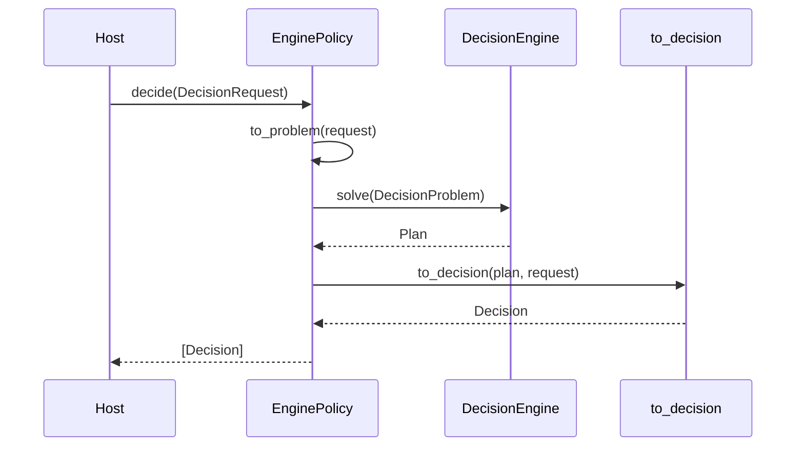

# The planner contract

Planners are optional. A host can use signal attention and the packaged policies without a planner.
A planner adds a formal choice over the options the host already supplied.

The contract has three pieces:

- `DecisionProblem` goes in;
- `Plan` comes out;
- `DecisionEngine` is the `solve` interface.

`EnginePolicy` adapts a planner or engine to the policy interface.

## `DecisionProblem`

`DecisionProblem` is the planner input. `to_problem` projects a `DecisionRequest` onto it.

| Field | Type | Meaning |
|---|---|---|
| `subject` | `str` | What the problem is about. |
| `at` | ISO-8601 `str` | The decision moment. |
| `situation` | `Situation \| None` | Observations, beliefs, goals and constraints. |
| `options` | `tuple[ActionOption, ...]` | Actions the planner may choose. |
| `signals` | `tuple` | Signals, when the planner needs them. |
| `context` | `Context \| None` | Signal context, when the planner needs it. |
| `attributes` | `dict` | Planner-specific state and inputs. |

The projection carries `subject`, `at`, `situation`, `options`, `signals`, `context` and
`attributes` from the request. Target, recipients, deadline and confidence belong to the delivery
envelope; the planner works on the problem.

## `Plan`

`Plan` is the planner answer, before it becomes a `Decision`.

| Field | Type | Meaning |
|---|---|---|
| `verb` | `str` | The chosen verb. |
| `confidence` | `float` | The planner confidence, `0..1`. |
| `reason_code` | `str` | The planner reason. |
| `rationale` | `str` | Human-readable explanation. |
| `action_id` | `str \| None` | The chosen option. |
| `intent` | `Intent \| None` | The action the host can execute. |
| `requires_approval` | `bool` | A person must approve. |
| `reversible` | `bool` | The chosen option can be undone. |
| `undo_hint` | `str \| None` | How to undo it. |
| `score` | `float \| None` | The planner ranking value. |
| `alternatives` | `tuple[dict, ...]` | Options that lost and why. |
| `attributes` | `dict` | Planner-specific breakdown. |

A planner returns one `Plan`. `EnginePolicy` converts it into one `Decision`.

## `DecisionEngine`

```python
class DecisionEngine(Protocol):
    def solve(self, problem: DecisionProblem) -> Plan: ...
```

Every built-in planner and `LiveDecisionEngine` implements this method. An external planner can
implement it too.

## `EnginePolicy`

`EnginePolicy` is the bridge between the two shapes:

```python
from laix import DecisionProblem, EnginePolicy, Plan

policy = EnginePolicy(engine)
decision = policy.decide(request)[0]
```

| Member | Meaning |
|---|---|
| `engine` | The `DecisionEngine` instance. |
| `name` | The policy name; `"engine.v1"` by default. |
| `version` | Same as `name`. |
| `decide(request, *, decision_id="", trace_id="")` | Projects, solves and converts. |

The conversion is `to_decision(plan, request, ...)`:

- copies the plan fields onto `Decision`;
- sets `policy_version` to the `EnginePolicy` name;
- merges `request.attributes` and `plan.attributes`, with the plan winning on a key collision.

`to_problem` and `to_decision` are public. An adapter that calls an engine directly can use them, so
every engine path returns the same `Decision`.

## Sequence



## External planners

An external planner can be a classifier, an optimizer or a model service. Wrap it in a thin adapter
that returns a `Plan`:

```python
from laix import DecisionProblem, EnginePolicy, Plan

class MyPlanner:
    name = "my-planner.v1"

    def solve(self, problem: DecisionProblem) -> Plan:
        return Plan(
            verb="act",
            confidence=0.88,
            reason_code="my_choice",
            rationale="the optimal solver chose the valve",
            action_id="valve",
            score=0.91,
        )

decision = EnginePolicy(MyPlanner()).decide(request)[0]
```

The adapter owns the mapping from the external output to the `Plan` fields. The policy owns the
conversion to `Decision`.

## Simulator

`Simulator` runs a planner through a deterministic step function. It is the way to compare planners
on the same trace.

| Type | Fields or methods |
|---|---|
| `Simulator` | `step`, `actions`, `start`, `horizon`, `name`, `random_step`, `seed`; `run(planner)`, `from_mdp(model, start=None, seed=None)` |
| `Scenario` | `name`, `simulator`, `optimum`; `run(planner)` |
| `SimulationStep` | `step`, `state`, `action`, `reward`, `next_state` |
| `SimulationResult` | `scenario`, `steps`, `total_reward`, `final_state`; `summary()` |
| `PlannerScore` | `planner`, `scenario`, `total_reward`, `steps`, `optimality_gap` |
| `SimulationReport` | `rows`; `summary()`, `best()`, `to_dict()` |

`SimulationReport.summary()` groups by planner and returns `runs`, `mean_reward` and `mean_gap`.
`best()` returns the planner with the highest mean reward. `SimulationResult.summary()` returns the
scenario, the step count, the total reward and the final state.

`compare_planners(planners, scenarios)` runs every planner on every scenario.
`seeded_scenarios(seed, *, count=3, horizon=8, actions=("a", "b"))` builds repeatable chains with a
known optimum. `Simulator.from_mdp(model, seed=...)` builds a deterministic or seeded stochastic rollout
from an `MdpModel`.

```python
from laix import MDPPlanner, Scenario, Simulator, UtilityPlanner, compare_planners

scenario = Scenario(
    name="forward-chain",
    simulator=Simulator.from_mdp(model),  # model: MdpModel
    optimum=4.0,
)

report = compare_planners(
    {"mdp": MDPPlanner(model), "utility": UtilityPlanner()},
    [scenario],
)
print(report.summary())
print(report.best())
```

The optimality gap is:

```text
gap = max(0, (optimum - total_reward) / max(|optimum|, 1e-9))
```

It is reported only when the scenario declares an optimum. Without an optimum, `optimality_gap` is
`None` and the summary treats it as `0.0`.

## Design rules

1. A planner scores the options the host offers.
2. A planner returns one `Plan` and the same shape as every other planner.
3. A planner is deterministic unless the host supplies a model or a random source.
4. Hard limits gate the choice. A planner may also block on its own concern.
5. A planner result is explainable: chosen option, alternatives, score and reason.
6. `LiveDecisionEngine` composes planners; it does not replace them.
7. A planner can be replaced without changing the request or the response handling.

## Where the code lives

| Path | Contents |
|---|---|
| `core/engines/contract/decision_problem.py` | `DecisionProblem` |
| `core/engines/contract/plan.py` | `Plan` |
| `core/engines/contract/decision_engine.py` | `DecisionEngine` |
| `core/engines/contract/engine.py` | `EnginePolicy`, `to_problem`, `to_decision` |
| `core/engines/simulation/` | simulator, scenarios and report |
| `core/engines/planners/` | the six built-in planners |
| `core/engines/live/` | the composition engine |

## Related

- [Policies](../06-policies.md) — `EnginePolicy` as a policy.
- [Live planners](01-live-planners.md) — the four live planners.
- [Live decision engine](02-live-decision-engine.md) — composition.
- [Model-based planners](03-model-based-planners.md) — MDP and POMDP.
