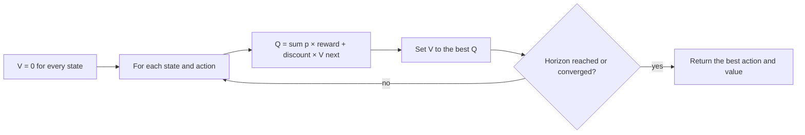
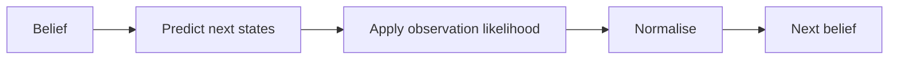

# Model-based planners

`MDPPlanner` and `POMDPPlanner` plan over a world model the host supplies. They are useful when an
action has delayed consequences, uncertain outcomes or a cost to waiting, and the host can describe
the states, transitions and rewards.

## MDP

A **Markov Decision Process** models a sequence of decisions. At each step the app is in a state,
chooses an action, the world moves to a next state with a probability, and the action earns a
reward. The next state depends on the current state and the action.

### Model

`MdpTransition`:

| Field | Meaning |
|---|---|
| `state` | The source state. |
| `action` | The action taken. |
| `next_state` | The destination state. |
| `probability` | `0..1`. |
| `reward` | The reward for this transition. |

`MdpModel`:

| Field | Default | Meaning |
|---|---|---|
| `states` | required | unique state names |
| `actions` | required | unique action names |
| `transitions` | required | the `MdpTransition` rows |
| `start` | required | the start state |
| `discount` | `0.9` | how much future reward matters, `0..1` |
| `horizon` | `20` | steps to plan, or `None` for convergence |

The model validates that the start state and every transition refer to known states and actions. For
every state/action pair with rows, the probabilities must sum to `1.0` within `1e-6`.

```python
from laix import MdpModel, MdpTransition

model = MdpModel(
    states=("s0", "s1", "s2"),
    actions=("go", "stay"),
    transitions=(
        MdpTransition("s0", "go", "s1", 1.0, 1.0),
        MdpTransition("s0", "stay", "s0", 1.0, 0.0),
        MdpTransition("s1", "go", "s2", 1.0, 2.0),
        MdpTransition("s1", "stay", "s1", 1.0, 0.0),
    ),
    start="s0",
    discount=0.9,
    horizon=2,
)
```

### Value iteration

```text
V(s) = max over actions of
       sum over next states of
       P(next | s, action) × (reward + discount × V(next))
```



| Function | Result |
|---|---|
| `value_iteration(model, horizon=None, tolerance=1e-9, max_iterations=1000)` | the value of every state |
| `action_values(model, state, values=None)` | `(action, value)` rows in descending value order |
| `plan_actions(model, state=None)` | the greedy action sequence |

A finite `horizon` limits the lookahead. `horizon=None` iterates to convergence or
`max_iterations`. A horizon of zero returns all-zero values. The planner uses the values of the
states reached after the first action, so the action values use a lookahead of `horizon - 1`.

### `MDPPlanner`

```python
from laix import DecisionProblem, MDPPlanner

plan = MDPPlanner(model).solve(
    DecisionProblem(subject="choose", at="2026-11-01T10:00:00+00:00")
)
print(plan.action_id, plan.score)
```

| Item | Value |
|---|---|
| Name | `mdp.v1` |
| State | `problem.attributes["state"]`, else the constructor state, else `model.start` |
| Success reason | `mdp_plan` |
| Terminal state | `wait` with `terminal_state` |
| Plan attributes | `state`, `expected_value`, `discount`, `horizon` |
| Alternatives | `action_id`, `value`, `rejected_because="lower expected value"` |

An unknown state raises `ValueError`. A terminal state has no available action and returns `wait`.

## POMDP

A **POMDP** is an MDP where the state is hidden. The planner cannot read the state directly. It keeps
a **belief**: a probability for each state. Each observation updates the belief, and the planner
chooses the action that is best under that belief.

### Model

`PomdpTransition` has `state`, `action`, `next_state`, `probability` and `reward`.

`ObservationProbability` has `next_state`, `action`, `observation` and `probability`.

`PomdpModel`:

| Field | Default | Meaning |
|---|---|---|
| `states` | required | hidden states |
| `actions` | required | actions |
| `observations` | required | observations |
| `transitions` | required | hidden-state transitions |
| `observation_table` | required | `ObservationProbability` rows |
| `discount` | `0.9` | future reward weight |
| `horizon` | `3` | planning depth |

The model validates the references, the transition probabilities and the observation probabilities
for every reachable `(next_state, action)` pair.

### Belief helpers

| Function | Result |
|---|---|
| `normalize_belief(belief, states)` | clamps, drops unknown states and renormalises |
| `belief_from_state(state, states)` | a one-hot belief |
| `belief_update(model, belief, action, observation)` | the Bayes posterior after one action and one observation |
| `observation_probability(model, belief, action, observation)` | `P(observation \| belief, action)` |
| `belief_entropy(belief)` | Shannon entropy in bits |
| `pomdp_value(model, belief, horizon=None)` | the best expected value over the horizon |
| `compare_pomdp_to_mdp(pomdp, mdp, belief, horizon=None)` | a `PlannerComparison` |

The belief update:

```text
predicted(s') = Σ_s belief(s) × P(s' | s, action)
posterior(s') ∝ predicted(s') × P(observation | s', action)
```

If the posterior has no mass, the helper returns the normalised predicted belief.



### `POMDPPlanner`

```python
from laix import DecisionProblem, POMDPPlanner, PomdpModel

plan = POMDPPlanner(model).solve(
    DecisionProblem(subject="choose", at="2026-11-01T10:00:00+00:00")
)
print(plan.action_id, plan.score)
```

The belief resolution order:

1. `problem.attributes["belief"]`;
2. the constructor belief;
3. `problem.attributes["state"]` as a one-hot belief;
4. a uniform belief over all states.

| Item | Value |
|---|---|
| Name | `pomdp.v1` |
| Horizon | `problem.attributes["horizon"]`, else `model.horizon` |
| Success reason | `pomdp_plan` |
| No action | `wait` with `no_action` |
| Plan attributes | `belief`, `entropy`, `horizon` |
| Alternatives | `action_id`, `value`, `rejected_because="lower expected value"` |

`compare_pomdp_to_mdp` is a diagnostic, not an optimality proof. It compares the belief value with
the MDP value of the most likely state; a POMDP can be worth less because uncertainty is real.

## Simulator

`Simulator` and `compare_planners` run planners over a model and report reward and optimality gap.
See the [planner contract](00-planner-contract.md#simulator).

## Limits

- A model-based planner needs a world model. The host supplies the states, transitions, rewards and
  observations; LAIX plans over them.
- The state space is explicit. Large models become expensive.
- The POMDP value grows quickly with the number of states, actions and observations. Keep the model
  small and purposeful.
- The planner is deterministic for a fixed model and belief.
- A model-based planner does not replace the live planners. It is a different decision method.

## MDP policy and LAIX policy

The MDP literature calls the best action per state a **policy**. That is not the LAIX `Policy`
layer. In LAIX, `MDPPlanner` is a planner; `EnginePolicy` is the adapter that turns it into a LAIX
policy. The two uses of the word are unrelated.

## Related

- [Planner contract](00-planner-contract.md)
- [Live planners](01-live-planners.md)
- [Calibration and model learning](../09-calibration-and-model-learning.md) — `ModelLearner` builds an
  `MdpModel` from observed transitions.
- [Simulation and evaluation](../12-evaluation.md)
