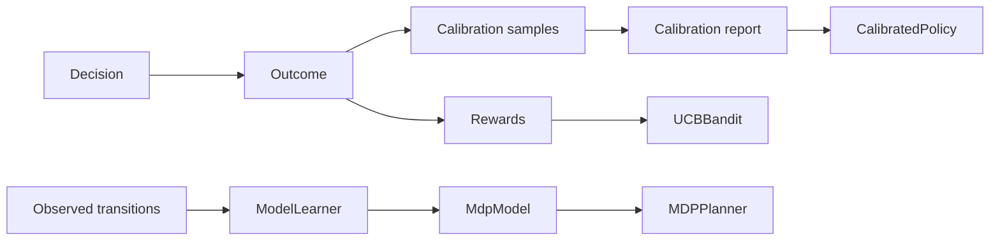

# Calibration and model learning

Two different corrections sit after the decision:

- **calibration** checks whether stated confidence matches observed correctness;
- **model learning** builds a transition model from observed transitions so a model-based planner can
  use it.

Calibration is not a planner. Model learning is not a policy. Both live in
`core/engines/learning/`.

## Prediction calibration

Prediction calibration compares confidence with accuracy.

| Type | Fields |
|---|---|
| `CalibrationSample` | `confidence`, `correct`, `policy` |
| `CalibrationBin` | `lower`, `upper`, `predicted`, `observed`, `count` |
| `CalibrationReport` | `samples`, `accuracy`, `expected`, `error`, `bins`, `policy`, `smoothing` |

`calibration_report(samples, *, bins=10, policy="", smoothing=0.0)`:

1. Bucket each sample by `min(int(confidence × bins), bins - 1)`.
2. Skip empty bins.
3. `predicted` is the mean confidence in the bin.
4. `observed` is `(correct + smoothing) / (count + 2 × smoothing)`.
5. `accuracy` is the overall correct share.
6. `expected` is the mean confidence.
7. `error` is `abs(expected - accuracy)`.

`CalibrationReport.adjust(confidence)` returns the observed rate of the matching bin. When the
confidence is exactly `1.0` and the bin ends at `1.0`, it returns that bin's observed rate.
Otherwise it applies `confidence - (expected - accuracy)` and clamps to `0..1`.

`calibration_by_policy(samples, bins=10, smoothing=0.0)` groups the report by policy name.
`samples_from_outcomes(outcomes, confidences, policies=None)` builds samples from outcomes; a
`helped` label counts as correct.

```python
from laix import calibration_report

report = calibration_report(samples, bins=10, smoothing=1.0)
adjusted = report.adjust(0.8)
```

## Decision calibration

Prediction calibration checks confidence. Decision calibration also checks whether the verb and the
action were right.

| Type | Fields |
|---|---|
| `DecisionCalibrationSample` | `confidence`, `correct`, `verb`, `action_id`, `policy` |
| `DecisionCalibrationReport` | the prediction fields plus `verb_accuracy` and `action_accuracy` |

`decision_calibration_report(samples, bins=10, policy="", smoothing=0.0)` uses the same binning and
smoothing. It adds accuracy per verb and per action over the non-empty values.

`decision_samples_from_outcomes(decisions, outcomes, policies=None)` matches decisions to outcomes by
`decision_id`. A `helped` label counts as correct.

`calibrate_decision(decision, report, source="decision-calibration")` returns a copy with:

- the adjusted confidence;
- `calibrated=True`;
- `confidence_source=source`;
- `attributes["calibration"] = {"before", "after", "samples", "accuracy"}`.

An empty report leaves the decision unchanged.

`CalibratedPolicy(policy, report, name=None)` wraps any policy and calibrates every decision it
returns. The name defaults to `<policy-name>.calibrated`.

```python
from laix import CalibratedPolicy

policy = CalibratedPolicy(base_policy, report)
decision = policy.decide(request)[0]
```

## Model learning

`ModelLearner` learns transition probabilities and expected rewards from observed transitions.

```python
from laix import ModelLearner

learner = ModelLearner(prior=0.5)
learner.observe("s0", "go", "s1", 1.0)
learner.observe("s1", "go", "s1", 2.0)
model = learner.to_mdp_model()
```

`LearnedTransition` carries `state`, `action`, `probabilities`, `expected_reward` and `count`.

| Method | Result |
|---|---|
| `observe(state, action, next_state, reward)` | Records one transition and reward. |
| `transition_probabilities(state, action)` | `(count + prior) / (total + prior × max(1, outcomes))` per next state. |
| `expected_reward(state, action)` | The mean observed reward, or `0.0`. |
| `learned()` | The `LearnedTransition` rows, sorted by state and action. |
| `to_mdp_model(states=None, actions=None, start=None, discount=0.9, horizon=20)` | An `MdpModel` from the learned table. |
| `evaluate(validation)` | Mean of `log(P(next) or 1e-9) - abs(expected_reward - reward)`. |
| `commit(validation)` | Keeps the model when its score is at least the best score; restores the best model otherwise. |
| `snapshot()` / `restore(snapshot)` | Copy and restore the learned tables. |
| `best_score` | The best committed score. |

`commit` returns `True` when the candidate is kept and `False` when it rolls back. The history keeps
one `(score, kept)` row per call.

## Where it fits



- Calibration improves the confidence on the next decision.
- `UCBBandit` improves the choice among arms.
- `ModelLearner` improves a model-based planner.

The three are independent. A host can use any of them without the others.

## Version axes

The package version is `0.10.0`. The record schema, rule sets and attention vectors are `0.8.0`.
Calibration and model learning do not change the record shape; they add reports and learned tables
that the host stores.

## Related

- [Outcome learning](08-outcome-learning.md)
- [Model-based planners](07-planning/03-model-based-planners.md)
- [Policies](06-policies.md)
- [Records and schema](02-records-and-schema.md)
- [Versioning](../05-project/versioning.md)
