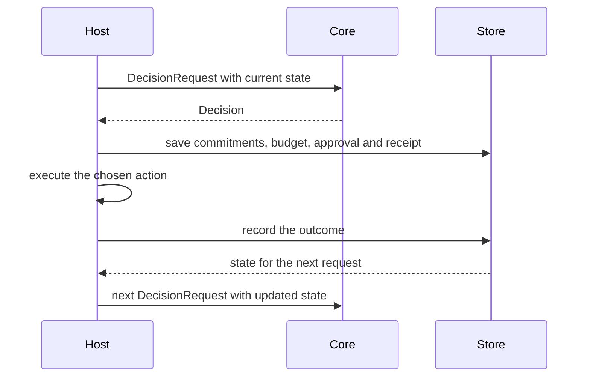

# Decision continuity

A LAIX decision is one step in a sequence. The next decision sees what the previous one left behind:
promises, attention budget, approvals, revisions, receipts and outcomes. Decision continuity is the
property that each step starts from the current state instead of from zero.

This is what makes LAIX a runtime rather than a one-shot classifier. The core stays stateless; the
host passes the current state into the next request.

## What carries forward

| State | Shape | Where it lives |
|---|---|---|
| Open commitments | `Commitment`, `CommitmentLedger` | core commitments and the host store |
| Attention budget | `AttentionBudget` | decision attributes |
| Approval state | `Decision.requires_approval`, `DecisionRecord` | the decision and the audit record |
| Prior decisions and revisions | `DecisionTimeline` | app-kit streaming |
| Receipts and recovery | `ExecutionBridge`, `Saga` | app-kit runtime |
| Outcomes and calibration | `Outcome`, `OutcomeStore`, `CalibrationReport` | core learning and host stores |

## How state reaches the next decision

1. The previous decision may fulfill, violate or create a commitment.
2. It may spend part of a shared attention budget.
3. It may require approval or leave an execution receipt.
4. It may supersede an earlier decision and produce a revision.
5. Its outcome may update a calibration report or a learner.

The next `DecisionProblem` carries the commitments, budget, approvals and receipts that matter. The
planner scores the current options against that state. `LiveDecisionEngine` does this for utility,
commitments, execution risk and attention in one plan.

## A sequence

| Step | Decision | State after |
|---|---|---|
| 1 | acts and creates commitment `c1` | `c1` open; budget 0.6 spent; receipt pending |
| 2 | asks because `c1` is due and the budget is low | `c1` open; approval pending |
| 3 | verifies after execution | receipt unknown; `c1` still open |
| 4 | acts on the verified result | `c1` fulfilled; receipt recorded; outcome stored |
| 5 | the next decision | calibration and the new state are available |

The exact path depends on the policy. The invariant is that no step starts from zero.

## What the core owns

LAIX evaluates the state and returns the decision. The host and the app kit own persistence:

- the host owns the durable store and retention;
- `CommitmentStore` and `OutcomeStore` define the persistence ports;
- `DecisionTimeline` defines revision and event-time semantics;
- `DecisionRecord` defines the audit lifecycle.

## Continuity benchmark

The continuity benchmark isolates the mechanism. Each episode is five decisions. A stateless
`UtilityPlanner` sees a static option set and no episode state. A stateful `LiveDecisionEngine` sees
the open commitment, attention budget, approval state and execution receipt.

| Policy | Episode success | Promise kept | Budget adhered | Approval correct | Continuity errors |
|---|---:|---:|---:|---:|---:|
| Reference | 100% | 100% | 100% | 100% | 0 |
| Stateless `UtilityPlanner` | 0% | 100% | 0% | 100% | 36 |
| Stateful `LiveDecisionEngine` | 100% | 100% | 100% | 100% | 0 |

The corpus has 12 episodes and 60 decisions. The stateful policy completes every episode. The
stateless policy repeats actions because it cannot see that the commitment was fulfilled, the
attention budget was spent and the receipt was pending.

The benchmark is a synthetic mechanism test with a designed action space. It shows that the runtime
uses the supplied state. The corpus and result are in
[`benchmarks/continuity/v1/`](../../benchmarks/continuity/v1/README.md) and
[`results/continuity-benchmark/`](../../results/continuity-benchmark/README.md). The design note is
[the continuity benchmark page](../06-research/02-evaluation/continuity-benchmark.md).

## Why it matters

- A one-shot classifier answers one question. LAIX carries the consequences into the next decision.
- An orchestration framework carries state. LAIX adds decision semantics to that state.
- Glue code can copy a decision object. A coherent sequence is where the integration shows.

## Related

- [Commitments](05-commitments.md)
- [Human-attention planning](07-planning/01-live-planners.md#human-attention-planner)
- [Outcome learning](08-outcome-learning.md)
- [Streaming decisions](../03-appkit/02-streaming.md)
- [Stores](../03-appkit/05-stores.md)
- [Execution and recovery](../03-appkit/04-execution.md)
