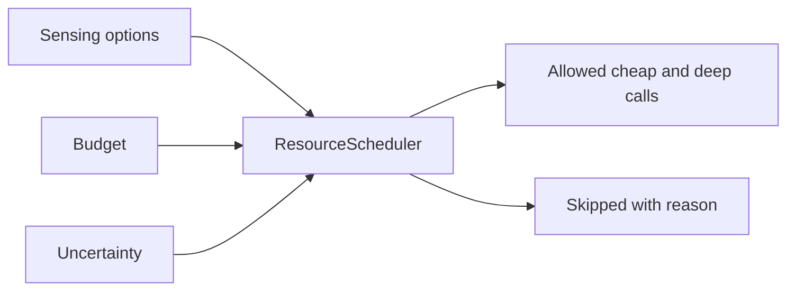

# Resources and scheduling

Resources are compute, latency and sensing capacity. They are different from the human-attention
budget:

- **Resource budget** limits how much work the runtime may do: deep calls, cost and latency.
- **Attention budget** limits how often a decision may involve a person: interruption, approval and
  escalation.

`HumanAttentionPlanner` uses `AttentionBudget`. `ResourceScheduler` uses `Budget`.

## Budget

`Budget`:

| Field | Default | Meaning |
|---|---:|---|
| `max_deep_calls` | 4 | Maximum deep calls in one schedule. |
| `max_cost` | 1.0 | Maximum total cost. |
| `max_latency_ms` | 2000 | Maximum latency for one deep option. |

## Sensing option

`SensingOption`:

| Field | Default | Meaning |
|---|---:|---|
| `name` | required | Option name. |
| `tier` | `cheap` | `cheap` or `deep`. |
| `cost` | 0.0 | Cost of the option. |
| `latency_ms` | 0 | Latency of the option. |
| `information_gain` | 0.0 | Expected gain, clamped `0..1`. |

An unknown tier is rejected.

## Resource scheduler

`ResourceScheduler(min_information_gain=0.35)` admits cheap and deep options under a budget.

```python
from laix import Budget, ResourceScheduler, SensingOption

plan = ResourceScheduler().schedule(
    (
        SensingOption(name="cache", tier="cheap", cost=0.0, latency_ms=2),
        SensingOption(name="model", tier="deep", cost=0.4, latency_ms=800, information_gain=0.6),
    ),
    budget=Budget(max_deep_calls=2, max_cost=1.0, max_latency_ms=1000),
    uncertainty=0.7,
)
print(plan.allowed, plan.skipped)
```

Admission:

| Tier | Rule |
|---|---|
| `cheap` | Always admitted. It adds cost but not a deep call. |
| `deep` | Checked in order: deep-call count, cost, latency, then information gain. |

The deep checks:

1. `deep_calls >= budget.max_deep_calls` → `deep-call budget exhausted`;
2. `cost + option.cost > budget.max_cost` → `cost budget exhausted`;
3. `option.latency_ms > budget.max_latency_ms` → `latency budget exceeded`;
4. `information_gain × max(uncertainty, 0.05) < min_information_gain` → `information gain below
   threshold`.

A skipped deep option is recorded in `ResourcePlan.skipped` with its name, reason and gain.

`ResourcePlan`:

| Field | Meaning |
|---|---|
| `allowed` | Admitted option names. |
| `skipped` | Dicts with `name`, `reason` and `gain`. |
| `deep_calls` | Number of admitted deep calls. |
| `cost` | Total admitted cost. |
| `reason` | The plan rationale. |
| `attributes` | `uncertainty` and `threshold`. |

`to_dict()` uses the keys `allowed`, `skipped`, `deepCalls`, `cost`, `reason` and `attributes`.

`ResourceScheduler.should_escalate(confidence, required=0.75)` returns `True` when the confidence is
below the requirement.

## Where it fits



The scheduler decides which looks are affordable. It does not choose the decision verb. The action
policy, a planner or the host uses the allowed looks.

## Where the code lives

| Path | Contents |
|---|---|
| `core/engines/resources/budget.py` | `Budget` |
| `core/engines/resources/sensing_option.py` | `SensingOption` |
| `core/engines/resources/plan.py` | `ResourcePlan` |
| `core/engines/resources/scheduler.py` | `ResourceScheduler` |

## Related

- [Human-attention planning](07-planning/01-live-planners.md#human-attention-planner)
- [Signal attention](04-signal-attention.md)
- [Foundation](13-foundation.md) — perception records
- [Live Context](../03-appkit/03-live-context.md)
