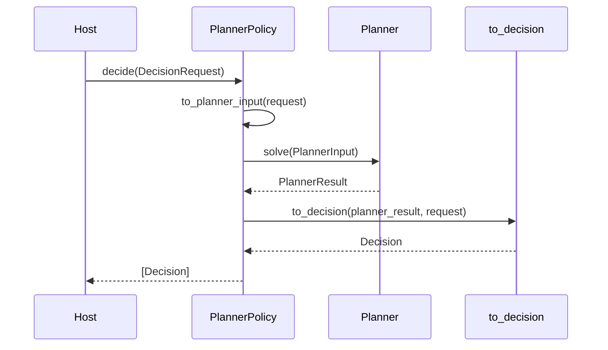

# The planner contract

Planners are optional. A host can use signal attention and the packaged policies without a planner.
A planner adds a formal choice over the options the host already supplied.

The contract has three pieces:

- `PlannerInput` goes in;
- `PlannerResult` comes out;
- `Planner` is the `solve` interface.

`PlannerPolicy` adapts a planner or composite planner to the policy interface.

## `PlannerInput`

`PlannerInput` is the planner input. `to_planner_input` projects a `DecisionRequest` onto it.

| Field | Type | Meaning |
|---|---|---|
| `subject` | `str` | What the problem is about. |
| `at` | ISO-8601 `str` | The decision moment. |
| `situation` | `Situation \| None` | Observations, beliefs, goals and constraints. |
| `options` | `tuple[ActionOption, ...]` | Actions the planner may choose. |
| `signals` | `tuple` | Signals, when the planner needs them. |
| `context` | `SignalContext \| None` | Signal context, when the planner needs it. |
| `attributes` | `dict` | Planner-specific state and inputs. |

The projection carries `subject`, `at`, `situation`, `options`, `signals`, `context` and
`attributes` from the request. Target, recipients, deadline and confidence belong to the delivery
envelope; the planner works on the problem.

## `PlannerResult`

`PlannerResult` is the planner answer, before it becomes a `Decision`.

| Field | Type | Meaning |
|---|---|---|
| `verb` | `str` | The chosen verb. |
| `confidence` | `float` | The planner confidence, `0..1`. |
| `reason_code` | `str` | The planner reason. |
| `rationale` | `str` | Human-readable explanation. |
| `action_id` | `str \| None` | The chosen option. |
| `intent` | `Intent \| None` | The action the host can execute. |
| `requires_approval` | `bool` | A person must approve. |
| `reversible` | `bool` | The chosen option can be undone. |
| `undo_hint` | `str \| None` | How to undo it. |
| `score` | `float \| None` | The planner ranking value. |
| `alternatives` | `tuple[dict, ...]` | Options that lost and why. |
| `attributes` | `dict` | Planner-specific breakdown. |

A planner returns one `PlannerResult`. `PlannerPolicy` converts it into one `Decision`.

## `Planner`

```python
class Planner(Protocol):
    def solve(self, problem: PlannerInput) -> PlannerResult: ...
```

Every built-in planner and `LiveCompositePlanner` implements this method. An external planner can
implement it too.

## Sequence planner

A chain of decisions uses a different protocol. `SequencePlanner` lives in
`decision/planners/sequence/contract.py`:

```python
class SequencePlanner(Protocol):
    name: str

    def plan(self, scenario: DecisionScenario) -> DecisionPlan: ...
```

`DecisionStep`, `DecisionScenario` and `DecisionPlan` are the sequence records:

| Type | Carries |
|---|---|
| `DecisionStep` | `at` and the options at that moment |
| `DecisionScenario` | steps, commitments, attention budget and open-commitment penalty |
| `DecisionPlan` | actions, score, attention spent, violations, nodes and optimality |

A `Planner` answers one live decision. A `SequencePlanner` answers a finite chain. See
[Sequence](../03-decision-shapes/02-sequence.md).

## `PlannerPolicy`

`PlannerPolicy` is the bridge between the two shapes:

```python
from laix import PlannerInput, PlannerPolicy, PlannerResult

policy = PlannerPolicy(planner)
decision = policy.decide(request)[0]
```

| Member | Meaning |
|---|---|
| `planner` | The `Planner` instance. |
| `name` | The policy name; `"planner.v1"` by default. |
| `version` | Same as `name`. |
| `decide(request, *, decision_id="", trace_id="")` | Projects, solves and converts. |

The conversion is `to_decision(planner_result, request, ...)`:

- copies the planner result fields onto `Decision`;
- sets `policy_version` to the `PlannerPolicy` name;
- merges `request.attributes` and `planner_result.attributes`, with the planner result winning on a key collision.

`to_planner_input` and `to_decision` are public. An adapter that calls a composite planner directly can use them, so
every planner path returns the same `Decision`.

## Call sequence



## External planners

An external planner can be a classifier, an optimizer or a model service. Wrap it in a thin adapter
that returns a `PlannerResult`:

```python
from laix import PlannerInput, PlannerPolicy, PlannerResult

class MyPlanner:
    name = "my-planner.v1"

    def solve(self, problem: PlannerInput) -> PlannerResult:
        return PlannerResult(
            verb="act",
            confidence=0.88,
            reason_code="my_choice",
            rationale="the optimal solver chose the valve",
            action_id="valve",
            score=0.91,
        )

decision = PlannerPolicy(MyPlanner()).decide(request)[0]
```

The adapter owns the mapping from the external output to the `PlannerResult` fields. The policy owns the
conversion to `Decision`.

## Simulator

`Simulator`, `Scenario`, `SimulationReport` and `compare_planners` are described in
[Simulation](../06-evaluation/03-simulation.md).

## Design rules

1. A planner scores the options the host offers.
2. A planner returns one `PlannerResult` and the same shape as every other planner.
3. A planner is deterministic unless the host supplies a model or a random source.
4. Hard limits gate the choice. A planner may also block on its own concern.
5. A planner result is explainable: chosen option, alternatives, score and reason.
6. `LiveCompositePlanner` composes planners; it does not replace them.
7. A planner can be replaced without changing the request or the response handling.

## Where the code lives

| Path | Contents |
|---|---|
| `decision/contract/planner_input.py` | `PlannerInput` |
| `decision/contract/planner_result.py` | `PlannerResult` |
| `decision/contract/planner.py` | `Planner` |
| `decision/contract/planner_policy.py` | `PlannerPolicy`, `to_planner_input`, `to_decision` |
| `decision/planners/sequence/contract.py` | `SequencePlanner`, `DecisionScenario`, `DecisionStep`, `DecisionPlan` |
| `decision/evaluation/simulation/` | simulator, scenarios and report |
| `decision/planners/single/` | the built-in planners |
| `decision/planners/single/composite/` | the composite planner |
| `decision/planners/sequence/` | CABB, rollout and replan for finite-horizon sequences |

## Related

- [Policies](../03-decision-shapes/01-single/05-policies.md) — `PlannerPolicy` as a policy.
- [Single-decision planners](../03-decision-shapes/01-single/01-planners.md) — the four live planners.
- [Composite planner](../03-decision-shapes/01-single/02-composite.md) — composition.
- [Model-based planners](../03-decision-shapes/01-single/03-model-based.md) — MDP and POMDP.
