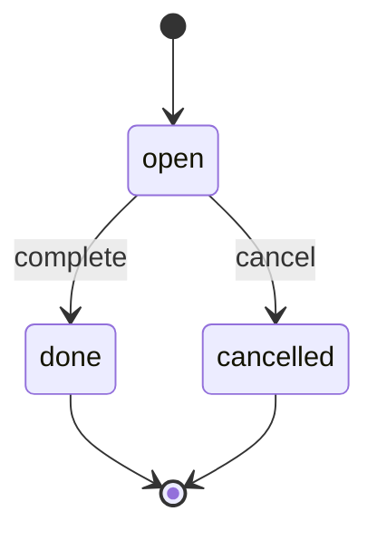
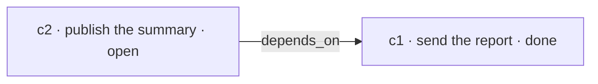
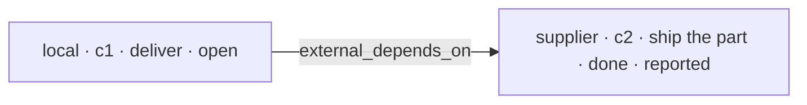

# Commitments

A commitment is a promise the task has already made. LAIX treats it as decision state, not as a note
beside the decision. An action can fulfill a promise, break one or create a new one, and the
commitment planner scores that effect with the rest of the decision.

A promise can also belong to another owner. A `CommitmentGraph` adds those external promises to the
local ledger, so the planner can see that an action depends on work somebody else must finish first.

## The shape

| Field | Type | Meaning |
|---|---|---|
| `id` | `str` | Stable identity used by options and the ledger. |
| `subject` | `str` | The promised outcome. |
| `due` | ISO-8601 `str \| None` | When the promise is due. |
| `status` | `str` | `open`, `done` or `cancelled`. |
| `depends_on` | `tuple[str, ...]` | Local commitments that must be `done` first. |
| `external_depends_on` | `tuple[CommitmentRef, ...]` | Another owner's commitments that must be `done` first. |
| `priority` | `float` | Importance in `0..1`. The default is `0.5`. |
| `owner` | `str` | Who made the promise. The default is `"local"`. |
| `ledger` | `str \| None` | Optional namespace when one owner keeps several ledgers. |
| `source` | `str` | How the promise is known: `local`, `reported` or `verified`. |
| `verified_at` | ISO-8601 `str \| None` | When a verifier last confirmed a `verified` promise. |
| `payload` | `dict` | Host-owned detail. Keep sensitive data in the host. |

`COMMITMENT_STATUSES` is the tuple `("open", "done", "cancelled")` and `COMMITMENT_SOURCES` is
`("local", "reported", "verified")`. `Commitment.__post_init__` rejects an unknown status or source.
`is_due(now)` compares `due` with the supplied clock. `to_dict()` and `from_dict()` round-trip the
shape.

```python
from laix import Commitment

commitment = Commitment(
    id="c1",
    subject="send the report",
    due="2026-11-01T09:00:00+00:00",
    priority=0.8,
)
```

## Trust

`source` describes how much LAIX should trust a promise:

| Source | Meaning | Treated as trusted |
|---|---|---|
| `local` | This host made and updates the promise. | yes |
| `reported` | Another party reported it; the host has not checked it. | no |
| `verified` | The host says a verifier confirmed it; `verified_at` records when. | yes |

`verified` is a **host assertion, not a proof**. LAIX records that the host says it checked the
promise; it does not sign, verify or fetch anything. `verified_at` is metadata, not a signature.
The graph does not expire it unless you ask for a maximum age.

`reported` is the safe default for another party's commitment. It is enough for planning that can
tolerate uncertainty, but it does not satisfy a dependency that requires verification. A local ledger
cannot resolve another owner at all; that is why `CommitmentGraph` takes already-resolved external
commitments from the host. The graph is a snapshot: if the supplier's status changes, the host must
refresh the commitment.

LAIX does not provide signatures, attestations, a shared commitment protocol, a hosted resolver,
multi-party negotiation or settlement. Those belong to the host or to a product layer above LAIX.

## Freshness

`verified_at` only matters when the host asks about freshness. The graph does not expire a
verification by itself.

```python
from datetime import datetime, timedelta

now = datetime.fromisoformat("2026-11-01T10:00:00+00:00")
max_age = timedelta(hours=24)

graph.stale_refs(now, max_age)
graph.blocked(
    commitment,
    require_verified=True,
    now=now,
    max_verification_age=max_age,
)
```

A stale verification is a blocker with reason `stale`. `CommitmentPlanner` accepts
`max_verification_age` and treats a stale `verified` dependency like an unverified one. `local` and
`reported` promises are not aged by this rule.


## The ledger

`CommitmentLedger` is the in-memory view of the promises for one task. The host saves it through a
`CommitmentStore`.

| Method | Result |
|---|---|
| `add(commitment)` | Stores and returns the commitment. |
| `get(id)` | Returns one commitment. |
| `complete(id)` | Marks it `done` and returns the updated copy. |
| `cancel(id)` | Marks it `cancelled` and returns the updated copy. |
| `all()` | Every commitment, including done and cancelled ones. |
| `open()` | Only the commitments with status `open`. |
| `due(now)` | Open commitments whose due time is at or before `now`. |
| `next(now=None)` | The first open commitment by due time, priority and id. |
| `next_actionable(now=None)` | The first open commitment whose dependencies are all `done`. |
| `blocked_open()` | Open commitments that still wait on another commitment. |
| `blocked(commitment)` | Whether one commitment waits on an unfinished dependency. |
| `to_dict()` / `from_dict(payload)` | Round-trip the ledger. |

The ordering key is `(due, -priority, id)`. A missing due time sorts last. `next_actionable` filters
blocked commitments before applying the same order. `next` and `next_actionable` accept `now` for a
uniform signature but do not filter by due time; use `due(now)` for that.

```python
from laix import Commitment, CommitmentLedger

ledger = CommitmentLedger(
    (
        Commitment(id="c1", subject="send the report", priority=0.8),
        Commitment(id="c2", subject="publish the summary", depends_on=("c1",)),
    )
)

print(ledger.next().id)                 # c1
print(ledger.next_actionable().id)      # c1
print([item.id for item in ledger.blocked_open()])  # ['c2']

ledger.complete("c1")
print(ledger.next_actionable().id)      # c2
```

## Status and dependencies





A commitment is actionable when every id in `depends_on` resolves to a commitment with status
`done`. A missing dependency counts as unfinished. A blocked commitment stays open; the ledger
reports it through `blocked_open()` and excludes it from `next_actionable()`.

`CommitmentLedger.blocked()` only knows local ids. It treats every `external_depends_on` reference
as unresolved, because one local ledger cannot see another owner. Use a `CommitmentGraph` to
resolve those references.

## The graph across owners

`CommitmentGraph` combines the local ledger with commitments owned by other parties:

```python
from laix import Commitment, CommitmentGraph, CommitmentLedger, CommitmentRef

local = CommitmentLedger(
    (
        Commitment(
            id="c1",
            subject="deliver to the customer",
            external_depends_on=(
                CommitmentRef(owner="supplier", ledger="supplier", id="c2"),
            ),
        ),
    )
)
external = (
    Commitment(
        id="c2",
        subject="ship the part",
        owner="supplier",
        ledger="supplier",
        status="done",
        source="reported",
    ),
)

graph = CommitmentGraph(local, external)
print(graph.blocked(local.get("c1")))                          # False
print(graph.blocked(local.get("c1"), require_verified=True))   # True
```

The graph never fetches remote state. The host resolves external commitments and passes them in;
the graph only reasons about the result. The app kit exposes a small `CommitmentResolver` port, an
`AsyncCommitmentResolver` variant and the `resolve_commitment_graph` /
`resolve_commitment_graph_async` helpers for hosts that want the same shape.

| Method | Result |
|---|---|
| `get(ref)` / `resolve(ref)` | The commitment behind an owner-qualified reference, or `None`. |
| `dependencies(commitment)` | Local ids plus external references, as `CommitmentRef` values. |
| `is_fresh(commitment, now, max_age)` | Whether a `verified` promise is inside its verification window. |
| `stale_refs(now, max_age)` | Verified promises older than `max_age`. |
| `blockers(commitment, require_verified=False, now=None, max_verification_age=None)` | Every dependency that is missing, open, unverified or stale. |
| `blocked(...)` | Whether at least one blocker remains. |
| `blocked_open(...)` | Open local commitments with a blocker. |
| `next_actionable(now=None, ...)` | The earliest open local commitment without a blocker. |
| `missing_refs(commitment=None)` | References that resolve nowhere in the graph. |
| `unverified_refs()` | Resolved dependencies marked `reported`. |
| `validate(now=None, max_verification_age=None)` | A `CommitmentGraphReport` with missing refs, cycles and stale refs. |
| `ancestors(ref)` | Everything the commitment depends on, directly or transitively. |
| `descendants(ref)` / `impact(ref)` | Everything that would be affected by a change to this commitment. |
| `chain(ref)` | The longest dependency chain that starts at this commitment. |
| `critical_path()` | The longest dependency chain in the graph. |
| `cycles()` | Dependency cycles, each as an ordered list of references. |
| `subgraph(refs)` | The induced subgraph for the supplied references. |
| `neighborhood(ref)` | The commitment, its ancestors and its descendants. |
| `redacted(keep_subject=False)` | A copy with payloads removed and subjects hidden by default. |
| `to_mermaid()` / `to_dot()` | Export the graph as a Mermaid flowchart or Graphviz digraph. |
| `to_dict()` / `from_dict(payload)` | Round-trip the local ledger and external commitments. |

Each blocker carries a `ref`, the resolved `commitment` (or `None`) and a `reason` of `missing`,
`open`, `unverified` or `stale`.



A reference is the triple `(owner, ledger, id)`. Two owners may use the same commitment id; the
owner and ledger keep them apart. Duplicate references in one graph are rejected.

## The store

`CommitmentStore` is the persistence port:

```python
class CommitmentStore:
    def save(self, key: str, ledger: CommitmentLedger) -> None: ...
    def load(self, key: str) -> CommitmentLedger | None: ...
    def delete(self, key: str) -> None: ...
```

`InMemoryCommitmentStore` is for tests and short-lived tasks. `FileCommitmentStore` writes one file
per key. The host can implement the port with its own database.

## How commitments enter a decision

The host passes commitments in `DecisionRequest.attributes`:

```python
DecisionRequest(
    ...,
    attributes={"commitments": ledger},
)
```

The planner reads the same value from `PlannerInput.attributes`. It accepts the `commitments`
key or the `commitment_ledger` alias. The accepted forms are:

- a `CommitmentLedger`;
- a tuple of `Commitment` objects;
- a mapping with a `commitments` key that `Commitment.from_dict` can read.

To reason about another owner, pass a `CommitmentGraph` under `commitment_graph`. The planner then
uses its local ledger and resolves external references. Without a graph, the planner builds one from
`commitments` plus an optional `external_commitments` list:

```python
PlannerInput(
    ...,
    attributes={
        "commitment_graph": graph,
        # or:
        "commitments": local_ledger,
        "external_commitments": [supplier_commitment],
    },
)
```

The planner asks the graph with `require_verified=True` by default, so a `reported` external
dependency does not count as done. Pass `require_verified=False` to `CommitmentPlanner` when the host
accepts reported dependencies, and pass `max_verification_age` to reject stale `verified` ones.
Fulfilling a hard commitment while it is blocked makes the option infeasible, just like breaking it.
The alternative records `blocked hard commitment: ...`, and the result attributes include
`commitments_blocked_fulfilled` and `commitments_blocked_by` with `{owner, ledger, id, reason}`
entries.

The commitment planner then scores an option's declared effect:

```python
ActionOption(
    id="send-later",
    verb="act",
    name="send later",
    params={
        "commitments": {
            "fulfills": ["c1"],
            "violates": ["c2"],
            "creates": ["c3"],
            "hard": True,
        }
    },
)
```

The effect can also be written under `params["commitment"]` or at the top level of `params` without
a wrapper. The scoring rules, weights and returned attributes are on the
[commitment planner page](../03-decision-shapes/01-single/01-planners.md#commitment-planner).

`PlanningPolicy` consumes a ledger and turns the next actionable commitment into a decision. The
constructor, the exact reason codes and the policy contract are on the
[policies page](../03-decision-shapes/01-single/05-policies.md#planning-policy).

### A worked example across owners

The same local promise, planned twice: once with a `reported` supplier commitment and once with a
`verified` one.

```python
from laix import (
    ActionOption,
    Commitment,
    CommitmentGraph,
    CommitmentLedger,
    CommitmentPlanner,
    CommitmentRef,
    PlannerInput,
)

supplier = CommitmentRef(owner="supplier", ledger="supplier", id="ship")
local = CommitmentLedger(
    (
        Commitment(
            id="deliver",
            subject="deliver to the customer",
            external_depends_on=(supplier,),
        ),
    )
)


def decide(external: Commitment):
    problem = PlannerInput(
        subject="deliver",
        at="2026-11-01T10:00:00+00:00",
        options=(
            ActionOption(
                id="finish",
                verb="act",
                name="finish the delivery",
                expected_benefit=1.0,
                params={"commitments": {"fulfills": ["deliver"], "hard": True}},
            ),
            ActionOption(
                id="wait",
                verb="wait",
                name="wait for verification",
                expected_benefit=0.1,
            ),
        ),
        attributes={"commitment_graph": CommitmentGraph(local, (external,))},
    )
    return CommitmentPlanner().solve(problem)


reported = Commitment(
    id="ship",
    subject="ship the part",
    owner="supplier",
    ledger="supplier",
    status="done",
    source="reported",
)
verified = Commitment(
    id="ship",
    subject="ship the part",
    owner="supplier",
    ledger="supplier",
    status="done",
    source="verified",
    verified_at="2026-11-01T09:30:00+00:00",
)

print(decide(reported).action_id)  # wait
print(decide(verified).action_id)  # finish
```

The supplier's status is the same in both calls. Only the trust source changes. In TypeScript the
same example uses `externalDependsOn`, `verifiedAt` and `new CommitmentGraph(local, [external])`.

## What the host owns

- the subject and the due time;
- the priority and the dependency graph;
- the durable store and retention;
- whether a commitment is done or cancelled;
- the mapping from an action to a fulfillment or a violation;
- authenticating the source that supplies another owner's commitments;
- resolving those commitments, setting `source` / `verified_at`, and deciding when a verification is
  still fresh enough to use.

LAIX owns the decision and the record. The host sends the report, publishes the summary, decides that
a promise was kept and records the outcome. It also decides which external promises are only
`reported` and which have been `verified`.

## Related

- [Decision contract](../01-contract/01-decision-contract.md)
- [Policies](../03-decision-shapes/01-single/05-policies.md) — `PlanningPolicy`
- [Single-decision planners](../03-decision-shapes/01-single/01-planners.md#commitment-planner) — `CommitmentPlanner`
- [Stores](../../03-appkit/04-connect/01-stores.md) — `CommitmentStore` and `CommitmentResolver`
