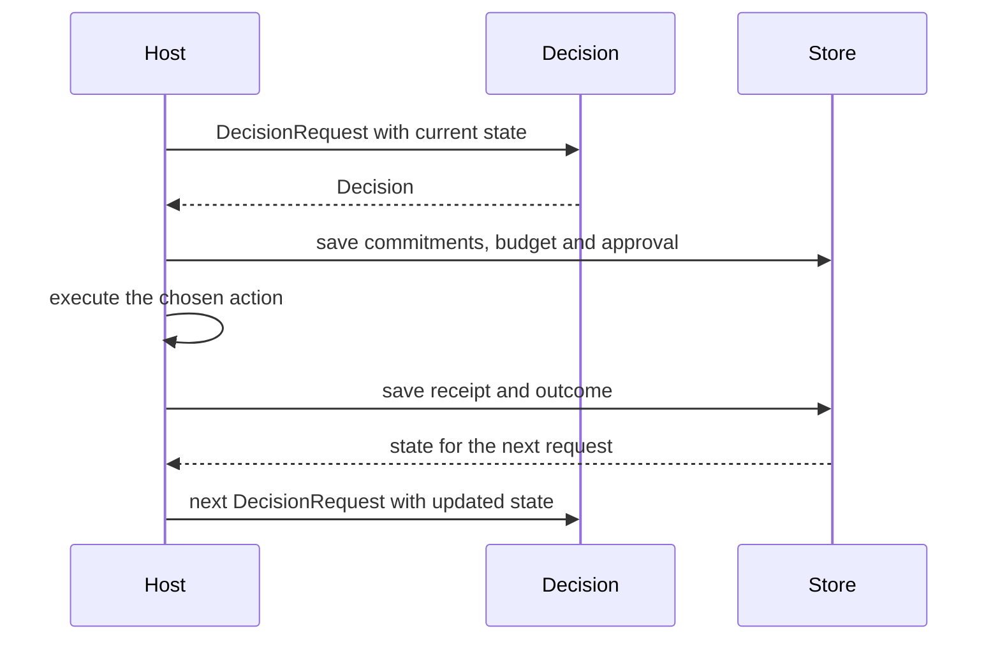

# Decision history

A LAIX decision is one step in a sequence. The next decision sees what the previous one left behind:
promises, human-attention budget, approvals, revisions, receipts and outcomes. Decision continuity is the
property that each step starts from the current state instead of from zero.

This is what makes LAIX stateful rather than a one-shot classifier. The decision layer stays stateless; the
host passes the current state into the next request.

## What carries forward

| State | Shape | Where it lives |
|---|---|---|
| Open commitments | `Commitment`, `CommitmentLedger` | decision domain commitments and the host store |
| Human-attention budget | `HumanAttentionBudget` | decision attributes |
| Approval state | `Decision.requires_approval`, `DecisionRecord` | the decision and the audit record |
| Prior decisions and revisions | `DecisionTimeline` | app-kit streaming |
| Receipts and recovery | `ExecutionBridge`, `Saga` | app kit |
| Outcomes and calibration | `Outcome`, `OutcomeStore`, `CalibrationReport` | decision domain outcomes and host stores |

Outcomes and calibration are described in [Outcomes](../02-domain/03-outcomes.md) and
[Learning](../05-learning/README.md).

## How state reaches the next decision



1. The previous decision may fulfill, violate or create a commitment.
2. It may spend part of a shared human-attention budget.
3. It may require approval or leave an execution receipt.
4. It may supersede an earlier decision and produce a revision.
5. Its outcome may update a calibration report or a learner.

The next `DecisionRequest` carries the commitments, budget, approvals and receipts that matter. The
planner receives them in `PlannerInput.attributes` and scores the current options against that
state. `LiveCompositePlanner` does this for utility, commitments, execution risk and attention in one
planner result.

## A sequence

| Step | Decision | State after |
|---|---|---|
| 1 | acts and creates commitment `c1` | `c1` open; budget 0.6 spent; receipt pending |
| 2 | asks because `c1` is due and the budget is low | `c1` open; approval pending |
| 3 | verifies after execution | receipt unknown; `c1` still open |
| 4 | acts on the verified result | `c1` fulfilled; receipt recorded; outcome stored |
| 5 | the next decision | calibration and the new state are available |

The exact path depends on the policy. The invariant is that no step starts from zero.

## CDR: continuity decision repair

`repair_continuity` finds explicit conflicts and rule-derived conflicts in a decision history. It
supersedes the cheaper side of each conflict.

```python
from laix import ContinuityRecord, repair_continuity

plan = repair_continuity(
    (
        ContinuityRecord(id="approval-1", kind="approval", status="rejected", refs=("order-1",), cost=1.0),
        ContinuityRecord(id="receipt-1", kind="receipt", status="executed", refs=("order-1",), cost=3.0),
    )
)
print(plan.actions)
```

`consistent` reports whether the input history was already consistent; a plan with conflicts still
contains the actions that repair them.

The default repair is greedy. Pass `exact=True` to solve the minimum-weight vertex cover over the
conflict graph by branch and bound:

```python
from laix import repair_continuity

plan = repair_continuity(records, exact=True)
print(plan.total_cost, [action.record_id for action in plan.actions])
```

The exact path is exponential in the worst case but fast on small decision histories. The full
method remains incremental truth maintenance with a weighted MaxSAT repair.

## What the decision layer owns

LAIX evaluates the state and returns the decision. The host and the app kit own persistence:

- the host owns the durable store and retention;
- `CommitmentStore` and `OutcomeStore` define the persistence ports;
- `DecisionTimeline` defines revision and event-time semantics;
- `DecisionRecord` defines the audit lifecycle.

## Why it matters

The [continuity benchmark](../06-evaluation/04-continuity-benchmark.md) measures the mechanism: 12
episodes, 60 decisions, a stateless planner and a stateful composite planner.

- A one-shot classifier answers one question. LAIX carries the consequences into the next decision.
- An orchestration framework carries state. LAIX adds decision semantics to that state.
- Glue code can copy a decision object. A coherent sequence is where the integration shows.

## Limits

The exact repair is a minimum-weight vertex cover over small histories. Large histories use the greedy
path. The full method remains incremental truth maintenance with a weighted MaxSAT repair.

## Examples

- Python: `examples/python/decision/decision/history/continuity_repair.py`
- Python: `examples/python/decision/decision/history/continuity_repair_exact.py`
- Python: `examples/python/decision/decision/history/conflict_scenario.py`
- TypeScript: `examples/typescript/decision/decision/history/continuity_repair.mts`
- TypeScript: `examples/typescript/decision/decision/history/continuity_repair_exact.mts`

## Related

- [Continuity benchmark](../06-evaluation/04-continuity-benchmark.md)
- [Commitments](../02-domain/02-commitments.md)
- [Planners](01-single/01-planners.md#human-attention-planner)
- [Outcomes](../02-domain/03-outcomes.md)
- [Evaluation](../06-evaluation/01-cases.md)
- [Streaming decisions](../../03-appkit/02-run/02-streaming.md)
- [Stores](../../03-appkit/04-connect/01-stores.md)
- [Execution and recovery](../../03-appkit/03-execute/01-execution-and-recovery.md)
