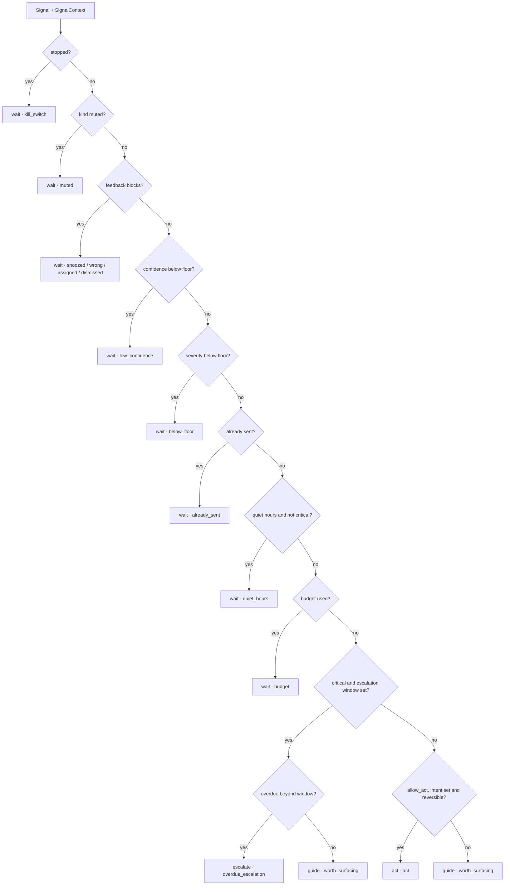

# Signal attention

Signal attention answers one question inside a task:

> Which signal deserves attention now, and what should the app do with it?

It is a deterministic gate pipeline. The first gate that fires decides the verb. The score is
recorded for explanation; the gates choose the verb.

Signal attention and `HumanAttentionPlanner` work at different levels:

- **Signal attention** ranks the signals the host sends and returns `guide`, `wait`, `act` or
  `escalate`.
- **Human-attention planning** prices interruption, approval and escalation when a planner chooses
  an action option. See [single-decision planners](../03-decision-shapes/01-single/01-planners.md#human-attention-planner).

## Scope

| DecisionClient | Owns |
|---|---|
| **Task attention** | LAIX decides about the signals the host gives it for one task. |
| **Product proactivity** | The product decides whether it may interrupt the user at all, across apps and tasks. |

A product with a global interruption rule keeps that rule and uses LAIX for task-level signal
decisions.

## Inputs

### `Signal`

| Field | Meaning |
|---|---|
| `id` | Stable signal id. It is also the dedupe key. |
| `kind` | Signal family, such as `deadline`, `risk` or `billing`. |
| `title`, `detail` | Human-readable text. |
| `severity` | `critical`, `high`, `medium`, `low` or `info`. Lower rank is more severe. |
| `confidence` | How sure the host is that the signal is real, `0..1`. |
| `due` | ISO-8601 deadline, or `None`. |
| `evidence_refs` | References that support the signal. |
| `group_key` | Optional grouping key for digests. |
| `interruption_cost` | The cost of involving a person, `0..1`. |
| `requires_approval` | Whether an action needs approval. |
| `intent` | `Intent(capability, args)` the host can execute. `None` means guide only. |
| `reversible` | Whether the intent can be undone. |
| `handover` | `Intent` used when the signal escalates. |

### `SignalContext`

| Field | Meaning |
|---|---|
| `now` | The clock for quiet hours, due times and dedupe. |
| `quiet_hours` | `("22:00", "06:00")`, `"22:00-06:00"` or `None`. The default is 22:00–06:00. |
| `mode` | The host mode, such as `shadow`. |
| `stopped` | The product kill switch. |
| `min_severity` | The least severe signal that may surface. The default is `high`. |
| `min_confidence` | The confidence floor. The default is `0.0`. |
| `muted_kinds` | Signal kinds the user muted. |
| `signal_interruption_budget` | Maximum delivered signals in one cycle, or `None`. |
| `sent` | Dedupe keys already delivered in the period. |
| `feedback` | `SignalFeedback` keyed by signal id. |
| `escalate_after_hours` | How long a critical signal may stay overdue before escalation. |
| `learned` | Per-kind point adjustment supplied by the host or a bandit. |
| `allow_act` | Allows `act` when the signal has a reversible intent. The default is `False`. |

`signal_interruption_budget` caps how many signal decisions are delivered in one `decide_signal_attention` call.
It is separate from the `HumanAttentionBudget` that `HumanAttentionPlanner` uses to price an action.

### `SignalFeedback`

| Field | Meaning |
|---|---|
| `state` | `accepted`, `dismissed`, `snoozed`, `wrong` or `assigned`. |
| `at` | When the feedback was recorded. |
| `until` | When a snooze expires. |
| `note` | Host note. |

`accepted` never suppresses. `snoozed` suppresses while `until` is in the future; a missing or
unreadable `until` keeps the signal silent. `dismissed`, `wrong` and `assigned` suppress.

`Signal.group_key` and `SignalContext.mode` are host metadata; the current gate set does not read them.

## The gate pipeline



The order is in `decision/engines/sensing/signals/gates/rules.py`. The first gate that returns a result stops the
scan. The default result is `guide` with `worth_surfacing`.

| Order | Gate | Fires when | Verb | Reason | `record` | `deliver` |
|---:|---|---|---|---|---|---|
| 1 | `kill_switch` | `context.stopped` | `wait` | `kill_switch` | false | false |
| 2 | `muted` | `signal.kind` in `context.muted_kinds` | `wait` | `muted` | false | false |
| 3 | `feedback` | `feedback_blocks(...)` returns a reason | `wait` | `snoozed`, `wrong`, `assigned` or `dismissed` | false | false |
| 4 | `low_confidence` | `signal.confidence < context.min_confidence` | `wait` | `low_confidence` | false | false |
| 5 | `below_floor` | `rank(signal.severity) > rank(context.min_severity)` | `wait` | `below_floor` | false | false |
| 6 | `already_sent` | `dedupe_key(signal, now)` in `context.sent` | `wait` | `already_sent` | false | false |
| 7 | `quiet_hours` | quiet hours and severity is not `critical` | `wait` | `quiet_hours` | true | false |
| 8 | `budget` | `signal_interruption_budget` is set and `delivered >= budget` | `wait` | `budget` | false | false |
| 9 | `overdue_escalation` | severity is `critical` and `escalate_after_hours` is set | `escalate` or `guide` | `overdue_escalation` or `worth_surfacing` | true | true |
| 10 | `act` | `allow_act`, `signal.intent` is set and `signal.reversible` | `act` | `act` | true | true |
| — | fallback | no gate fired | `guide` | `worth_surfacing` | true | true |

Three details matter:

- **Quiet hours records with `deliver=False`.** The decision stays in history with `record=True` and
  `deliver=False`.
- **A critical signal bypasses quiet hours.** If it is overdue beyond `escalate_after_hours`, it
  escalates. If it is not overdue, the gate returns `guide` and stops the scan.
- **`act` requires an opt-in and a reversible intent.** Signal attention acts only when `allow_act` is
  on, the signal has an intent and the intent is reversible.

The gate set emits the codes in the table above. `ask_approval` is defined in the `ReasonCode` enum;
approval is carried by `requires_approval` on the decision.

## The score

The score is an inspectable breakdown. It is stored on the decision and in `Decision.breakdown`, but
the gates choose the verb.

| Part | Points |
|---|---|
| Severity | `critical` 60, `high` 45, `medium` 30, `low` 15, `info` 5 |
| Due | overdue 30, within 24 h 20, within 72 h 12, within 168 h 6, later 0 |
| Confidence | `signal.confidence × 20` |
| Interruption | `-signal.interruption_cost × 20` |
| Learned | `context.learned[signal.kind]`, default 0 |
| **Total** | the sum of the five parts |

`cost_of_waiting` is `due_points × WAIT_FACTOR`, where the factor is 2.0 for `critical`, 1.5 for
`high`, 1.0 for `medium`, 0.5 for `low` and 0.25 for `info`. It is rounded to two decimals.

The bill example: `high` = 45, due within 24 h = 20, confidence `0.95 × 20` = 19, no interruption
and no learned adjustment. The total is 84, printed as `guide worth_surfacing 84.0`.

## Output

`decide_signal_attention` returns one `SignalAttentionDecision` per signal, in input order. It counts delivered
decisions while it walks the list, so the interruption budget applies within one call.

| Field | Meaning |
|---|---|
| `signal_id` | The source signal. |
| `verb` | The chosen verb. |
| `score` | The total signal-attention score. |
| `reason_code` | The gate that fired. |
| `confidence` | The signal confidence. |
| `deliver` | Whether the host should surface it now. |
| `record` | Whether the host should keep it. |
| `requires_approval` | Carried from the signal. |
| `evidence_refs` | Carried from the signal. |
| `breakdown` | The five score parts. |
| `trace_id` | `tr-` plus a SHA-1 prefix of `signal.id\|date\|verb`. |
| `intent` | The action for `act` and `ask`, the handover for `escalate`, otherwise `None`. |
| `cost_of_waiting` | Points at stake per hour of silence. |
| `reversible` | Carried from the signal. |
| `undo_hint` | `withdraw`, `cancel` or `None`. |

`from_signal_attention` converts it to the public `Decision`. The signal-attention decision uses the reason code
as its rationale; the structured explanation is in `breakdown` and `attributes`.

## Helpers

| Helper | Purpose |
|---|---|
| `dedupe_key(signal, now)` | `signal.id:YYYY-MM-DD`. |
| `trace_id(signal, now, verb)` | Stable trace id for one signal decision. |
| `hours_until(now, due)` | Hours to a deadline; negative means overdue. |
| `is_quiet(now, quiet_hours)` | Quiet-window check, inclusive on both ends. |
| `rollup(signals, limit=5)` | Most severe signals first, then the soonest due. |
| `score(signal, context)` | The five-part `ScoreBreakdown`. |
| `cost_of_waiting(signal, context)` | The waiting cost. |

## Example

```python
from datetime import datetime, timezone

from laix import SignalContext, DecisionRequest, Signal, decide

request = DecisionRequest(
    subject="electricity bill",
    at="2026-11-01T10:00:00+00:00",
    signals=(
        Signal(
            id="bill-1",
            kind="deadline",
            title="Electricity bill due tomorrow",
            severity="high",
            confidence=0.95,
            due="2026-11-02T09:00:00+00:00",
        ),
    ),
    context=SignalContext(
        now=datetime(2026, 11, 1, 10, 0, tzinfo=timezone.utc),
        quiet_hours=("22:00", "06:00"),
        min_severity="medium",
    ),
)

decision = decide(request)[0]
print(decision.verb, decision.reason_code, decision.score)
# guide worth_surfacing 84.0
```

The same bill at 23:30 returns `wait` with `quiet_hours`; the score is still 84, `record` is true and
`deliver` is false.

## Conformance

The signal-attention vectors are shared by Python and TypeScript:

- `packages/contracts/signal-attention.v1.json` — decision cases;
- `packages/contracts/signal-attention-bench.v1.json` — outcome cases.

`npm run conformance` runs the shared vectors. The LAIX-Bench `attention` suite runs the same
behaviour through the app kit. See [Evaluation](../06-evaluation/01-cases.md).

## Related

- [Decision contract](../01-contract/01-decision-contract.md)
- [Dispatch](../01-contract/04-dispatch.md)
- [Policies](../03-decision-shapes/01-single/05-policies.md)
- [Human-attention planning](../03-decision-shapes/01-single/01-planners.md#human-attention-planner)
- [Evaluation](../06-evaluation/01-cases.md)
