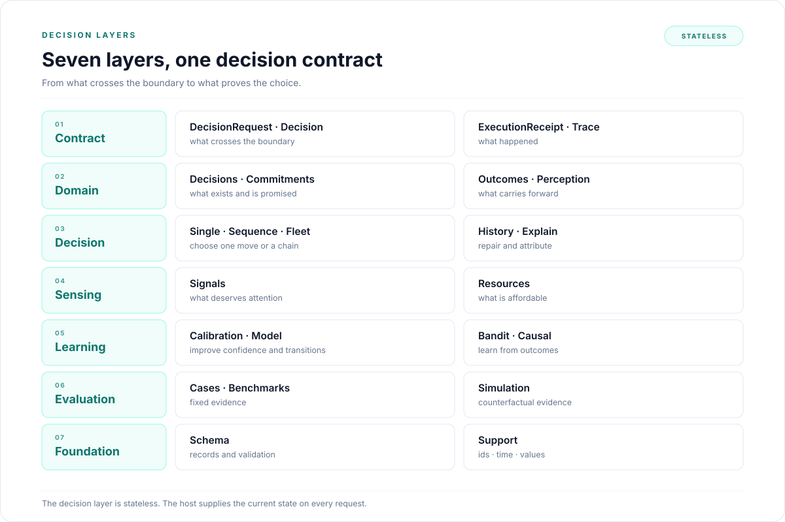

# Decision overview

LAIX turns one request into one decision or several decisions. It is a decision layer, not a
classifier: it has no UI, no storage and no execution, and the host supplies the state that the
next decision starts from. Every mechanism returns the same `Decision` shape.

## One decision

A `DecisionRequest` carries a subject, a time and either signals with context or a situation with
options. `decide` selects the mechanism from the request shape and returns a `Decision`: a verb, a
reason code, confidence and the chosen action.

```python
from laix import ActionOption, Constraint, DecisionRequest, Situation, decide

request = DecisionRequest(
    subject="leaking sink",
    at="2026-11-01T10:00:00+00:00",
    situation=Situation(
        id="situation-1",
        at="2026-11-01T10:00:00+00:00",
        subject="leaking sink",
        constraints=(Constraint(id="risk", kind="risk", value=0.3, hard=True),),
    ),
    options=(
        ActionOption(id="valve", verb="act", name="close the valve", expected_benefit=0.9, risk=0.1),
        ActionOption(id="hit", verb="act", name="hit the pipe", expected_benefit=1.0, risk=0.9),
    ),
)

decision = decide(request)[0]
print(decision.verb, decision.action_id, decision.reason_code)
```

The request has a situation and options, so `decide` selects the action policy. The hard risk limit
removes the second option. The result is one `Decision` with a verb, a reason code and the chosen
option. Every mechanism in the decision layer returns that same shape.

## The live decision

One concern is often not enough. When the choice depends on value, promises, risk and people at once,
`LiveCompositePlanner` composes four planners into one `PlannerResult`.

| Planner | Question |
|---|---|
| `UtilityPlanner` | What is worth most? |
| `CommitmentPlanner` | What was promised? |
| `ExecutionRiskPlanner` | What can go wrong, and how hard is recovery? |
| `HumanAttentionPlanner` | Is a person needed, and what does that cost? |

Each planner contributes a score. The composite planner applies the weights, the hard limits and the approval
state, and returns one `PlannerResult` with a `CompositeScore`. `PlannerPolicy` converts that planner result into the same
`Decision` the minimal request produced. The
[live composite planner](03-decision-shapes/01-single/02-composite.md) page describes the composition.

## The next decision

A decision is a step, not a snapshot. The next request starts from what the previous one left behind:
open commitments, human-attention budget, approval state, prior decisions and revisions, receipts, and
outcomes with calibration. The decision layer stays stateless between calls. The host stores the state and
passes it into the next request.

```text
DecisionRequest
      │
      ▼
   dispatch
      │
      ├── signal attention ──┐
      ├── policy ────────────┤
      └── planner/composite planner ────┤
                             ▼
                          Decision
                             │
                             ▼
                    host executes the action
                             │
                             ▼
                 ExecutionReceipt / Outcome
                             │
                             ▼
                 reward · calibration · learning
                             │
                             ▼
             next DecisionRequest with current state
```

That hand-off is [decision continuity](03-decision-shapes/04-history/README.md). It is what makes the
decision layer stateful: the same chooser sees a different, current state on every step.

## A conceptual view

This diagram is a conceptual view of the decision layer, not the folder map. The folder map is in
[Reading map](#reading-map) and [Where the code lives](#where-the-code-lives).



| Layer | Contains | Answers |
|---|---|---|
| **Contract** | `DecisionRequest`, `Decision`, `ExecutionReceipt`, `Trace` | What crosses the boundary. |
| **Domain** | Decisions, commitments, outcomes, perception | What exists and what carries forward. |
| **Decision** | Single, sequence, fleet, history, explain, policies and extensions | How a decision is made. |
| **Sensing** | Signals, resources | What feeds a decision. |
| **Learning** | Calibration, model, bandit, causal | How it improves. |
| **Evaluation** | Cases, benchmarks, simulation | How it is proved. |
| **Foundation** | Schema, support | What it rests on. |

## Ways to get a decision

| Entry point | What it does | Use it when |
|---|---|---|
| `decide(request)` | Selects signal attention or the action policy from the request shape. | You want the answer only. |
| `decide(request, policy=...)` | Runs the policy you pass. | You want a packaged, authored or learned policy. |
| `decide(request, policy=PlannerPolicy(planner))` | Runs a planner or the live composite planner behind the policy interface. | You want utility, commitments, execution risk or attention scoring. |
| `DecisionClient` | Uses the same decision dispatch and adds the loop, traces, execution and records. | You want the full app kit. |

`decide` lives in `decision/dispatch.py` and imports no app-kit code. [Dispatch](01-contract/04-dispatch.md) explains
the selection rule and the identity fields.

## Choose a mechanism

| You have | Use |
|---|---|
| Signals and a context | Signal attention |
| A situation and options, no special policy | The built-in action policy |
| Options and explicit decision rules | `RulePolicy` |
| Options and one concern: utility, promises, execution risk or human attention | The matching planner through `PlannerPolicy` |
| Options and several live concerns | `LiveCompositePlanner` through `PlannerPolicy` |
| Options, uncertainty, information value or a wait option | `CAVODPlanner` through `PlannerPolicy` |
| Options and a known horizon | `CABBPlanner`, `RolloutPlanner` or `ReplanPlanner` |
| Several pending decisions competing for human attention | `AttentionScheduler` |
| A decision history that may conflict | `repair_continuity` |
| A decision that needs a counterfactual explanation | `counterfactual_attribution` |
| A world model with states and transitions | `MDPPlanner` through `PlannerPolicy` |
| A hidden state and observations | `POMDPPlanner` through `PlannerPolicy` |
| A learned choice among arms | `BanditPolicy` |
| A planner or composite planner behind the policy interface | `PlannerPolicy` |

The request shape selects signal attention or the action policy. Every other row is an explicit
`policy=` choice.

## Vocabulary

The words are not interchangeable.

| Term | Meaning |
|---|---|
| **Planner** | A strategy that scores the options and chooses one. Built-ins: `UtilityPlanner`, `CommitmentPlanner`, `ExecutionRiskPlanner`, `HumanAttentionPlanner`, `CAVODPlanner`, `MDPPlanner`, `POMDPPlanner`. |
| **CompositePlanner** | A composition of planners that returns one `PlannerResult`. The built-in composite planner is `LiveCompositePlanner`. |
| **DecisionPolicy** | An integration layer with `decide(request)`. `PlannerPolicy` adapts a planner or composite planner to that interface. |
| **Learner** | Code that updates a choice from measured outcomes: `UCBBandit`, `ModelLearner`. |
| **Protocol** | `Planner`: the `solve(problem) -> PlannerResult` interface. `SequencePlanner`: the `plan(scenario) -> DecisionPlan` interface. |
| **Decision** | The public answer. One verb, one reason, confidence, action, approval and trail identifiers. |
| **PlannerResult** | The planner's internal answer. `PlannerPolicy` converts it into a `Decision`. |
| **`DecisionRequest`** | The public input. It carries signals and context, or a situation and options. |
| **`PlannerInput`** | The planner input. It is the request projected onto the planner contract. |
| **Signal attention** | The mechanism that ranks signals and returns `guide`, `wait`, `act` or `escalate`. |
| **Human-attention planning** | `HumanAttentionPlanner`: the planner that prices interruption, approval and escalation when it chooses an action. |
| **Human-attention budget** | Human interruption capacity; `HumanAttentionBudget`. It limits how often a decision may involve a person. |
| **Signal interruption budget** | A per-cycle cap on delivered signal decisions, set by `SignalContext.signal_interruption_budget`. |
| **Resource budget** | Compute, latency and sensing capacity. `ResourceScheduler` admits or rejects work. |

The full vocabulary is in the [glossary](../05-reference/01-glossary.md).

## What the decision layer owns

- The dispatch entry point.
- The request and response shapes.
- The seven verbs and the reason-code contract.
- The signal-attention rules.
- The policy contract and the packaged policies.
- The planner contract and the built-in planners.
- The live composite planner.
- Commitments as decision state.
- Resources as capacity: budget, scheduling and sensing options.
- Outcome, bandit, causal, calibration and model-learning primitives.
- The evaluation primitives and the live decision benchmark.
- The record schema, perception records and shared support helpers.

The host owns the experience, the data, the UI, the execution, the durable stores, the delivery
channels and the retention policy. The host also maps an action to a commitment effect, an outcome to
a label and a decision to an arm.

## Invariants

- One request shape: `DecisionRequest` in, `Decision` out.
- One response shape on every path: signal attention, policies, planners and the composite planner.
- Seven verbs: `wait`, `observe`, `guide`, `ask`, `act`, `verify`, `escalate`.
- Reason codes are stable; app logic branches on them, not on `rationale`.
- The decision layer is stateless between calls. The host supplies state.
- A planner returns one `PlannerResult`; `PlannerPolicy` converts it to one `Decision`.
- Hard limits gate the choice before a decision is returned.
- Record field names, JSON keys and schema versions are versioned; class names are code identifiers.

## Reading map

Read the sections in order. Each section opens with a short index that lists its pages in reading
order.

The sequence follows the dependency order: the contract defines the shapes; the domain describes the
records and state; the decision layer covers every decision shape; sensing covers the input side;
learning changes the chooser; evaluation proves it; support holds the infrastructure.

| Section | Covers |
|---|---|
| [Contract](01-contract/README.md) | The request and response shapes, the planner contract, records and dispatch. |
| [Domain](02-domain/README.md) | Decisions, commitments, outcomes and perception. |
| [Decision](03-decision-shapes/README.md) | Single, sequence, fleet, history, explain and policies, plus planner extensions. |
| [Sensing](04-sensing/README.md) | Signal attention and resource admission. |
| [Learning](05-learning/README.md) | Calibration, model learning, bandit and causal attribution. |
| [Evaluation](06-evaluation/README.md) | Cases, benchmarks, simulation and the continuity benchmark. |
| [Support](07-support/README.md) | Schema and support helpers. |

## Where the code lives

| Path | Contents |
|---|---|
| `decision/domain/decisions/` | request, response and trail records. |
| `decision/dispatch.py` | `decide` and `select`. |
| `decision/sensing/signals/` | signal attention, gates, score and timing. |
| `decision/policies/` | decision-policy protocol, registry and packaged policies. |
| `decision/contract/` | `PlannerInput`, `PlannerResult`, `Planner` and `PlannerPolicy`. |
| `decision/planners/single/` | utility, commitment, execution, human-attention, decision-value, composite, MDP, POMDP, portfolio, risk and conflict planners. |
| `decision/planners/single/composite/` | `LiveCompositePlanner` and `CompositeScore`. |
| `decision/planners/sequence/` | finite-horizon sequence contract, `CABBPlanner`, `RolloutPlanner` and `ReplanPlanner`. |
| `decision/planners/fleet/` | `AttentionScheduler` and the exact single-arm `WhittleScheduler`. |
| `decision/planners/case_based/` | `CaseBasedPlanner` and `PastDecision`. |
| `decision/planners/history/` | `repair_continuity` and `RevalidationPlanner`. |
| `decision/planners/explain/` | attribution, bounded counterfactual search and decision counterfactuals. |
| `decision/evaluation/simulation/` | simulator, scenarios and planner comparison. |
| `decision/evaluation/bench/` | the live decision benchmark. |
| `decision/sensing/resources/` | budget, resource plan, scheduler and sensing options. |
| `decision/domain/commitments/` | commitment model, ledger and stores. |
| `decision/domain/outcomes/` | outcome records, ledger, stores and signal-attention feedback records. |
| `decision/learning/` | calibration, model learning, bandit and causal attribution. |
| `decision/evaluation/cases/` | cases, rows, reports and decision comparison. |
| `decision/domain/perception/` | detector, detection, event and frame. |
| `decision/schema/` | record registry, schema generation and validation. |
| `decision/support/` | ids, time, values, serialization, errors, verbs and version. |

Streaming, execution, records and delivery live in the optional app kit:
[App-kit overview](../03-appkit/README.md).
