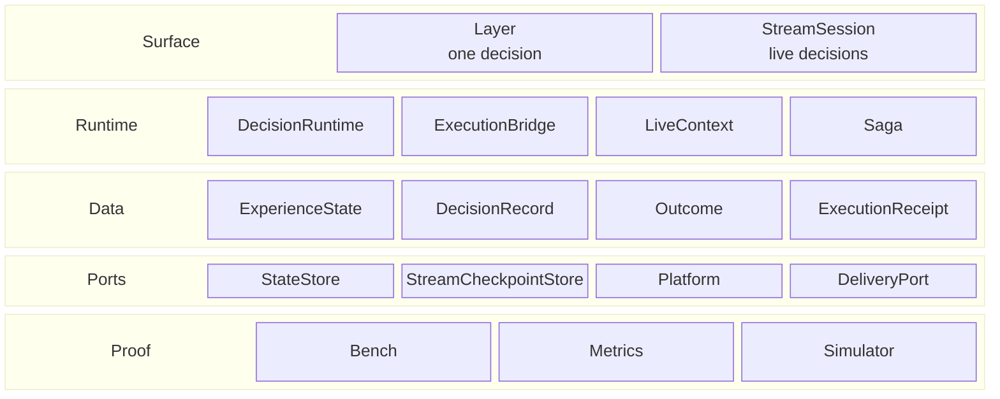

# App-kit building blocks

The core map is [Core building blocks](../02-core/00-architecture.md). This page is the optional
layer around it, grouped by what each piece is: an API, a runtime, a data shape, a port or a tool.

## The rows

| Row | Kind | Contains | What it is |
|---|---|---|---|
| **Surface** | API | Layer · StreamSession | How a host calls LAIX. |
| **Runtime** | Components | DecisionRuntime · ExecutionBridge · LiveContext · Saga | What runs a decision, an action, perception and recovery. |
| **Data** | Shapes | ExperienceState · DecisionRecord · Outcome · ExecutionReceipt | What is carried or kept. |
| **Ports** | Interfaces | StateStore · StreamCheckpointStore · Platform · DeliveryPort | What the host implements or supplies. |
| **Proof** | Tools | Bench · Metrics · Simulator | How the kit is tested and observed. |

## What each part contains

| Row | Part | Kind | Contains |
|---|---|---|---|
| Surface | **Layer** | API | decide, execute, measure, deliver |
| Surface | **StreamSession** | API | observe, decisions, feed, windows, revisions, checkpoints |
| Runtime | **DecisionRuntime** | Component | policy, state, execution, outcome |
| Runtime | **ExecutionBridge** | Component | approval, idempotency, execute, cancel, undo, unknown, reconcile, run_steps |
| Runtime | **LiveContext** | Component | detectors, admission, frames |
| Runtime | **Saga** | Component | steps, compensation, recovery |
| Data | **ExperienceState** | Shape | goals, phase, beliefs, TTL, history |
| Data | **DecisionRecord** | Shape | draft, approve, reject, execute, undo, verify |
| Data | **Outcome** | Shape | measurement, direction, attribution, label |
| Data | **ExecutionReceipt** | Shape | status, actor, result, error, idempotency key |
| Ports | **StateStore** | Interface | save, load, delete a state snapshot |
| Ports | **StreamCheckpointStore** | Interface | save, load, delete a stream checkpoint |
| Ports | **Platform** | Interface | skills, events, approvals |
| Ports | **DeliveryPort** | Interface | deliver a result and return a receipt |
| Proof | **Bench** | Tool | deterministic cases, suites, report |
| Proof | **Metrics** | Tool | Prometheus counters from stream stats |
| Proof | **Simulator** | Tool | engine runs, scenarios, optimality gap |

## Reading the app kit

- **Surface** — `Layer` answers one request; `StreamSession` answers a stream over time. Both use the
  same core decision.
- **Runtime** — `DecisionRuntime` links a policy to state, execution and outcome; `ExecutionBridge` is
  the write boundary and `run_steps` compensates completed steps when one fails; `LiveContext` runs
  detectors and returns frames; `Saga` compensates completed steps when a later step fails.
- **Data** — `ExperienceState` is live state, `DecisionRecord` is the audit lifecycle, `Outcome` is
  what was measured, `ExecutionReceipt` is what the host returned.
- **Ports** — the host supplies a state store, a stream checkpoint store, a platform and a delivery
  port. The host supplies the implementations.
- **Proof** — the bench checks decisions; metrics exposes stream counters; the simulator runs
  engines in a model and reports reward and optimality gap.

The app kit is optional. A host that only needs the answer calls `decide` or `Layer`; a host that
also executes, records, streams or delivers adds the rest.
