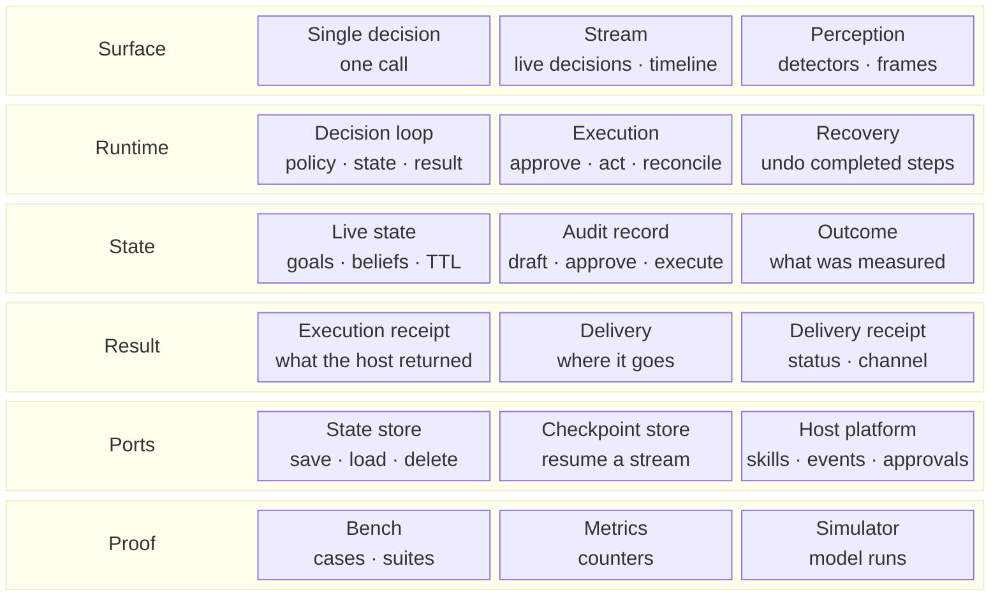

# App-kit building blocks

The core map is [Core overview](../02-core/00-overview.md). This page is the optional
layer around it. Read top-down by role in the live loop: how a host calls in, what runs, what is
remembered, what comes back, what the host supplies, and how it is checked. Each band has three
parts, and each part says what it does. The vocabulary is defined in the
[glossary](../04-concepts/glossary.md).



## The rows

| Row | Contains | What it is |
|---|---|---|
| **Surface** | Single decision · Stream · Perception | How a host calls in and observes. |
| **Runtime** | Decision loop · Execution · Recovery | What runs a decision, its action and its recovery. |
| **State** | Live state · Audit record · Outcome | What is true now, what was decided, what was measured. |
| **Result** | Execution receipt · Delivery · Delivery receipt | What comes back and where it goes. |
| **Ports** | State store · Checkpoint store · Host platform | What the host supplies. |
| **Proof** | Bench · Metrics · Simulator | How the kit is checked and observed. |

## What each part is

| Row | Part | Code | Contains |
|---|---|---|---|
| Surface | **Single decision** | `Layer` | decide, execute, measure, deliver one decision |
| Surface | **Stream** | `StreamSession` | observe, decisions, feed, windows, revisions, checkpoints, timeline |
| Surface | **Perception** | `LiveContext` | detectors, admission, frames |
| Runtime | **Decision loop** | `DecisionRuntime` | policy, state, execution, outcome |
| Runtime | **Execution** | `ExecutionBridge` | approval, idempotency, execute, cancel, undo, unknown, reconcile, run_steps |
| Runtime | **Recovery** | `Saga` | steps, compensation, recovery |
| State | **Live state** | `ExperienceState` | goals, phase, beliefs, TTL, history |
| State | **Audit record** | `DecisionRecord` | draft, approve, reject, execute, undo, verify |
| State | **Outcome** | `Outcome` | measurement, direction, attribution, label |
| Result | **Execution receipt** | `ExecutionReceipt` | status, actor, result, error, idempotency key |
| Result | **Delivery** | `DeliveryPort` | deliver a result and return a receipt |
| Result | **Delivery receipt** | `DeliveryReceipt` | id, decision, channel, status, detail |
| Ports | **State store** | `StateStore` | save, load, delete a state snapshot |
| Ports | **Checkpoint store** | `StreamCheckpointStore` | save, load, delete a stream checkpoint |
| Ports | **Host platform** | `Platform` | skills, events, approvals |
| Proof | **Bench** | `Bench` | deterministic cases, suites, report |
| Proof | **Metrics** | `Metrics` | Prometheus counters from stream stats |
| Proof | **Simulator** | `Simulator` | planner runs, scenarios, optimality gap |

## Reading the app kit

- **Surface** — **Single decision** (`Layer`) answers one request. **Stream** (`StreamSession`)
  answers a stream over time, keeps checkpoints and can feed a decision timeline. **Perception**
  (`LiveContext`) runs detectors over incoming context and returns frames.
- **Runtime** — **Decision loop** (`DecisionRuntime`) links a policy to state, execution and
  outcome. **Execution** (`ExecutionBridge`) is the write boundary: it checks approval, enforces
  idempotency (a retry returns the original receipt), calls the host skill and records a receipt.
  **Recovery** (`Saga`) undoes completed steps when a later step fails.
- **State** — **Live state** (`ExperienceState`) is the live context: goals, phase, beliefs, TTL and
  history. **Audit record** (`DecisionRecord`) is the audit lifecycle: draft, approve or reject,
  execute, undo, verify. **Outcome** (`Outcome`) is what was measured afterwards.
- **Result** — **Execution receipt** (`ExecutionReceipt`) is what the host returned from an action.
  **Delivery** (`DeliveryPort`) is where a decision is delivered. **Delivery receipt**
  (`DeliveryReceipt`) is what delivery returned.
- **Ports** — **State store** (`StateStore`), **Checkpoint store** (`StreamCheckpointStore`) and
  **Host platform** (`Platform`) are supplied by the host.
- **Proof** — **Bench** (`Bench`) runs deterministic cases and suites. **Metrics** (`Metrics`)
  exposes stream counters. **Simulator** (`Simulator`) runs planners in a model and reports reward
  and optimality gap.

## What recovery does

Recovery uses a **saga**: a multi-step action where each step has a way to undo itself. Steps run in
order. If a later step fails, the completed steps are compensated in reverse order, so the world
returns to a consistent state.

Example: book a flight, then a hotel, then a car.

- If the car fails, cancel the hotel, then cancel the flight.
- The result says which steps completed and which were compensated.

```python
from laix.appkit import Saga, SagaStep

result = Saga().run(
    [
        SagaStep("book_flight", forward=book_flight, compensate=cancel_flight),
        SagaStep("book_hotel", forward=book_hotel, compensate=cancel_hotel),
        SagaStep("book_car", forward=book_car, compensate=cancel_car),
    ]
)

print(result.completed)     # steps that succeeded
print(result.compensated)   # steps that were undone
print(result.error)         # None when every step succeeded
```

Use `Saga` when one action has several side effects that must be undone together.
`ExecutionBridge.run_steps` applies the same idea to execution steps and returns one receipt per
step. Compensation is best effort: one failing compensation leaves the others to run.

## What a port is

A port is an interface the host implements. LAIX calls it; the host decides how it works: where
state is saved, how a stream resumes, how skills and approvals are reached, and where a decision is
delivered.

**State store**, **Checkpoint store** and **Host platform** are ports. **Delivery** is also a port;
it sits with Result because it is the output boundary. Small in-memory implementations ship for
tests: `InMemoryStateStore`, `InMemoryStreamCheckpointStore`, `InMemoryPlatform` and `NullDelivery`.

The app kit is optional. A host that needs the answer calls `decide` or `Layer`; a host that also
executes, records, streams or delivers adds the rest.
