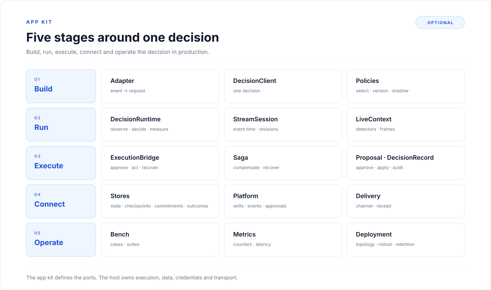

# App-kit overview

The core turns one request into one decision. The app kit is the optional layer that turns that
decision into an app: it builds the request, runs the decision loop, executes the action, connects the
host's storage and platform, and proves the result.

Four things define the app kit:

- **One decision.** `DecisionClient` runs the core, and can execute, record and deliver the result.
- **A runtime loop.** `DecisionRuntime` links observation, state, policy, execution and outcome.
- **A stream.** `StreamSession` keeps event time, cadence, buffers, revisions and checkpoints.
- **A host boundary.** Stores, platform and delivery are ports. The host owns the database, the
  credentials and the transport.

The core stays stateless. The app kit adds the surfaces, execution, ports and proof around it.

## The five stages

| Stage | Question | Pages |
|---|---|---|
| **Build** | How does the host call LAIX, get one decision and choose a policy? | [Integration](01-build/01-integration.md), [Single decision](01-build/02-single-decision.md), [Policies in the app](01-build/03-policies-in-the-app.md), [LangGraph](01-build/04-langgraph.md), [MCP server](01-build/05-mcp.md) |
| **Run** | What runs over time and before the choice? | [Decision runtime](02-run/01-decision-runtime.md), [Streaming](02-run/02-streaming.md), [Live Context](02-run/03-live-context.md) |
| **Execute** | What happens after the choice? | [Execution and recovery](03-execute/01-execution-and-recovery.md), [Proposals and records](03-execute/02-proposals-and-records.md) |
| **Connect** | What does the host supply? | [Stores](04-connect/01-stores.md), [Platform](04-connect/02-platform.md), [Delivery](04-connect/03-delivery.md) |
| **Operate** | How is it proved and run in production? | [Bench](05-operate/01-bench.md), [Metrics](05-operate/02-metrics.md), [Deployment](05-operate/03-deployment.md) |

## What the app kit adds

| Stage | Contract | What it does |
|---|---|---|
| Build | `DecisionClient` | Decides, executes, measures and delivers one decision. |
| Build | `DecisionPolicyRegistry` | Registers the policies a client can select. |
| Run | `DecisionRuntime` | Links observation, state, policy, execution and outcome. |
| Run | `StreamSession` | Turns a stream of events into decisions over time. |
| Run | `LiveContext` | Runs detectors and returns a frame. |
| Execute | `ExecutionBridge` | Checks approval, enforces idempotency, calls a skill and records a receipt. |
| Execute | `Saga` | Compensates completed steps when a later step fails. |
| Execute | `Proposal` | The approval lifecycle for an action that needs a person. |
| Execute | `DecisionRecord` | The audit lifecycle around a decision. |
| Connect | `StateStore` | Saves and loads live state. |
| Connect | `StreamCheckpointStore` | Saves and resumes a stream. |
| Connect | `Platform` | Runs skills, approvals, state and events. |
| Connect | `DeliveryPort` | Delivers a decision and returns a receipt. |
| Operate | `BenchReport` | Runs deterministic cases and suites. |
| Operate | `StreamStats` | Exports stream counters and latency. |
| Operate | `run_planner_bench` | Runs the bench CLI over a simulator and reports reward, steps and optimality gap. |

The records that cross those stages:

| Contract | What it records |
|---|---|
| `ExperienceState` | Goal, phase, beliefs, open items and expiry. |
| `Proposal` | Pending, approved, rejected, applied and undone. |
| `DecisionRecord` | Draft, approval, execution, undo and verification. |
| `Outcome` | What was measured after a decision. |
| `ExecutionReceipt` | Status, actor, result, error and idempotency key. |
| `DeliveryReceipt` | Decision, channel, status and detail. |

## The boundary

The app kit is optional. A host that only needs the answer calls `decide` or `DecisionClient`. A host that
also executes, records, streams or delivers adds the rest.

The app kit defines the ports. The host implements them:

- where state and checkpoints are saved;
- how stream state is resumed;
- how skills, events and approvals are reached;
- where a decision is delivered;
- how long records, traces and outcomes are kept.

The host also owns credentials, transport, execution handlers, retries and channel fallback. LAIX
does not open a database, call a model provider or deliver a message on its own.

## Reading map

Read in order. Each section opens with a short index that lists its pages in reading order.

| Section | Covers |
|---|---|
| [Build](01-build/README.md) | The adapter, one decision and policy selection. |
| [Run](02-run/README.md) | The runtime loop, streams and perception. |
| [Execute](03-execute/README.md) | Execution, recovery, proposals and records. |
| [Connect](04-connect/README.md) | Stores, platform and delivery. |
| [Operate](05-operate/README.md) | Bench, metrics and deployment. |

## Where the code lives

| Path | Contents |
|---|---|
| `appkit/decision_client.py` | `DecisionClient`, the one-decision surface. |
| `appkit/cli.py` | `laix explain` and `laix lint`. |
| `appkit/mcp_server.py` | optional `laix-mcp` stdio server. |
| `appkit/runtime/` | decision runtime, execution, saga, state and stores. |
| `appkit/streaming/` | session, window, sources, checkpoint and timeline. |
| `appkit/live_context/` | the host-driven detector loop. |
| `appkit/audit/` | decision record, proposal, approval, undo and audit events. |
| `appkit/delivery/` | delivery port, receipt and the null implementation. |
| `appkit/platform/` | platform, in-memory platform, skill call, approvals and events. |
| `appkit/bench/` | case, suite, row, report, runner and planner bench. |

The core map is [Core overview](../02-core/README.md). The vocabulary is in the
[glossary](../04-concepts/04-reference/01-glossary.md).
