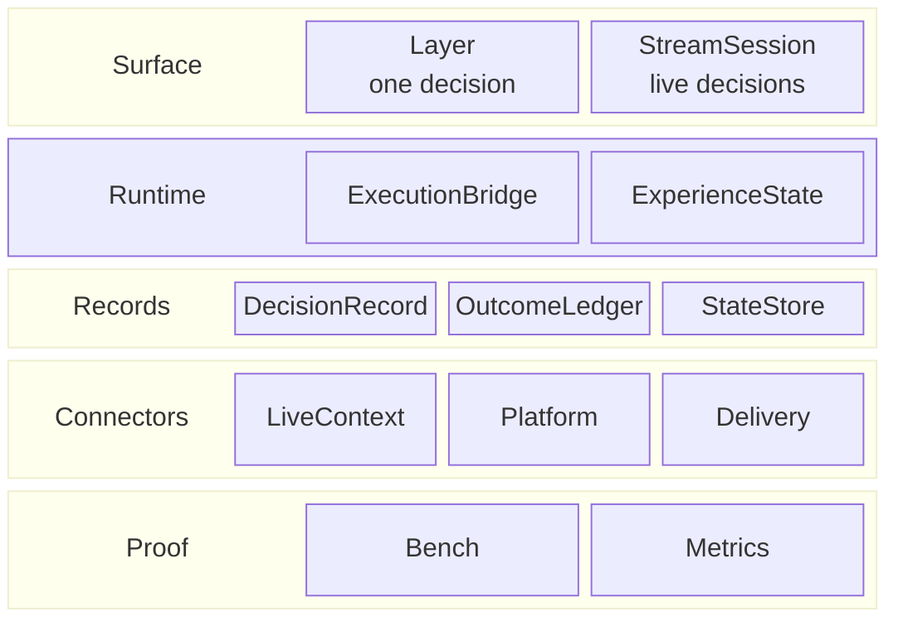

# App-kit building blocks

The core map is [Core building blocks](../core/00-core-architecture.md). This page is the optional
layer around it. Read top-down: each row uses the rows below it.

## The rows

| Row block | Contains | What it is |
|---|---|---|
| **Surface** | Layer · StreamSession | How a host calls LAIX. |
| **Runtime** | DecisionRuntime · ExecutionBridge · ExperienceState | How one decision becomes an action. |
| **Records** | DecisionRecord · OutcomeLedger · StateStore | What is kept after the decision. |
| **Connectors** | LiveContext · Platform · Delivery | How the host supplies context and receives actions. |
| **Proof** | Bench · Metrics | How the kit is tested and observed. |

## What each part contains

| Row | Part | Contains | Built on |
|---|---|---|---|
| Surface | **Layer** | decide, execute, measure, deliver | Runtime, records, delivery |
| Surface | **StreamSession** | observe, decisions, feed, windows, revisions, checkpoints | Core, runtime |
| Runtime | **DecisionRuntime** | policy, state, execution, outcome | Core, execution, state |
| Runtime | **ExecutionBridge** | approval, idempotency, execute, cancel, undo, unknown, reconcile | Core |
| Runtime | **ExperienceState** | goals, phase, beliefs, TTL, history | Core |
| Records | **DecisionRecord** | draft, approve, reject, execute, undo, verify | Core |
| Records | **OutcomeLedger** | measured outcome per decision | Core |
| Records | **StateStore** | snapshot save, load, delete | Core |
| Connectors | **LiveContext** | detectors, admission, frames | Core |
| Connectors | **Platform** | skills, events, approvals | Core |
| Connectors | **Delivery** | port, receipt, null delivery | Core |
| Proof | **Bench** | deterministic cases, suites, report | Core |
| Proof | **Metrics** | Prometheus counters from stream stats | StreamSession |

## Reading the app kit

- **Surface** — `Layer` answers one request; `StreamSession` answers a stream over time. Both use the
  same core decision.
- **Runtime** — the runtime links a policy to state, execution and outcome. The execution bridge is
  the write boundary: approval, idempotency, unknown outcomes and reconciliation.
- **Records** — a decision record is the audit lifecycle; the outcome ledger is what was measured;
  the state store is how a host resumes state.
- **Connectors** — Live Context supplies perception, Platform runs host skills, Delivery carries the
  result to the host's channel.
- **Proof** — Bench checks decisions; Metrics exposes stream counters.

The app kit is optional. A host that only needs the answer calls `decide` or `Layer`; a host that
also executes, records, streams or delivers adds the rest.
