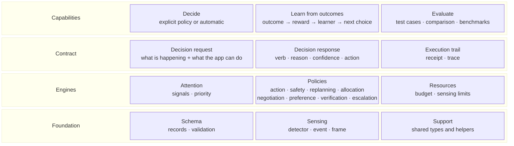

# Core building blocks

LAIX core only. Read bottom-up: each row builds on the row below it.



## The rows

| Row block | Contains | What it is |
|---|---|---|
| **Capabilities** | Decide · Learn from outcomes · Evaluate | What the core can do. |
| **Contract** | Decision request · Decision response · Execution trail | The boundary and its records. |
| **Engines** | Attention · Policies · Resources | What produces a decision and limits sensing. |
| **Foundation** | Schema · Sensing · Support | Shared records and utilities. |

## Automatic selection

The call selects an engine in one of two ways. Without `policy=`, the request selects a built-in
engine. With `policy=`, it uses the policy you pass.

| The call has | The engine |
|---|---|
| `signals` + `context` | Attention |
| `situation` + `options` | Action policy |
| `policy=...` | The policy you pass |

Packaged and custom policies are always selected explicitly.

## Learning loop

```text
outcome → reward → learner → better policy
outcome → label → feedback → better attention
```

## What each part contains

| Part | Contains | Built on |
|---|---|---|
| **Decide** | explicit policy or automatic; return the response | Contract, engines, support |
| **Learn from outcomes** | outcome → reward → learner → better policy; outcome → label → feedback → better attention | Support |
| **Evaluate** | test cases, comparison, reports, benchmarks | Contract, engines, support |
| **Decision request** | what is happening and what the app can do; signals + context, or situation + options | Support |
| **Decision response** | verb, reason, confidence, action, evidence, approval | Support |
| **Execution trail** | execution receipt, trace | Support |
| **Attention** | signals, priority, timing | Contract, support |
| **Policies** | action, safety, replanning, allocation, negotiation, preference, verification, escalation | Contract, learning, support |
| **Resources** | budget, sensing options, limits | Support |
| **Schema** | records, validation | Contract, learning, support |
| **Sensing** | detector, detection, event, frame | Support |
| **Support** | shared types and helpers: ids, time, verbs, errors, version | — |

## Reading the stack

- **Decide** is the entry point. It takes an explicit policy or chooses automatically from the request and returns a response.
- **Learn from outcomes** turns a measured result into a better next choice for Policies and Attention.
- **Evaluate** checks the engines; it is not on the request path.
- **Decision request** and **Decision response** are the boundary.
- Automatic routing: `signals + context` → Attention; `situation + options` → Action policy.
- A packaged or custom policy is selected explicitly with `policy=...`.
- **Decision response** carries the verb, reason, confidence, action and approval.
- **Execution trail** records what happened after the response.
- **Attention**, **Policies** and **Resources** are the engines.
- **Schema**, **Sensing** and **Support** are the shared building blocks.
