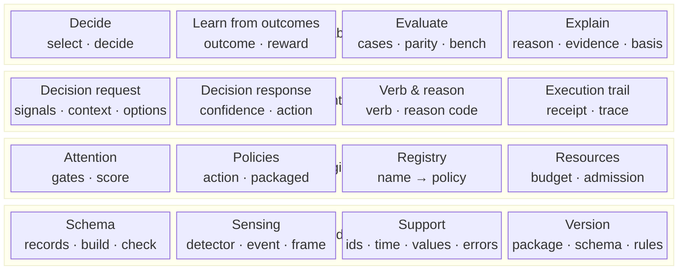

# Core building blocks

LAIX core only. Read bottom-up: each row builds on the row below it.

## The rows

| Row block | Contains | What it is |
|---|---|---|
| **Capabilities** | Decide · Learn from outcomes · Evaluate · Explain | What the core can do. |
| **Contract** | Decision request · Decision response · Verb & reason · Execution trail | The boundary and its records. |
| **Engines** | Attention · Policies · Registry · Resources | What produces a decision. |
| **Foundation** | Schema · Sensing · Support · Version | The shared records and foundations. |

## What each part contains

| Part | Contains | Built on |
|---|---|---|
| **Decide** | `select` and `decide` | Contract, engines |
| **Learn from outcomes** | outcome, reward, ledger, bandit | Support |
| **Evaluate** | cases, parity, report, bench | Contract, engines |
| **Explain** | rationale, evidence, basis | Decision response |
| **Decision request** | signals, context, situation, options | Support |
| **Decision response** | confidence, action, approval | Support |
| **Verb & reason** | verb, reason code, rationale | Decision response |
| **Execution trail** | execution receipt, trace | Support |
| **Attention** | gates, score, timing | Contract, support |
| **Policies** | action and packaged policies | Contract, learning, support |
| **Registry** | policy name → policy object | Policies, support |
| **Resources** | budget, sensing option, admission | Support |
| **Schema** | records, build, check | Contract, learning, support |
| **Sensing** | detector, detection, event, frame | Support |
| **Support** | ids, time, values, errors | — |
| **Version** | package, schema and rule-set versions | Support |

## Reading the stack

- **Decide** is the entry point. It chooses a policy or engine and returns a response.
- **Learn from outcomes** turns a measured result into a better next choice.
- **Evaluate** checks the engines; it is not on the request path.
- **Explain** gives the reason, evidence and basis behind a response.
- **Decision request** and **Decision response** are the boundary.
- **Verb & reason** is the core of the response: what to do and why.
- **Execution trail** records what happened after the response.
- **Attention**, **Policies**, **Registry** and **Resources** are the engines.
- **Schema**, **Sensing**, **Support** and **Version** are the shared foundations.
