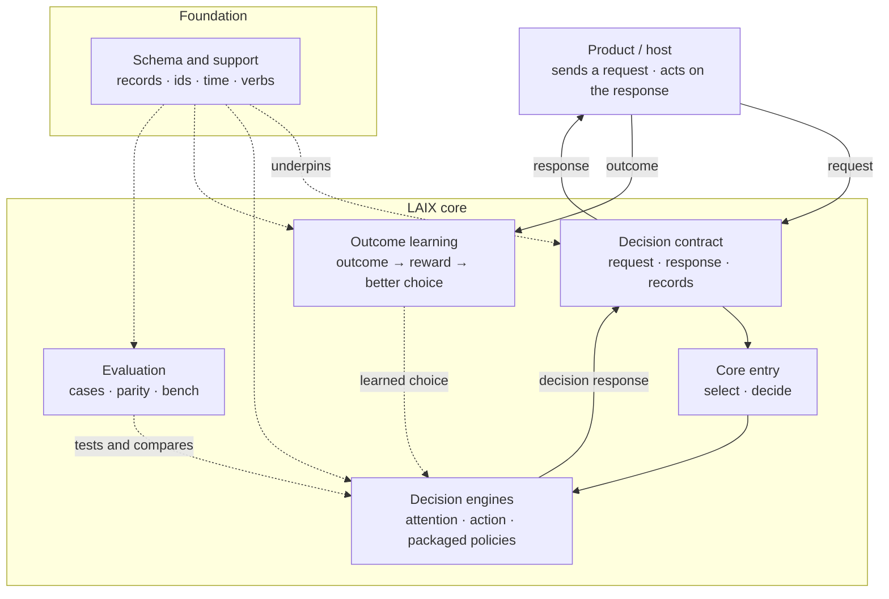

# Core architecture

This is the core in one picture. Solid arrows are the runtime flow; dashed arrows are feedback or
support.

## The parts

| Part | What it does |
|---|---|
| **Decision contract** | The request the product sends and the response LAIX returns, including the records around them. |
| **Core entry** | `select` and `decide`: choose a policy or engine and return the response. |
| **Decision engines** | Attention, action and the packaged policies. They turn a request into one decision. |
| **Outcome learning** | Turns a measured outcome into a reward and a better next choice. |
| **Evaluation** | Runs cases, compares policies and reports whether behaviour changed. |
| **Schema and support** | The shared records, ids, time, verbs and errors everything else uses. |

## How to read it

- The product asks; the core answers. The product owns the work, memory, execution and channels.
- The decision contract is the boundary: one request in, one response out.
- The core entry is the single call: it chooses a policy or engine and returns the response.
- The engines are the decision makers. They turn a request into one decision.
- Outcomes come back from the product and improve the next choice.
- Evaluation checks the engines; it does not sit on the request path.
- Schema and support sit underneath every part.

## Outside the core

The product owns memory, connectors, permissions, execution and the user interface. The app kit is
the optional layer that adds a runtime, execution, records and delivery around a core decision.
