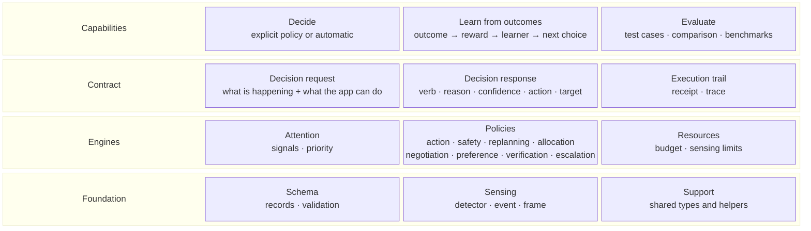

# Core building blocks

LAIX core only. Read bottom-up: each row builds on the row below it.



## The rows

| Row block | Contains | What it is |
|---|---|---|
| **Capabilities** | Decide · Learn from outcomes · Evaluate | What the core can do. |
| **Contract** | Decision request · Decision response · Execution trail | The boundary and its records. |
| **Engines** | Attention · Policies · Resources | What produces a decision and limits sensing. |
| **Foundation** | Schema · Sensing · Support | Shared records and utilities. |

## Which engine runs

The call picks an engine in one of two ways. Without `policy=`, the request selects a built-in
engine. With `policy=`, it uses the policy you pass.

| The call has | The engine |
|---|---|
| `signals` + `context` | Attention |
| `situation` + `options` | Action policy |
| `policy=...` | The policy you pass |

Packaged and custom policies are always selected explicitly. An `EnginePolicy` is a custom policy:
it wraps JEV, an optimizer or a planner behind the same interface. `RulePolicy` and
`TargetedPolicy` are the authoring and target wrappers.

## Learning loop

```text
outcome → reward → learner → better policy
outcome → label → feedback → better attention
```

## What each part contains

| Row | Part | Contains | Built on |
|---|---|---|---|
| Capabilities | **Decide** | explicit policy or automatic; return the response | Contract, engines, support |
| Capabilities | **Learn from outcomes** | outcome → reward → learner → better policy; outcome → label → feedback → better attention | Support |
| Capabilities | **Evaluate** | test cases, comparison, reports, benchmarks | Contract, engines, support |
| Contract | **Decision request** | what is happening and what the app can do; signals + context, or situation + options | Support |
| Contract | **Decision response** | verb, reason, confidence, action, evidence, approval, target, recipients | Support |
| Contract | **Execution trail** | execution receipt, trace | Support |
| Engines | **Attention** | signals, priority, timing | Contract, support |
| Engines | **Policies** | eight packs, engine adapter, rule and target wrappers | Contract, learning, support |
| Engines | **Resources** | budget, sensing options, limits | Support |
| Foundation | **Schema** | records, validation | Contract, learning, support |
| Foundation | **Sensing** | detector, detection, event, frame | Support |
| Foundation | **Support** | shared types and helpers: ids, time, verbs, errors, version | — |

## Reading the stack

- **Capabilities** — Decide chooses explicitly or automatically; Learn turns outcomes into a better policy or attention; Evaluate checks the engines.
- **Contract** — the request describes what is happening and what the app can do; the response carries the verb, reason, confidence, action, approval and target; the trail records what happened.
- **Engine choice** — `signals + context` → Attention; `situation + options` → Action policy. A packaged or custom policy is selected explicitly with `policy=...`.
- **Engines** — Attention ranks signals; Policies cover action, safety, replanning, allocation, negotiation, preference, verification and escalation, plus `EnginePolicy`, `RulePolicy` and `TargetedPolicy`; Resources set sensing limits.
- **Foundation** — Schema validates records; Sensing defines detectors, events and frames; Support provides shared types and helpers.

Streaming, execution, records and delivery are app-kit blocks, not core: see
[App-kit building blocks](../appkit/00-appkit-architecture.md).
