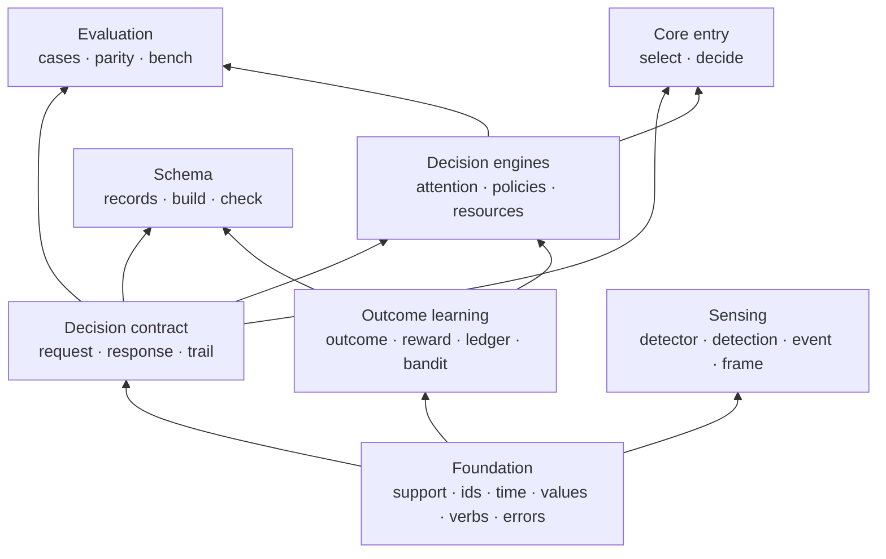

# Core building blocks

LAIX core only. Read bottom-up: each block depends on the blocks below it. Arrows point from a block
to what it depends on.

## The blocks

| Block | What it contains | Built on |
|---|---|---|
| **Foundation** | `support`: ids, time, values, verbs, errors | — |
| **Decision contract** | request, response and trail records | Foundation |
| **Outcome learning** | outcomes, rewards, ledger, UCB bandit | Foundation |
| **Sensing** | detector, detection, event and frame contracts | Foundation |
| **Decision engines** | attention, policies and resource admission | Decision contract, outcome learning |
| **Evaluation** | cases, parity, reports and bench | Decision contract, decision engines |
| **Schema** | record list, schema build and checks | Decision contract, outcome learning |
| **Core entry** | `select` and `decide` | Decision contract, decision engines |

## Reading the stack

- **Foundation** is the base. Nothing below it.
- **Decision contract** is the boundary: request in, response out.
- **Outcome learning** and **sensing** are independent capabilities on the foundation.
- **Decision engines** turn a contract request into a response, using learning when a policy learns.
- **Evaluation** checks the engines; it is not on the request path.
- **Schema** reads the records from the contract and learning blocks.
- **Core entry** is the single call: it chooses a policy or engine and returns the response.
