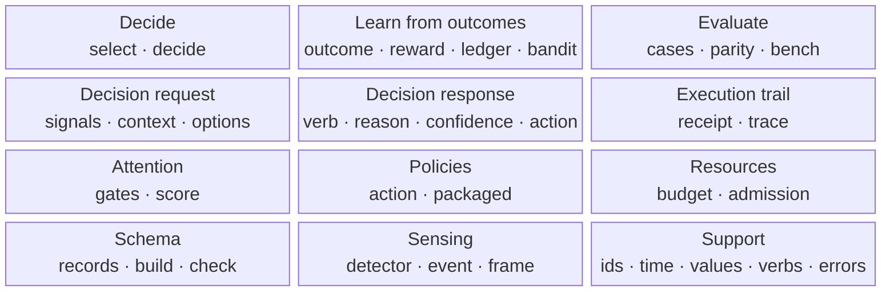

# Core building blocks

LAIX core only. Read bottom-up: each row builds on the row below it.

## The rows

| Row | Blocks | What it is |
|---|---|---|
| **Top** | Decide · Learn from outcomes · Evaluate | What the core can do. |
| **Second** | Decision request · Decision response · Execution trail | The contract and its records. |
| **Third** | Attention · Policies · Resources | The engines that produce a decision. |
| **Bottom** | Schema · Sensing · Support | The shared records and foundations. |

## What each block contains

| Block | Contains | Built on |
|---|---|---|
| **Decide** | `select` and `decide` | Decision request, decision response, engines |
| **Learn from outcomes** | outcome, reward, ledger, bandit | Support |
| **Evaluate** | cases, parity, report, bench | Decision request, decision response, engines |
| **Decision request** | signals, context, situation, options | Support |
| **Decision response** | verb, reason, confidence, action, evidence | Support |
| **Execution trail** | execution receipt, trace | Support |
| **Attention** | gates, score, timing | Decision request, decision response, support |
| **Policies** | action and packaged policies | Decision request, decision response, learning, support |
| **Resources** | budget, sensing option, admission | Support |
| **Schema** | records, build, check | Decision request, decision response, learning, support |
| **Sensing** | detector, detection, event, frame | Support |
| **Support** | ids, time, values, verbs, errors | — |

## Reading the stack

- **Decide** is the entry point. It chooses a policy or engine and returns a response.
- **Learn from outcomes** turns a measured result into a better next choice.
- **Evaluate** checks the engines; it is not on the request path.
- **Decision request** and **Decision response** are the boundary: one request in, one response out.
- **Execution trail** records what happened after the response.
- **Attention**, **Policies** and **Resources** are the engines.
- **Schema**, **Sensing** and **Support** are the shared foundations.
