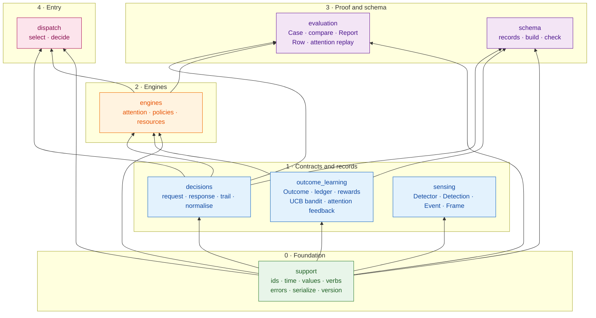

# Core map

Read this first. Every box is a package under `laix.core`. Arrows point from a package to what it
depends on, so the bottom is the foundation and the top is the entry point.

`laix.core` and `laix` are the public surface. They re-export names from these packages; they are not
an extra dependency layer.

## What each layer does

| Layer | Packages | Depends on |
|---|---|---|
| **0 · Foundation** | `support` | — |
| **1 · Contracts and records** | `decisions` | `support` |
| | `outcome_learning` | `support` |
| | `sensing` | `support` |
| **2 · Engines** | `engines` | `support`, `decisions`, `outcome_learning` |
| **3 · Proof and schema** | `evaluation` | `support`, `decisions`, `engines` |
| | `schema` | `support`, `decisions`, `outcome_learning` |
| **4 · Entry** | `dispatch` | `support`, `decisions`, `engines` |

## How to read it

- `support` is the base. It has no dependency inside `laix.core`.
- `decisions`, `outcome_learning` and `sensing` depend only on `support`.
- `engines` adds `decisions` and `outcome_learning`.
- `evaluation` compares decisions and engines; it sits above both.
- `schema` reads the record classes from `decisions` and `outcome_learning`.
- `dispatch` is the core entry point. It selects a policy or engine and returns decisions.
- The public surface re-exports these packages. It does not add behaviour.
